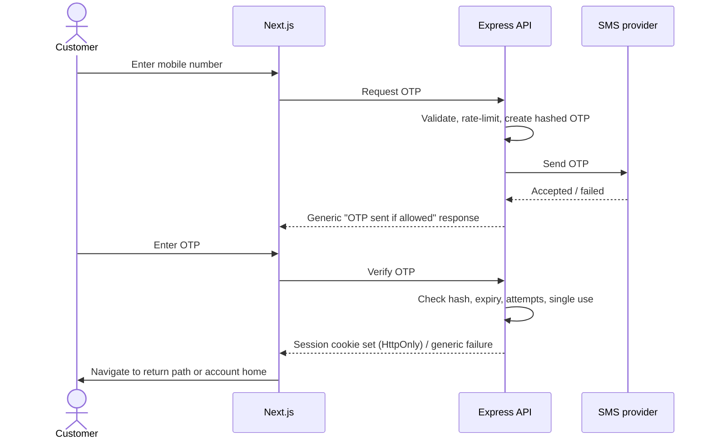
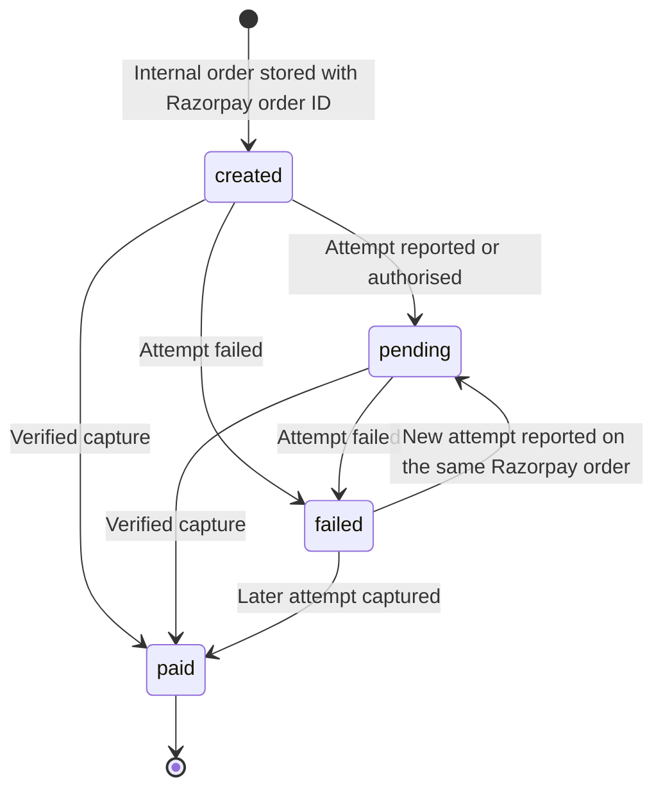
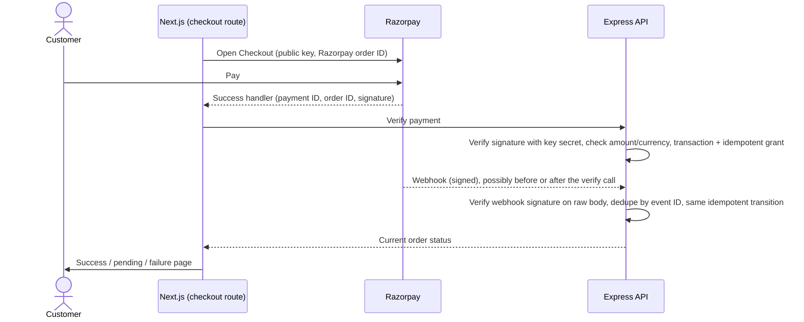
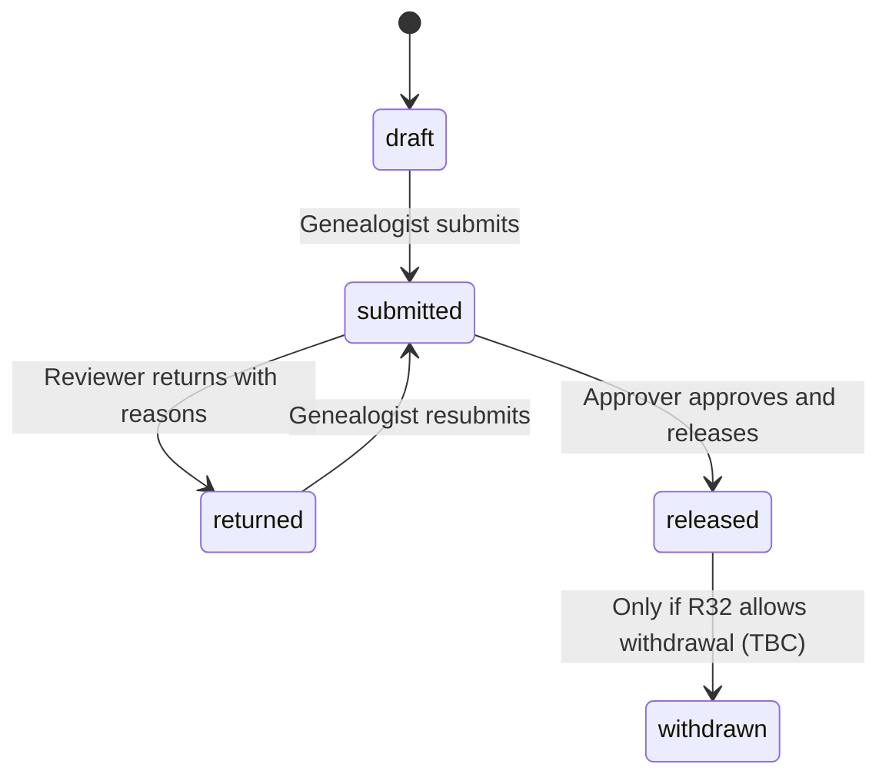

# Kulvriksh Digital Platform — Product Flows

| Item | Value |
|---|---|
| Document | `docs/01-PRODUCT-FLOWS.md` |
| Status | Draft for review |
| Source documents | [`00-ROADMAP.md`](00-ROADMAP.md) (scope, decisions, TBC register), [`PERFORMANCE-AND-NAVIGATION-STANDARDS.md`](PERFORMANCE-AND-NAVIGATION-STANDARDS.md) (performance specification) |
| Last updated | 2026-10-22 |
| Revision | r2 (2026-10-22): review corrections — webhook durability, payment/grant transaction boundaries, reconciliation and background-task rules, metadata vs content permissions, TBC register status |
| Revision | r3 (2026-10-24): OTP keyed hashing, atomic attempts and a cross-challenge guessing budget (F-AUTH-01–03); order idempotency key/plan mismatch and receipt reference (F-ORD-01); run leases replacing advisory locks, and lease fencing (F-ORD-05, §12.4). Details: [`02-DATA-MODEL.md`](02-DATA-MODEL.md) r2 |

This document describes how every in-scope module behaves end to end, before any code is written. It adds no new scope. Where the roadmap leaves a decision open, this document says so and links to the roadmap item. It does not fill the gap with an assumption.

---

## Contents

1. [Purpose, scope, terminology, roles and architecture](#1-purpose-scope-terminology-roles-and-architecture)
2. [Public visitor journey](#2-public-visitor-journey)
3. [Customer authentication](#3-customer-authentication)
4. [Customer profile and account states](#4-customer-profile-and-account-states)
5. [Services, orders, payments and entitlements](#5-services-orders-payments-and-entitlements)
6. [Family workspaces and tree](#6-family-workspaces-and-tree)
7. [Media, voice and text-to-speech](#7-media-voice-and-text-to-speech)
8. [Genealogist portal and research](#8-genealogist-portal-and-research)
9. [Report approval and release](#9-report-approval-and-release)
10. [Admin portal](#10-admin-portal)
11. [Notifications](#11-notifications)
12. [Cross-cutting states](#12-cross-cutting-states)
13. [Security and permissions matrix](#13-security-and-permissions-matrix)
14. [Performance and navigation](#14-performance-and-navigation)
15. [Open questions and TBC decisions](#15-open-questions-and-tbc-decisions)
16. [End-to-end acceptance scenarios](#16-end-to-end-acceptance-scenarios)

---

## 1. Purpose, scope, terminology, roles and architecture

### 1.1 Purpose

This document is the behaviour specification developers implement against. For each flow it fixes:
- who can act, and under what conditions
- what the Next.js frontend does
- what the Express API is responsible for
- what data changes
- how validation, authorisation and failures are handled
- how the flow is accepted

### 1.2 Scope

The scope is exactly the ten approved items in [Roadmap §3](00-ROADMAP.md#3-approved-scope).

**Excluded:**
- **Refund processing (D3).** There is no refund API, refund UI or automatic handling of refund webhooks.
- **Migration to object storage.** Only the storage abstraction is in scope.

Either exclusion can be brought in only through [roadmap change control](00-ROADMAP.md#10-change-control).

### 1.3 Notation

| Notation | Meaning |
|---|---|
| **TBC (R*n*)** | Unresolved; tracked as item *n* in [Roadmap §9](00-ROADMAP.md#9-unconfirmed-requirements-tbc). Must not be resolved in code without a recorded decision. |
| **TBC (FQ-*n*)** | Unresolved question tracked only in this document. **It is not in the roadmap register yet.** It must be added at the next roadmap update ([§15.3](#153-questions-tracked-only-in-this-document-fq)). Some FQs track roadmap TBCs that have no register number ([§15.2](#152-roadmap-tbcs-without-a-register-number)). |
| **Proposed** | An engineering default. It is **not** a client-approved decision. It needs technical review at CP2 before implementation. If it turns out to affect business behaviour, it must be confirmed with the client. |
| **FE** | Next.js frontend (browser or Next.js server). |
| **API** | Express/TypeScript business API. It is the only authority for business rules, authorisation, pricing, payments and entitlements. |
| **F-xxx-nn** | Flow identifier. |
| **AS-xxx-nn** | Acceptance scenario identifier. |

### 1.4 Terminology

| Term | Meaning |
|---|---|
| Visitor | An unauthenticated user of the public website. |
| Customer | An authenticated user who signed in with mobile OTP. |
| Genealogist | A genealogist/Vahivancha user who works on families assigned by an admin. |
| Admin | An operator who uses the admin panel. Whether there is one admin role or several is TBC (R33). |
| Service / plan | A sellable offering and its purchasable variant, managed by admins. Definitions and pricing are TBC (R12–R14). |
| Order | A customer's intent to buy one plan. The price is fixed by the API when the order is created. |
| Payment attempt | One Razorpay payment against an order. An order may have several attempts. |
| Entitlement | A right granted to a customer after a verified payment. What it unlocks is TBC (R14). |
| Grant record | Proposed. A per-order record that tracks whether the entitlement for a confirmed payment has been created: `pending`, `granted` or `failed` ([§5.1](#51-order-payment-attempt-and-grant-states-working-set)). |
| Webhook event record | Proposed. A stored, deduplicated Razorpay event with its processing state ([F-ORD-04](#f-ord-04-webhooks)). |
| Metadata / content | For file-backed resources: metadata is the descriptive information (name, type, size, dates, links); content is the file bytes. They are permissioned separately ([§7.2](#72-file-access-rule)). |
| Family workspace | A private container for one family's members, relationships, media and research, owned by one customer (D1). |
| Member | A person record inside a workspace. Fields are TBC (R17). |
| Relationship | A typed link between two members. Types are TBC (R18). |
| Assignment | An admin-created grant that gives a genealogist access to a workspace, limited in scope (D2, R28). |
| Research record | A genealogist's working record on an assigned family. Fields are TBC (R31). |
| Report | A research output that customers can see only after release (D4). |
| Release | The workflow step that makes a report visible to the owning customer (R32). |
| Storage abstraction | The interface every file operation goes through. Initially it is backed by VPS NVMe. |
| Audit event | An append-only record of a sensitive action: actor, action, target, timestamp and outcome. |

### 1.5 User roles

| Role | Signs in with | Reaches |
|---|---|---|
| Visitor | — | Public pages, surname pages, enquiry form, sign-in page |
| Customer | Mobile OTP | Customer area: profile, orders, workspaces, media, released reports |
| Genealogist | Method TBC (R9) | Genealogist portal: assigned workspaces only |
| Admin | Method TBC (R9); extra protection TBC (R34) | Admin panel |

A user must never gain a role through the frontend. Roles are assigned only by the API: customers are created through OTP sign-in, and genealogists and admins are created as described in [F-ADM-02](#f-adm-02-genealogist-management) and [F-ADM-00](#f-adm-00-admin-sign-in-and-bootstrap).

### 1.6 Confirmed architecture

| Layer | Choice | Responsibility in these flows |
|---|---|---|
| Frontend | Next.js (React-based), TypeScript where appropriate | Rendering, client-side navigation, form usability checks, loading/error states. It never holds the final authority on authorisation or business rules. |
| API | Node.js, Express.js, TypeScript | Validation, authorisation, business rules, payments, entitlements, file access, notifications, audit. |
| Database | PostgreSQL via Prisma | Persistent state. Multi-step changes run in transactions. |
| Payments | Razorpay | Checkout and payment processing. Verified server-side. |
| Files | Storage abstraction → VPS NVMe | All private files. No file is ever served from a public directory. |

**Request paths:**
- Next.js Server Components call the API on the server and forward the user's session.
- Client Components call the API from the browser.
- The routing between the two, for example same-origin through the reverse proxy, is fixed in Phase 2 ([Roadmap §2](00-ROADMAP.md#frontend-architecture)).

**Indicative route map.** URL patterns are fixed in Phase 2/3. The ones below are illustrative only.

| Area | Indicative routes | Rendering (see [§14](#14-performance-and-navigation)) |
|---|---|---|
| Public | `/`, other public pages (R1), `/surnames/[slug]`, enquiry page/section, `/sign-in` | Static or revalidated; no per-user data |
| Customer | `/account`, `/account/orders`, `/workspaces`, `/workspaces/[id]`, `/workspaces/[id]/tree`, `/workspaces/[id]/media`, `/workspaces/[id]/reports` | Per request; never shared-cached |
| Genealogist | `/genealogist`, `/genealogist/families/[id]`, `/genealogist/families/[id]/research` | Per request; never shared-cached |
| Admin | `/admin/...` per module | Per request; never shared-cached |

---

## 2. Public visitor journey

### F-PUB-01 Landing and public pages

| Item | Detail |
|---|---|
| Actor / preconditions | Visitor; none. |
| Entry point | Direct URL, search result, external link. |
| Data changed | None. Analytics page view only (consent per R5). |
| Authorisation | Public. Public pages never read session or per-user data during rendering. |

**Steps**
1. FE serves statically generated or revalidated HTML with meaningful content, unique metadata and a canonical URL.
2. Shared layout (navbar, footer) renders once and stays mounted during internal navigation.
3. Internal links use client-side navigation. External links behave normally.
4. Analytics loads deferred, after the main content (tool TBC, R5).
5. Calls to action lead to surname pages, service discovery ([F-PUB-03](#f-pub-03-service-discovery)), the enquiry form ([F-PUB-04](#f-pub-04-enquiry-submission)) or sign-in ([F-AUTH-01](#f-auth-01-otp-request)).

**States**

| State | Behaviour |
|---|---|
| Loading | Content is already in the HTML. Client-side navigations show an immediate, accessible loading indicator if the destination is not ready. |
| Not found | An HTTP 404 status with a helpful page and links home. Never a soft 404. |
| Failure | Analytics or another non-essential script failing has no visible effect. |

**Open items:** page list (R1), languages (R3), legal pages (R7), browser matrix (R6), accessibility level (R45), analytics events beyond page views (FQ-19).

**Acceptance**
- **AS-PUB-01:** A public page fetched without JavaScript contains its main content, title and meta description.
- **AS-PUB-02:** Navigating between two public pages in the production build causes no full-document reload, no navbar remount and no duplicate requests.
- **AS-PUB-03:** Blocking the analytics script does not break the page or produce uncaught errors.

### F-PUB-02 Surname pages

| Item | Detail |
|---|---|
| Actor / preconditions | Visitor. The 25 surnames and their content are supplied (R2). |
| Entry point | Search engine, sitemap, internal links. |
| Data changed | None. |
| Authorisation | Public. |

**Steps**
1. FE generates each of the 25 surname pages statically at build time from the agreed content source (source and ownership TBC, R2).
2. Each page has a clean SEO-friendly URL, a unique title and meta description, a canonical URL, a correct heading hierarchy, and structured content.
3. All 25 pages are listed in the sitemap, and robots configuration allows them.
4. When content changes, the affected pages are revalidated explicitly. Content is not fetched per request.
5. An unknown surname slug returns HTTP 404.

**States:** Same as [F-PUB-01](#f-pub-01-landing-and-public-pages). There is no empty state: a surname page without content is not published.

**Acceptance**
- **AS-PUB-04:** All 25 surname URLs return 200, appear in the sitemap and have unique titles and descriptions.
- **AS-PUB-05:** `/surnames/<unknown>` (indicative path) returns status 404.
- **AS-PUB-06:** Lab LCP, CLS and an INP proxy are recorded for one representative surname page in the production build. Results are recorded, not assumed ([§14](#14-performance-and-navigation)).

### F-PUB-03 Service discovery

| Item | Detail |
|---|---|
| Actor / preconditions | Visitor or customer. At least one active service/plan exists ([F-ADM-04](#f-adm-04-services-and-plans)). |
| Entry point | Public navigation, calls to action. |
| Data changed | None. |
| Authorisation | Public read of **active** services and plans only. |

**Steps**
1. FE renders active services and plans from the API, using a revalidated (not per-user) render. **TBC (FQ-7):** whether prices are shown publicly or only after sign-in.
2. The visitor chooses a plan and selects the purchase action.
3. If not signed in, FE navigates to sign-in with a return path. After sign-in, the customer returns to plan selection ([F-ORD-01](#f-ord-01-plan-selection-and-order-creation)).
4. If signed in, FE goes straight to [F-ORD-01](#f-ord-01-plan-selection-and-order-creation).

**Validation:** The return path must be an internal relative path. Any other value is ignored, which prevents open redirects.

**States**

| State | Behaviour |
|---|---|
| Empty | No active services: an informative message plus an enquiry call to action. |
| Failure | Catalogue unavailable: the last successfully generated page is kept. If the page was never generated, an error state with retry. |

**Acceptance**
- **AS-PUB-07:** Inactive plans never appear publicly.
- **AS-PUB-08:** A return path of `https://evil.example` is ignored after sign-in.

### F-PUB-04 Enquiry submission

| Item | Detail |
|---|---|
| Actor / preconditions | Visitor or customer; none. |
| Entry point | Enquiry form on a public page. |
| Data changed | One new enquiry record with status "new". The status set is TBC (FQ-12). |
| Authorisation | Public write, rate-limited. |

**Steps**
1. The visitor fills in the form. Fields are TBC (R4).
2. FE performs usability validation (required fields, formats) and disables the submit button while sending.
3. FE sends the request with a client-generated idempotency key.
4. API:
   - validates every field against the schema
   - applies the rate limit (per IP, plus per contact detail where applicable)
   - applies the anti-spam check (method TBC, R4)
   - stores the enquiry
   - creates notification records if an enquiry event is configured ([§11](#11-notifications))
5. API responds with success. FE shows a confirmation and clears the form.

**Validation and authorisation:** Server-side schema validation and length limits on all fields. Free text is stored as text and always output-encoded, never rendered as HTML.

**States**

| State | Behaviour |
|---|---|
| Loading | Submit button shows progress and is disabled. Form inputs are kept. |
| Validation error | Field-level messages; input kept. |
| Rate-limited / spam | A generic, non-revealing message ("please try again later"). |
| Timeout / server error | An error message with a retry button. Retrying reuses the same idempotency key, so no duplicate enquiry is created. |

**Notifications / audit:** An admin notification if configured (R36). No audit event is needed (not a sensitive action).

**Acceptance**
- **AS-PUB-09:** A valid enquiry appears in the admin enquiry list ([F-ADM-06](#f-adm-06-enquiries)).
- **AS-PUB-10:** Double-clicking submit, or retrying after a timeout, creates exactly one enquiry.
- **AS-PUB-11:** Script content in a field is displayed as text in admin views.
- **AS-PUB-12:** Exceeding the rate limit returns HTTP 429 with a generic message.

---

## 3. Customer authentication

**Values TBC (FQ-3):** OTP length, OTP lifetime, resend cooldown, maximum verification attempts, rate-limit windows and lockout duration. They are set as configuration, not hard-coded. The roadmap fixes only the behaviour: single-use, short expiry, rate-limited, lockout after repeated wrong attempts.

**Phone number format and supported countries:** TBC (FQ-1).

### F-AUTH-01 OTP request

| Item | Detail |
|---|---|
| Actor / preconditions | Visitor; not signed in. |
| Entry point | `/sign-in`, or a redirect from a protected page with a return path. |
| Data changed | A new OTP challenge: the code is stored only as a keyed hash (HMAC with a server-side secret), plus an expiry and an attempt counter. Any earlier unexpired challenge for the same number is invalidated. Proposed design: [Data model §5.5](02-DATA-MODEL.md#55-otp_challenge-rate_limit_bucket-auth_lockout). |
| Authorisation | Public, rate-limited per mobile number and per IP. |

**Steps**
1. The customer enters a mobile number. FE validates the format and disables the submit button.
2. API:
   - validates and normalises the number
   - checks the rate limits
   - generates the code with a cryptographically secure random generator
   - creates the challenge, storing only a keyed hash (HMAC) of the code
   - checks rate limits and creates the challenge in one short transaction, each limit using a single atomic database statement
   - sends the code through the SMS provider interface **after commit**, outside the transaction
3. API returns the same generic response whether or not the number is registered, so numbers cannot be enumerated.
4. FE shows the code-entry step with a resend control that is disabled during the cooldown.

**States**

| State | Behaviour |
|---|---|
| Loading | Button shows progress and is disabled. |
| Rate-limited | HTTP 429. The message says when to try again, without revealing whether the number is registered. |
| SMS provider failure | A retryable error ("could not send code, try again"). The challenge is invalidated, the failure is logged and an alert is raised ([Roadmap Phase 4](00-ROADMAP.md#phase-4--authentication-and-authorisation)). There is no automatic background re-send. |
| Timeout | The same as a provider failure from the user's view. The user may resend after the cooldown. |

**Audit:** OTP requested (number masked); provider failures.

**Acceptance**
- **AS-AUTH-01:** Registered and unregistered numbers get the same response status and body, with no material timing difference.
- **AS-AUTH-02:** Requests beyond the configured limit return 429.
- **AS-AUTH-03:** The OTP never appears in logs, API responses or analytics.
- **AS-AUTH-04:** A simulated SMS outage shows a retryable error and records an alertable failure.

### F-AUTH-02 OTP verification and sign-in

| Item | Detail |
|---|---|
| Actor / preconditions | Visitor with an active OTP challenge. |
| Data changed | The challenge is marked used, or its attempt count is incremented. A session is created. Whether a customer account is created automatically on first successful verification, or needs a separate registration step, is **TBC (FQ-2)**. |

**Steps**
1. The customer enters the code. FE disables submit while sending.
2. API checks, in order:
   - the number is not locked out
   - **atomically** increments the challenge's attempt count, but only while the challenge is unused, not invalidated, unexpired and below the attempt limit. This happens **before** comparing, so parallel guesses cannot exceed the limit.
   - compares the keyed hash of the submitted code **in constant time**
3. On a mismatch, API:
   - adds the failure to a **per-number failure count that spans all challenges**, so requesting a new code does not reset the guessing budget
   - applies the lockout when that count reaches its limit (FQ-3)
   - records the failure audit in its own transaction, so it survives the rollback
4. On a match, in one transaction, API:
   - marks the challenge used **atomically**. Only the request that succeeds in consuming it continues; any concurrent duplicate gets the generic failure.
   - finds the customer, or creates one (subject to FQ-2)
   - checks the account state ([§4](#4-customer-profile-and-account-states))
   - creates a session and sets an HttpOnly, Secure, SameSite cookie (mechanism fixed in Phase 2)
5. FE navigates to the validated return path, or to the customer home.

**States**

| State | Behaviour |
|---|---|
| Wrong code | A generic "incorrect or expired code" message. The attempts left may be shown. |
| Too many attempts | The challenge is invalidated once its attempt limit is reached. The number is locked out once the per-number failure count, across all challenges, reaches its limit (values FQ-3). The message offers to request a new code later. |
| Expired code | A generic message with a resend action. |
| Account not active | Sign-in is refused with a neutral message to contact support. Account states are TBC (R35). |
| Duplicate submission | A second verify for an already-used challenge fails safely. The first session stands. |

**Audit:** sign-in success, sign-in failure, lockout.

**Acceptance**
- **AS-AUTH-05:** A code works once only.
- **AS-AUTH-06:** An expired code fails.
- **AS-AUTH-07:** After the maximum number of wrong attempts, even the correct code fails until lockout ends.
- **AS-AUTH-08:** The session cookie has the HttpOnly, Secure (in production) and SameSite attributes.

### F-AUTH-03 Resend OTP

The same as [F-AUTH-01](#f-auth-01-otp-request), with these differences:
- It is allowed only after the cooldown.
- It invalidates the previous code.
- It counts toward the rate limits.
- It does **not** reset the per-number failed-verification count or an active lockout ([F-AUTH-02](#f-auth-02-otp-verification-and-sign-in)).

**Acceptance — AS-AUTH-09:** After a resend, the previous code is rejected.

### F-AUTH-04 Logout

**Steps**
1. The customer selects sign out.
2. API invalidates the session server-side and clears the cookie.
3. FE performs a **deliberate full-document navigation** to the public home or sign-in page. This clears any client-side cached private data. It is a documented exception to client-side navigation ([§14](#14-performance-and-navigation)).

**Audit:** logout.

**Acceptance — AS-AUTH-10:** After logout, pressing browser Back does not show private content from cache. Any protected request returns 401.

### F-AUTH-05 Session expiry and protected-route access

| Situation | Behaviour |
|---|---|
| Unauthenticated user opens a protected route | Redirect once to sign-in with a validated return path. No redirect chains. |
| Session expires during use | The next API call returns 401. FE redirects once to sign-in, keeping the return path. Unsaved form input is kept in memory where practical. No private data is served from cache. |
| Session revoked (logout elsewhere, account suspended, role removed) | Same as expiry. Revocation is checked on every API request. |
| Signed-in user opens `/sign-in` | Redirected to their home area. |

Session lifetime and idle timeout are TBC (FQ-4).

Frontend route protection is for user experience only. The API enforces authentication and authorisation on every request.

**Acceptance — AS-AUTH-11:** There are no redirect loops between sign-in and protected routes in any combination of expired, revoked or valid sessions.

---

## 4. Customer profile and account states

### F-PRO-01 View and update profile

| Item | Detail |
|---|---|
| Actor / preconditions | Signed-in customer. |
| Entry point | `/account`. |
| Data changed | Customer profile fields (TBC, R8). |
| Authorisation | A customer can read and update **only their own** profile. The profile ID comes from the session, never from the URL or body. |

**Steps**
1. FE renders the profile per request.
2. The customer edits and submits. Submit is disabled while sending.
3. API validates every field (schema per R8) and updates the profile.
4. FE confirms and shows the saved values.

**Open items**
- Whether a completed profile is required before purchase or workspace creation: TBC (FQ-5).
- Whether the mobile number can be changed, which would require OTP re-verification of the new number: TBC (FQ-6).

**States**

| State | Behaviour |
|---|---|
| Validation error | Field messages; input kept. |
| Timeout | Retry is allowed. The update is idempotent because it sets values rather than incrementing them. |
| Concurrent edit (two tabs) | Last write wins (proposed). |

**Audit:** profile changes to contact details.

**Acceptance**
- **AS-PRO-01:** A request to update another customer's profile, by any parameter manipulation, has no effect.
- **AS-PRO-02:** Invalid input is rejected server-side even if the frontend checks are bypassed.

### F-PRO-02 Account states

| State | Status | Meaning |
|---|---|---|
| Active | Confirmed | Normal access. |
| Suspended / deactivated | **TBC (R35)** | Admin-imposed. If adopted: sign-in is refused, existing sessions are revoked immediately, and data is retained. |
| Deleted | **TBC (R10)** | Account deletion and data retention policy are unresolved. No deletion flow is implemented until decided. |

**Acceptance — AS-PRO-03 (only if R35 adopts suspension):** Suspending a customer ends their active session on the next request.

---

## 5. Services, orders, payments and entitlements

**Open items for this module:**
- service and plan definitions, prices and taxes (R12)
- one-time, time-limited or recurring plans (R13)
- the mapping from plans to entitlements (R14)
- receipts and invoices (R15)
- the manual refund process (R16)

Refund processing is excluded (D3).

### 5.1 Order, payment-attempt and grant states (working set)

The roadmap gives `created → pending → paid / failed` as an example and says the exact states are "confirmed in Phase 1/2". That decision has no register number; it is tracked here as FQ-24. The flows below use the working set.

**Order states**

| State | Meaning |
|---|---|
| `created` | The internal order and its Razorpay order exist. No payment attempt has been recorded. |
| `pending` | At least one attempt has been reported (checkout callback or an authorised-payment event), but none is confirmed as captured. |
| `paid` | A captured payment has been verified, and its amount and currency match the order snapshot. Terminal in the initial release, because refunds are excluded (D3). |
| `failed` | The latest attempt failed and none was captured. **Not terminal:** Razorpay allows further attempts on the same Razorpay order. |

**Rules**
- **Transitions only move forward.** Any event that would move a `paid` order to another state is recorded and has no effect. This is how out-of-order events are handled.
- **Payment attempts** are keyed by Razorpay payment ID (unique). An attempt's status is `authorised`, `captured` or `failed`. `captured` is final for that attempt.
- **Snapshot:** each order stores a snapshot of the plan, price and currency at creation. Later catalogue changes do not affect it.
- **Expiry:** whether abandoned `created`/`pending`/`failed` orders expire, and when, is TBC (FQ-18). Until decided, they stay as they are and are covered by reconciliation ([F-ORD-05](#f-ord-05-reconciliation)).

**Entitlement grant record (proposed design)**

There is one grant record per paid order, unique per order. It separates "payment confirmed" from "entitlement granted" so that neither can be lost or duplicated ([F-ORD-03](#f-ord-03-payment-confirmation-and-entitlement-grant)).

| Grant state | Meaning |
|---|---|
| `pending` | The payment is confirmed. The entitlement is not yet created, or the last attempt failed and will be retried automatically. |
| `granted` | The entitlement exists. Final. |
| `failed` | Automatic attempts are used up (limit is configured). Shown in the admin attention queue. An admin re-run can still move it to `granted`. |

### F-ORD-01 Plan selection and order creation

| Item | Detail |
|---|---|
| Actor / preconditions | Signed-in, active customer. The plan is active. Profile completion may be required (FQ-5). |
| Entry point | Plan purchase action ([F-PUB-03](#f-pub-03-service-discovery)). |
| Data changed | Order (`created`) with a price snapshot; a Razorpay order reference. |
| Authorisation | Customer only. The price, currency and amount are computed by the API from the catalogue. Any client-supplied amount is ignored. |

**Steps**
1. FE shows a plan summary (served by the API) and a "Proceed to pay" button. The button is disabled after the first click.
2. FE sends a create-order request with a client-generated idempotency key.
3. API:
   - It validates the idempotency key's format (proposed: a client-generated UUID). An invalid key returns 400 and nothing is created.
   - If an order with this idempotency key already exists for this customer:
     - with the **same plan**, it returns that order and stops; no new Razorpay order is created
     - with a **different plan**, it returns **409** and creates nothing
   - It checks that the plan is active and computes the amount from the catalogue.
   - It generates the internal order ID **before** calling Razorpay.
   - It creates the Razorpay order server-side with the key secret, a timeout, and the internal order ID as the receipt reference. This network call happens **outside** any database transaction.
   - In one transaction, it inserts the internal order (`created`) under that ID, with the plan snapshot, the idempotency key (unique per customer) and the Razorpay order ID.
   - The creation protocol and a reserve-first alternative for CP2 are in [Data model §6.2](02-DATA-MODEL.md#62-customer_order).
   - It returns the order ID, Razorpay order ID, amount and the **public** key ID.
4. FE continues to [F-ORD-02](#f-ord-02-razorpay-checkout).

**Duplicate and retry rules**
- The same idempotency key returns the same order. It never creates a second one.
- **Concurrent duplicates:** two requests with the same key may both reach Razorpay. Only one internal order insert succeeds, because of the unique constraint. The other request re-reads the winner: it returns the winning order if the plan matches, or 409 if it does not. The losing Razorpay order is never sent to the browser, so it cannot be paid. It stays unused, can be traced through its receipt reference, and is ignored by reconciliation, which only iterates internal orders.
- **Order creation is never retried automatically.** After a timeout, FE checks for an existing order with the same key before offering a manual retry.
- Whether a customer may hold several unpaid orders for the same plan, and whether repeat purchase of an owned plan is allowed, is TBC (R13, R14).

**States**

| State | Behaviour |
|---|---|
| Plan inactive or changed | HTTP 409. FE shows the updated plan. |
| Razorpay order creation fails or times out | No internal order is inserted. A retryable error is shown, and the failure is logged. |
| Crash after the Razorpay order is created but before the insert | No internal order exists, and the Razorpay order was never shown to the customer. A manual retry with the same key creates a fresh order. |
| Timeout seen by FE | Check-then-manual-retry, as above. |

**Audit:** order created.

**Acceptance**
- **AS-ORD-01:** Tampering with the amount in the request has no effect on the charged amount.
- **AS-ORD-02:** Two create requests with the same idempotency key produce one order.
- **AS-ORD-03:** An inactive plan cannot be ordered.

### F-ORD-02 Razorpay checkout

**Steps**
1. FE loads the Razorpay Checkout script **only on the checkout route**, then opens Checkout with the public key ID and the Razorpay order ID.
2. The outcome is one of:
   - **Success:** FE receives the payment ID, order ID and signature, and calls the verify endpoint ([F-ORD-03](#f-ord-03-payment-confirmation-and-entitlement-grant)).
   - **Failure reported by Checkout:** FE shows the failure with the option to retry payment on the **same order**, by reopening Checkout with the same Razorpay order ID. No new order is created.
   - **Customer closes Checkout:** the order keeps its current state. FE returns to the plan summary with "Resume payment".
3. While verification is in progress, FE shows "Confirming your payment…". It polls the order status a bounded number of times (count and interval configured). It never blocks the interface indefinitely.

**States**

| State | Behaviour |
|---|---|
| Script fails to load | An error with retry. No order is changed. |
| Verify call times out | FE polls the order status. If it is still unconfirmed after the bounded polls, FE shows "Payment is being confirmed. Check your order history." The webhook or reconciliation completes it. |
| Network loss after paying | Same as above. Payment is never re-initiated automatically. |

**Acceptance**
- **AS-ORD-04:** The Checkout script is absent on non-checkout routes.
- **AS-ORD-05:** Closing Checkout and resuming uses the same order.
- **AS-ORD-06:** Losing the network after payment does not create a second order or charge. The order reaches `paid` through the webhook or reconciliation.

### F-ORD-03 Payment confirmation and entitlement grant

| Item | Detail |
|---|---|
| Used by | The verify endpoint (customer browser), webhooks ([F-ORD-04](#f-ord-04-webhooks)) and reconciliation ([F-ORD-05](#f-ord-05-reconciliation)). All three call the **same** two operations, *Confirm* and *Grant*, described below. |
| Data changed | Payment attempt; order state; grant record; entitlement (exactly once); notification records; audit events. |

**Transaction boundaries (proposed design)**

The roadmap requires two things: a confirmed order stays `paid` even if granting fails, and the entitlement is granted exactly once ([Roadmap Phase 5](00-ROADMAP.md#phase-5--services-orders-and-payments)). This is met by splitting the work into two separately committed transactions. No network call is ever made while a database transaction is open.

**Before any transaction (no database locks held):**
- Verify the signature. For the verify endpoint this is the checkout signature over the order ID and payment ID, using the key secret. Webhooks use their own signature check ([F-ORD-04](#f-ord-04-webhooks)).
- Where needed, fetch the payment from the Razorpay API with a timeout, to confirm its status, amount and currency.

**Transaction A — *Confirm***
1. Lock the order row.
2. Insert or update the payment attempt by Razorpay payment ID (unique).
3. **If the attempt is captured, the amount and currency match the snapshot, and the order is not yet `paid`:**
   - set the order to `paid`
   - insert the grant record as `pending` (unique per order)
   - insert the notification records for the "payment successful" event, if enabled ([§11](#11-notifications))
   - write the audit event
4. **If the amount or currency does not match:** do not set `paid`. Record the attention reason "amount mismatch" and write the audit event.
5. **If the order is already `paid`, or the evidence would move the state backwards:** make no change. This keeps the operation idempotent.
6. Commit. **From this point the confirmed payment is durable**, whatever happens afterwards.

**Transaction B — *Grant***
1. Lock the grant record. If it is already `granted`, return.
2. Create the entitlement(s) for the order according to the plan mapping (R14). The entitlement is unique per order.
3. Set the grant record to `granted` and write the audit event.
4. Commit.

**Running and recovering *Grant***
- *Grant* runs immediately after *Confirm* commits, in the same request. This is best effort.
- If *Grant* fails, its transaction rolls back. A separate small update records the attempt count and last error. The grant stays `pending`, and the grant-recovery task ([§12.4](#124-in-process-background-tasks)) retries it within its limits. Once automatic attempts are used up, the grant becomes `failed` and appears in the admin attention queue ([F-ADM-05](#f-adm-05-orders-and-payments)).

**Guarantees**

| Risk | Why it cannot happen |
|---|---|
| A confirmed payment is lost | *Confirm* commits on its own. Nothing that happens later rolls it back. |
| An entitlement is granted twice | *Grant* is idempotent: it checks the grant state and the entitlement is unique per order. |
| A failed grant goes unnoticed | The grant record stays `pending` or `failed`, which the recovery task and the admin queue both query. |
| A crash between *Confirm* and *Grant* | The grant is left `pending`, and the recovery task completes it. |
| Verify, webhook and reconciliation race each other | The order row lock and the unique constraints serialise them. The first to commit applies the change, and the others find nothing to do. |

**Verify endpoint steps**
1. API authenticates the customer and checks that the order belongs to them.
2. API verifies the checkout signature. If it is invalid, API returns 400, logs the attempt and changes nothing.
3. API fetches the payment from Razorpay. If this times out, API returns "confirmation pending" without changing any state. The webhook or reconciliation completes it.
4. API runs *Confirm*, then *Grant*, and returns the current order and grant status.

**Payment capture:** whether Razorpay auto-capture is enabled is confirmed in Phase 5. If capture is manual, a server-side capture call is added before *Confirm*, and it also happens outside any transaction.

**Acceptance**
- **AS-ORD-07:** An invalid signature is rejected and the order is unchanged.
- **AS-ORD-08:** Calling verify twice, or verify plus webhook in either order, produces one `paid` transition and exactly one entitlement.
- **AS-ORD-09:** An amount mismatch leaves the order not `paid`, grants nothing, and records an attention reason.
- **AS-ORD-10:** A customer cannot verify against another customer's order.
- **AS-ORD-17:** If *Grant* is forced to fail, the order stays `paid` and the grant `pending`, visible to admins. After the fault is removed, recovery grants exactly one entitlement.
- **AS-ORD-18:** If the process is killed after *Confirm* commits but before *Grant*, after restart the recovery task grants exactly one entitlement.

### F-ORD-04 Webhooks

| Item | Detail |
|---|---|
| Actor / preconditions | Razorpay; the webhook secret is configured. |
| Entry point | The public webhook endpoint (no session; signature-authenticated). |
| Data changed | A webhook event record, plus the same changes as *Confirm* ([F-ORD-03](#f-ord-03-payment-confirmation-and-entitlement-grant)), **committed together**. |

**Design: atomic processing (proposed)**

The event record and its business effects are written in **the same database transaction**. API returns 2xx **only after that transaction commits**. So there is no state in which an event is marked handled but its effects are missing.

**Event record states**

| State | Meaning |
|---|---|
| `processed` | Its effects were committed in the same transaction, or it was a valid no-op, for example an older state arriving after `paid`. |
| `ignored` | A valid event that is deliberately not acted on, such as refund events (D3) or unused event types. |
| `needs_attention` | A valid event that cannot be applied: an unknown order or payment, or an amount mismatch. It is stored with its reason and shown to admins. API returns 2xx because a redelivery would not help. |

No event is ever stored in a "received but not yet applied" state.

**Steps**
1. API reads the **raw request body** and verifies the signature with the webhook secret **before parsing**. If it is invalid, API returns 400 and logs a security event. Nothing is stored as an event.
2. API parses the event ID (the Razorpay event identifier), the event type and the referenced order and payment IDs. The signed payload carries everything needed, so no outbound call is made here.
3. API begins a transaction and inserts the event record. The event ID has a unique constraint.
   - **Duplicate (unique conflict):** the event was already handled. API rolls back and returns 2xx.
4. In the same transaction, API applies *Confirm* for payment and order events, sets the event state, and commits.
5. API returns 2xx.
6. After the response, API attempts *Grant* if a grant is `pending`. The outcome of *Grant* never changes the webhook response.
7. **Any error before the commit** rolls back everything, including the event record, and API returns 5xx. Razorpay then redelivers the event.

**Failure and ordering cases**

| Case | Outcome |
|---|---|
| Crash before commit | Nothing is stored. Razorpay redelivers, and the event is processed from scratch. |
| Crash after commit, before the response | Razorpay redelivers. The unique conflict causes a 2xx with no second effect. |
| Crash after commit, before *Grant* | The grant stays `pending` and is completed by the recovery task ([§12.4](#124-in-process-background-tasks)). |
| Two copies of the same event delivered at the same time | The second insert waits on the first's uncommitted row. If the first commits, the second gets a conflict and returns 2xx. If the first rolls back, the second proceeds normally. |
| Out of order (e.g. `failed` or `authorised` after captured) | The order row lock and forward-only transitions apply. The event is stored as `processed` (no-op), and the order stays `paid`. |
| Unknown order or payment | `needs_attention`. Reconciliation or an admin follows up. |
| Razorpay stops redelivering after repeated 5xx | Reconciliation ([F-ORD-05](#f-ord-05-reconciliation)) is the backstop. |

**Other rules**
- Webhook processing is database-only and short. It never calls Razorpay or any other provider inside the transaction.
- **Proposed:** only the payload fields needed for processing and audit are stored. Retention follows R10.
- Refund-related events are stored as `ignored` and never acted on (D3).

**Acceptance**
- **AS-ORD-11:** Replaying the same event has no extra effect.
- **AS-ORD-12:** A "failed" event arriving after "captured" leaves the order `paid`.
- **AS-ORD-13:** An unsigned or mis-signed payload is rejected, and no event is stored.
- **AS-ORD-19:** If an error is forced after the event insert but before commit, no event record and no effects exist, and the redelivery is processed exactly once.
- **AS-ORD-20:** Two concurrent deliveries of one event produce one effect, and both receive 2xx.
- **AS-ORD-21:** A refund event is stored as `ignored`, and the order and entitlement are unchanged.

### F-ORD-05 Reconciliation

**Proposed.** This runs as an in-process task inside the Express API, under the rules in [§12.4](#124-in-process-background-tasks). No queue service or extra infrastructure is used.

| Aspect | Behaviour |
|---|---|
| Purpose | A backstop for missed callbacks and webhooks, using read-only Razorpay API calls. |
| Triggers | Once shortly after the process starts, then on a fixed interval. The interval is TBC (FQ-18). |
| Selection | Orders in `created`, `pending` or `failed` that are older than a minimum age (so live checkouts are left alone) and inside a lookback window (FQ-18). Orders checked longest ago are processed first. |
| Per order | Fetch the payments for the Razorpay order with a timeout. If one is captured, run *Confirm*, then *Grant*. Otherwise record the last-checked time and increment the check count. |
| Racing with verify and webhooks | All three use the same *Confirm* and *Grant* operations, with the order row lock and unique constraints. Whichever commits first wins, and the others do nothing. |
| Overlap prevention | A **run lease** on the task's `background_task_state` row, claimed with one conditional update using the database clock ([Data model §10.1](02-DATA-MODEL.md#101-background_task_state)). If the lease is held, the run is skipped. An in-process flag also stops timers overlapping. Session-level advisory locks are **not** used, because they are unsafe with pooled connections. This stays safe if more than one API process is run later. |
| Bounded work | A maximum batch size, a timeout per Razorpay call, a time budget for each run, and a rate limit on Razorpay calls. Anything left over is handled in the next run. |
| Errors | Each order's errors are logged and the run continues. An order that still cannot be reconciled after a set number of checks goes to the admin attention queue. |
| Restart | Progress lives in the database (last-checked time and check count), not in memory. An interrupted run is never released explicitly. Its run lease expires, and the next run picks up the remaining orders. Each order's transition is idempotent and compare-and-set, so a run that lost its lease cannot cause duplicate effects. |
| Expiry | Unpaid orders are not expired until FQ-18 is decided. |

**Acceptance**
- **AS-ORD-14:** With webhooks disabled in a test, a captured payment is still moved to `paid` by reconciliation.
- **AS-ORD-22:** If two runs start at once, only one acquires the lock, and no order is processed twice in parallel.
- **AS-ORD-23:** If the process restarts mid-run, the next run finishes the remaining orders with no duplicate transitions or entitlements.

### F-ORD-06 Entitlement checks

- Features gated by purchase call the API, and the API checks for an active entitlement. Which features are gated is TBC (R14 and Roadmap Phase 6).
- Time limits or expiry apply only if R13 defines them.
- The frontend may hide gated actions, but the API is the only enforcement.

**Acceptance — AS-ORD-15:** A customer without the entitlement receives 403 from a gated API, even if they call it directly.

### F-ORD-07 Order history

| Item | Detail |
|---|---|
| Actor / preconditions | Signed-in customer. |
| Data changed | None. |
| Authorisation | Own orders only. |

**Steps:** The list is paginated and indexed, newest first, showing state, plan snapshot, amount and date. A detail view shows the payment attempts and the current status. Receipts and invoices are TBC (R15).

**States**
- Empty: an empty state with a link to services.
- `created`/`pending`/`failed` orders show "Resume payment" where possible.
- A `paid` order whose grant is `pending` or `failed` shows "We are completing your purchase". A `failed` grant also shows a support contact.

**Acceptance — AS-ORD-16:** Another customer's order ID returns 404 ([§12](#12-cross-cutting-states)).

---

## 6. Family workspaces and tree

**Open items for this module:**
- member fields (R17)
- relationship types (R18)
- maximum family size (R19)
- PDF content and layout (R20)
- member deletion behaviour (R21)
- workspace sharing — not in scope (R22)
- whether workspace creation requires an entitlement (Roadmap Phase 6)
- the number of workspaces per customer (FQ-8)
- whether customers can delete a workspace (FQ-16)

### F-FAM-01 Create workspace

| Item | Detail |
|---|---|
| Actor / preconditions | Signed-in, active customer. Entitlement required if gating is decided so. Workspace limit per FQ-8. |
| Entry point | `/workspaces` → "Create". |
| Data changed | A workspace with `owner = customer` (from the session). |
| Authorisation | The owner is always the session customer. Workspaces are private to the owner by default (D1). |

**Steps**
1. The customer submits the workspace details. Fields are TBC; they are defined with R17 in the data model.
2. API validates the details, checks the entitlement or limit if applicable, and creates the workspace.
3. FE navigates to the new workspace.

**Duplicate handling:** submit is disabled while sending, and the request carries an idempotency key. One click creates one workspace.

**Audit:** workspace created.

**Acceptance**
- **AS-FAM-01:** A new workspace is visible only to its owner, admins, and genealogists assigned to it later.
- **AS-FAM-02:** Double submission creates one workspace.

### F-FAM-02 Member management

| Item | Detail |
|---|---|
| Actor / preconditions | The workspace owner. Assigned genealogists only if R30 allows edits. |
| Data changed | Member records (create, update, delete). |
| Authorisation | Every request checks workspace access (owner, an assignment within scope, or admin read) on the server. Member IDs are always checked against their workspace. |

**Steps**
1. **Create or update:** FE form → API validates against the member schema (R17) → saved → FE updates the list and tree without a full reload.
2. **Delete:** FE asks for confirmation. API applies the deletion rule for members with relationships — cascade or block is **TBC (R21)**. Until decided, implementations must not silently cascade.
3. **List:** paginated, using only the fields the list needs.

**States**

| State | Behaviour |
|---|---|
| Validation error | Field messages. |
| Deleting a member with relationships | Outcome depends on R21. Relationship data must stay consistent either way. |
| Concurrent edits | **Proposed:** the record version is checked, and a conflicting update returns 409 with a "reload" prompt. This also covers multiple genealogists, if R29 allows them. |

**Audit:** member created, updated or deleted, with the actor's role.

**Acceptance**
- **AS-FAM-03:** Another customer cannot read or modify a member, even by guessing IDs.
- **AS-FAM-04:** Member text containing markup is rendered as text.

### F-FAM-03 Relationships and invalid-relationship handling

| Item | Detail |
|---|---|
| Data changed | Relationship records between two members of the **same** workspace. |
| Supported types | TBC (R18). No type list is hard-coded until R18 is resolved. |

**Validation rules confirmed by the roadmap**
- Both members exist and belong to the same workspace.
- No impossible structures. In particular, no member can become their own ancestor (no cycles in ancestry).
- A member cannot be related to themselves.

**Proposed engineering rules**
- An identical duplicate relationship is rejected with 409.
- Any further type-specific constraints (for example, how many parents a member may have) are defined only with R18.

**Steps**
1. The customer chooses two members and a relationship type.
2. API validates the rules in a transaction.
3. On success, the tree updates. On failure, API returns 422 with a clear reason (for example "This would make X their own ancestor"), and FE shows it next to the form.

**Acceptance**
- **AS-FAM-05:** Creating a cycle in ancestry is rejected with a clear message and no data change.
- **AS-FAM-06:** A relationship between members of different workspaces is rejected.

### F-FAM-04 Interactive tree, search and navigation

| Item | Detail |
|---|---|
| Actor / preconditions | Anyone with read access to the workspace. |
| Entry point | `/workspaces/[id]/tree` (indicative). |
| Data changed | None. |

**Steps**
1. FE loads the tree as a Client Component **on the tree route only**. Its code is not part of other routes.
2. API returns the tree data in a bounded number of queries, with only the fields needed and no N+1 queries.
3. The user can view, zoom, pan, and select a member to see details or go to the member page.
4. **Search:** the user searches members within the current workspace by name. The name fields depend on R17. Matching members are highlighted or focused. Search is server-side or client-side depending on the measured tree size (R19), and never searches outside the workspace.
5. Navigating between the tree, member pages and media is client-side. The workspace layout stays mounted.

**States**

| State | Behaviour |
|---|---|
| Loading | A shell with a reserved tree area appears immediately. No layout shift. |
| Empty | No members: guidance with an "Add member" action. |
| No search results | A "No members match" message; the tree stays intact. |
| Large tree | Must stay usable at the agreed maximum size (R19). Load time and interaction are measured and recorded. |
| Failure | An error state with retry. The rest of the workspace stays usable. |

**Acceptance**
- **AS-FAM-07:** Opening the tree from the workspace page is a client-side navigation, and the tree bundle is not loaded on other routes.
- **AS-FAM-08:** The tree query count does not grow with the number of members (no N+1).
- **AS-FAM-09:** Search never returns members from another workspace.

### F-FAM-05 PDF export

| Item | Detail |
|---|---|
| Actor / preconditions | The workspace owner. Export by assigned genealogists is TBC (R28, FQ-25). Export or download by admins is TBC (FQ-14). Both are denied until decided ([§13](#13-security-and-permissions-matrix)). Entitlement gating per R14, if any. |
| Data changed | An export job record (`queued`, `running`, `ready`, `failed`). A temporary file stored through the storage abstraction. Whether files are persisted or generated on demand, and how long they are kept, is TBC (FQ-11). |

**Steps**
1. The user requests an export. FE disables the button while the request is in progress.
2. API checks access and creates an export job, or returns the existing in-progress job for the same workspace and user, so duplicates are not created.
3. **Proposed:** generation runs in-process with **bounded concurrency**, and with size and time limits ([Roadmap Phase 6](00-ROADMAP.md#phase-6--family-workspaces-and-graphical-tree)). It never blocks ordinary API requests. If the limit is reached, the job waits or API returns "busy, try again shortly" (429). No queue service is added.
4. FE shows progress by polling the job status (bounded). When the export is ready, the user downloads it through an **access-checked** download ([§7.2](#72-file-access-rule)).

**States**

| State | Behaviour |
|---|---|
| Busy | A message telling the user to retry shortly. |
| Generation timeout or size limit exceeded | The job fails with a clear message. Partial files are deleted. |
| Server restart during generation | The `running` job's lease expires, so the job is marked `failed` and its partial file is deleted ([§12.4](#124-in-process-background-tasks)). The user can retry manually. |
| Download by an unauthorised user | 404. |

**Audit:** export requested.

**Acceptance**
- **AS-FAM-10:** The PDF for a representative family is correct and readable, and its time and memory use are recorded.
- **AS-FAM-11:** The export file cannot be downloaded without access to the workspace.
- **AS-FAM-12:** Repeated clicks create one job.

---

## 7. Media, voice and text-to-speech

**Open items for this module:**
- allowed file types, sizes and quotas (R23)
- voice: upload, in-browser recording or both, and the maximum duration (R24)
- TTS provider, languages and voices (R25)
- stripping image metadata (R26)
- malware scanning (R27)
- whether media is linked to the family, a member or both (FQ-9)
- the source text and length limits for TTS (FQ-10)

### 7.1 Upload rules (all file types)

1. **Allow-list:** a file type is checked by its content signature, not only its extension. File types not on the allow-list (R23) are rejected.
2. **Size:** the limit (R23) is enforced while the upload streams, so an oversized upload is cut off early rather than fully received.
3. **Quota:** the per-customer or per-workspace quota (R23) is checked before and during the upload.
4. **Disk guard:** uploads are refused before shared disk space becomes critical (the threshold is configured), and an alert is raised.
5. **Naming:** stored names and paths are generated by the server. Users never supply a path.
6. **Consistency:** the file is written through the storage abstraction to a temporary location, then committed. The metadata record is finalised only after the commit. Interrupted uploads leave no orphaned records or files; a cleanup task removes stale temporary files.
7. **Concurrency:** uploads have timeouts and limited concurrency, protecting the 1 vCPU / 4 GB server.

### 7.2 File access rule

- **Metadata and content are separate permissions.**
  - Metadata means the file name, type, size, dates and links to members.
  - Content means the file bytes, whether viewed, downloaded, played or previewed.
  - Being allowed to list or see metadata never implies access to content. The content endpoint makes its own permission check against [§13](#13-security-and-permissions-matrix).
- Every content request goes through an API check of the requester's access to the owning workspace or report, on **every request**. Delivery is either streamed through the API or uses short-lived signed URLs that the API checks.
- **Proposed:** every content access by someone other than the owning customer, such as an assigned genealogist or an admin, is audit-logged.
- Files are never served from a public directory. Responses are marked `private`/`no-store` and never enter shared caches.
- Private images never pass through a shared or public image-optimisation cache.
- Large files are streamed, not loaded into memory. Audio supports range requests so playback can seek.

### F-MED-01 Upload photographs, PDFs and documents

| Item | Detail |
|---|---|
| Actor / preconditions | The workspace owner. Whether genealogists can upload, see metadata of, or open customer media is TBC (R28, FQ-25). Research attachments are covered in [F-GEN-03](#f-gen-03-research-records-and-notes). |
| Entry point | `/workspaces/[id]/media` → "Upload". |
| Data changed | A media record (type, size, owner workspace, linked member per FQ-9) and a stored file. |

**Steps**
1. The user selects files. FE checks the type and size for usability and shows per-file progress.
2. API applies [§7.1](#71-upload-rules-all-file-types). If R26 is resolved in favour, image metadata such as location is stripped. Thumbnails are generated if confirmed (FQ-22).
3. On success, FE adds the item to the gallery without a full reload.

**States**

| State | Behaviour |
|---|---|
| Loading | Per-file progress. Other parts of the page stay usable. |
| Rejected type or size | A per-file message. Other files continue. |
| Quota exceeded | A clear message showing current usage. Nothing is stored. |
| Disk guard triggered | "Uploads temporarily unavailable"; an alert is raised. |
| Interrupted or timeout | The file is marked failed and can be retried manually. No orphan records are left. |

**Audit:** upload and deletion.

**Acceptance**
- **AS-MED-01:** A renamed executable with an allowed extension is rejected.
- **AS-MED-02:** An oversized upload is rejected without the whole file being stored.
- **AS-MED-03:** Exceeding the quota is rejected.
- **AS-MED-04:** An interrupted upload leaves no record and no file.

### F-MED-02 View, download and delete media

**Steps**
1. The gallery list is paginated or lazy-loaded, with reserved dimensions so the layout does not shift.
2. View and download follow [§7.2](#72-file-access-rule).
3. **Delete:** the owner confirms. API removes the record and the file through the storage abstraction. If removing the file fails, the record is kept marked "pending deletion" and retried by cleanup.

**States:** An empty gallery shows guidance and an upload action.

**Acceptance**
- **AS-MED-05:** A file URL copied from one account returns 404 in another account and 401 when signed out.
- **AS-MED-06:** Media responses carry no public caching headers.
- **AS-MED-11:** If a role is granted metadata-only access (depending on FQ-14 and FQ-25), the content endpoint returns 404 for that role, while the metadata listing works.

### F-MED-03 Voice records (upload and/or recording) and playback

**Steps**
1. **Upload:** as in [F-MED-01](#f-med-01-upload-photographs-pdfs-and-documents), with audio types from R23.
2. **In-browser recording, if R24 includes it:**
   - FE requests microphone permission
   - FE records up to the maximum duration (R24) and lets the user preview before uploading
   - if permission is denied, FE shows an explanation and offers upload instead (if allowed)
3. **Playback:** streamed with range support. Access is checked per request.

**Acceptance**
- **AS-MED-07:** Audio playback can seek in the supported browsers (R6).
- **AS-MED-08:** A recording over the maximum duration is rejected server-side.

### F-MED-04 Text-to-speech

| Item | Detail |
|---|---|
| Actor / preconditions | The workspace owner. The TTS provider is configured (R25). |
| Data changed | A TTS job record; generated audio stored privately through the storage abstraction, counting toward the quota. |

**Steps**
1. The user provides or selects the source text (source and length limits TBC, FQ-10) and chooses a language or voice from the configured list (R25).
2. API validates the input and creates a job. It returns the existing job for an identical in-progress request, so duplicates are not created.
3. API calls the provider through the TTS interface, with a timeout and limited concurrency.
4. On success, the audio is committed and linked. On failure or timeout, the job is marked failed and **no partial file is stored**.
5. FE polls the job status (bounded) and then offers playback.

**Retry:** user-initiated only. Retrying a failed TTS job is safe because it creates a new job; it is not duplicate work.

**Restart:** if the server restarts while a job is `running`, the job's lease expires, it is marked `failed`, and no partial audio is kept ([§12.4](#124-in-process-background-tasks)).

**Acceptance**
- **AS-MED-09:** A provider timeout shows a retryable error and stores nothing.
- **AS-MED-10:** Generated audio is accessible only to users with access to the workspace.

---

## 8. Genealogist portal and research

**Open items for this module:**
- the sign-in method (R9)
- assignment scope (R28)
- multiple genealogists per family (R29)
- whether genealogists may edit members (R30)
- research record fields, notes and report format (R31)
- the approval workflow (R32)

### F-GEN-01 Genealogist sign-in

1. Uses the method chosen under R9. The same session, revocation, lockout and audit rules as [§3](#3-customer-authentication) apply.
2. Only accounts with an active genealogist role can sign in to the portal. Deactivated accounts are refused, and their sessions are revoked ([F-ADM-02](#f-adm-02-genealogist-management)).
3. After sign-in, the genealogist lands on the portal home.

**Acceptance — AS-GEN-01:** A customer session cannot access any genealogist route or API.

### F-GEN-02 Assigned-family access

| Item | Detail |
|---|---|
| Actor / preconditions | An active genealogist with at least one active assignment. |
| Entry point | Portal home → assigned families list. |
| Data changed | None (read). |
| Authorisation | **Every request** checks for an active assignment covering the workspace and the requested scope (R28). Unassigned workspaces return 404. |

**Steps**
1. The list of assigned families is paginated, indexed and assignment-scoped.
2. The genealogist opens a family and sees what the assignment scope allows (R28): members, relationships and the tree, read-only unless R30 allows edits. These remain unresolved and are **denied until decided** (deny by default, [§13](#13-security-and-permissions-matrix)):
   - customer media metadata and content (FQ-25)
   - customer contact details (FQ-26)
   - PDF export (R28, FQ-25)
3. Navigation inside the portal is client-side, with a stable portal layout.

**States**

| State | Behaviour |
|---|---|
| Empty | "No families assigned yet." |
| Assignment removed mid-session | The next request returns 404 and FE returns to the list with a notice. Access ends immediately ([Roadmap Phase 8](00-ROADMAP.md#phase-8--genealogist-portal-and-research)). |

**Acceptance**
- **AS-GEN-02:** A genealogist sees only assigned families.
- **AS-GEN-03:** After unassignment, the next request for that family fails.
- **AS-GEN-04:** Guessing another workspace ID returns 404.

### F-GEN-03 Research records and notes

| Item | Detail |
|---|---|
| Actor / preconditions | A genealogist with an active assignment. |
| Data changed | Research records on the assigned workspace, and optional attachments through the storage abstraction. |
| Notes | Whether notes are part of research records or a separate record type is TBC (R31). |

**Steps**
1. Create or update a research record (fields per R31). Whether attachments are allowed, and of which types, is TBC (FQ-23). If they are allowed, they follow [§7.1](#71-upload-rules-all-file-types) and [§7.2](#72-file-access-rule).
2. Concurrent edits use version checks (proposed). A conflict returns 409.
3. The list is paginated.

**Visibility:** research records are **not visible to customers** unless and until they are part of a released report (D4). Whether customers see any progress status before release is TBC (FQ-21).

**Audit:** every create and update ([Roadmap Phase 8](00-ROADMAP.md#phase-8--genealogist-portal-and-research)).

**After unassignment:** records are kept and visible to admins, but not to the former genealogist. What happens when the genealogist is reassigned is TBC (FQ-15).

**Acceptance**
- **AS-GEN-05:** Customers cannot read research records through any API.
- **AS-GEN-06:** Every create and update produces an audit event naming the genealogist.

### F-GEN-04 Report preparation and submission

| Item | Detail |
|---|---|
| Actor / preconditions | A genealogist with an active assignment. |
| Data changed | A report in `draft`, moving to `submitted`. Whether the report is an uploaded file, generated in the platform, or both is TBC (R31). |

**Steps**
1. The genealogist creates a draft report for the assigned workspace and edits it, or uploads its file.
2. The genealogist submits. API validates completeness (rules per R31) and moves the report from `draft` to `submitted` atomically. A repeated submit returns the current state without changes.
3. Admins see it in the approval queue ([F-ADM-07](#f-adm-07-research-and-report-approvals)).
4. If the report is returned ([§9](#9-report-approval-and-release)), it goes back to the genealogist as editable, with the reviewer's comments if R32 includes comments.

**Audit:** report created, submitted, resubmitted.

**Acceptance**
- **AS-GEN-07:** A submitted report cannot be seen by the customer.
- **AS-GEN-08:** Submitting twice produces one transition.

---

## 9. Report approval and release

### 9.1 Working states

The roadmap gives `draft → submitted → approved/released (or returned)`, with the exact states and approver role TBC (R32).

**Rules**
- Whether "approved" and "released" are separate steps is TBC (R32). Until then, they are modelled as one transition to `released`.
- The approver role is TBC (R32). At least admins can approve, per [Roadmap Phase 9](00-ROADMAP.md#phase-9--admin-panel-and-notifications).
- **Only `released` reports are visible to the owning customer** (D4). This is enforced at the API and at the file-delivery layer.

### F-REP-01 Approve and release

| Item | Detail |
|---|---|
| Actor / preconditions | An approver (per R32); the report is `submitted`. |
| Data changed | Report state set to `released`, with release time and approver; audit event; notification records. |

**Steps**
1. The approver opens the submitted report in the admin approval queue and reviews it.
2. The approver releases it. API checks the role and the current state (`submitted`), then transitions atomically.
3. In the **same transaction** as the release, API writes the customer notification records, if the event is enabled. Dispatch only picks up committed records ([F-NOT-01](#f-not-01-delivery)), so a notification can never be sent for a release that did not commit.
4. The customer can now see and download the report ([F-REP-03](#f-rep-03-customer-access-to-released-reports)).

**Duplicate handling:** a second release of an already-released report returns the current state. No duplicate notification is created.

**Acceptance**
- **AS-REP-01:** Before release, the customer gets 404 for the report and its file, including through direct file URLs.
- **AS-REP-02:** After release, the owning customer can view and download it.
- **AS-REP-03:** If notification **sending** fails (provider outage), the release still holds, and the record is retried according to [F-NOT-01](#f-not-01-delivery). If the release transaction fails, neither the release nor any notification record exists.
- **AS-REP-04:** Releasing twice sends one notification.

### F-REP-02 Return for changes

The approver returns a `submitted` report with reasons. Its state becomes `returned`, and it is editable by the assigned genealogist again. Whether the genealogist is notified depends on R36.

**Audit:** returned, with the actor.

### F-REP-03 Customer access to released reports

- The customer sees released reports for **their own workspaces** only, in a paginated list. Downloads follow [§7.2](#72-file-access-rule).
- Empty state: "No reports available yet." Whether in-progress status is shown is TBC (FQ-21).

### F-REP-04 Withdrawal (TBC)

Whether a released report can be withdrawn is **TBC (R32)**. If withdrawal is adopted:
- customer access is revoked consistently at the API and the file layer from the next request
- the action is audit-logged
- whether to notify the customer is decided with R36 (FQ-20)

Until R32 is resolved, **no withdrawal action is implemented**.

---

## 10. Admin portal

**General rules for all admin flows**
- Admin APIs reject non-admin sessions with 403.
- Admin sign-in uses the method in R9, with extra protection per R34.
- Admin roles and permissions follow R33. Until R33 is resolved, a single admin role is assumed for development, and the authorisation helpers must allow finer roles to be added later.
- Lists use server-side pagination, filtering and search backed by indexes, with only the fields each table needs and no N+1 queries.
- Navigation in the admin panel is client-side, with a stable layout.
- Every change to sensitive data is audit-logged ([Roadmap Phase 9](00-ROADMAP.md#phase-9--admin-panel-and-notifications)).

### F-ADM-00 Admin sign-in and bootstrap

1. The sign-in method is TBC (R9), with protection measures TBC (R34). Lockout, session and audit rules follow [§3](#3-customer-authentication).
2. **Proposed bootstrap:** the first admin account is created by a secure server-side command during deployment, never through a public route. Further admins are created according to R33.

**Acceptance — AS-ADM-01:** No public endpoint can create an admin or genealogist account.

### F-ADM-01 Customer management

| Action | Behaviour |
|---|---|
| Search and view customers | Paginated and searchable. Shows profile, contact details, orders and owned workspaces (read). Access to private file content is not included (FQ-14). |
| Status changes | Actions are TBC (R35). If suspension is adopted, it revokes sessions immediately ([F-PRO-02](#f-pro-02-account-states)). |

**Audit:** status changes.

**Acceptance — AS-ADM-02:** A status change is audit-logged with the admin, the target and the time.

### F-ADM-02 Genealogist management

| Action | Behaviour |
|---|---|
| Create | Admin creates a genealogist account. Credentials or invitation follow R9. |
| Deactivate | Sign-in is refused and active sessions are revoked immediately. Assignments are kept for history but grant no access. |
| View | Profile, assignments and activity (from audit). |

**Audit:** create, deactivate, reactivate.

**Acceptance — AS-ADM-03:** A deactivated genealogist's existing session fails on its next request.

### F-ADM-03 Assignments

**Steps**
1. The admin selects a workspace and a genealogist, plus the scope if R28 defines scopes.
2. API checks that both exist and are active. Whether a second genealogist can be assigned to the same family is TBC (R29).
3. Assignment takes effect immediately.
4. **Removal** ends access on the genealogist's next request.

**Duplicate handling:** an identical active assignment is not created twice; API returns 409 or the existing assignment.

**Notifications:** per R36 (candidate event: "genealogist assigned").

**Audit:** assign, unassign.

**Acceptance**
- **AS-ADM-04:** Assign, then the genealogist can access. Unassign, then access is lost immediately.
- **AS-ADM-05:** Both actions are audit-logged.

### F-ADM-04 Services and plans

| Action | Behaviour |
|---|---|
| Create / update | Fields and pricing per R12–R14. Prices are validated as positive amounts in the configured currency. |
| Activate / deactivate | Inactive plans are hidden publicly and cannot be ordered. **Proposed:** plans that have orders are deactivated, not hard-deleted, to keep order history intact. |
| Effect on existing orders | None. Orders keep their snapshot ([§5.1](#51-order-payment-attempt-and-grant-states-working-set)). |

**Revalidation:** public catalogue pages are revalidated after changes ([F-PUB-03](#f-pub-03-service-discovery)).

**Audit:** price and activation changes.

**Acceptance**
- **AS-ADM-06:** A price change does not change any existing order's amount.
- **AS-ADM-07:** A deactivated plan disappears from public pages after revalidation.

### F-ADM-05 Orders and payments

| Action | Behaviour |
|---|---|
| View and filter | By state, date and customer. Paginated. |
| Detail | Plan snapshot, payment attempts, webhook events and their states, reconciliation checks, grant record state and last error. |
| Attention queue | Any of: an amount mismatch, a grant in `failed` (or `pending` beyond a threshold), a webhook event in `needs_attention`, or an order still unreconciled after the configured number of checks. |
| Resolve a grant failure | **Proposed:** an admin action that re-runs *Grant* ([F-ORD-03](#f-ord-03-payment-confirmation-and-entitlement-grant)) for a `paid` order. It is idempotent and safe to repeat. |
| Refunds | **Not available** (D3). Refund requests are handled manually outside the platform (R16). |

**Audit:** any admin action on orders.

**Acceptance — AS-ADM-08:** Re-running the grant on an already-granted order creates no second entitlement.

### F-ADM-06 Enquiries

- A paginated list and detail view. The admin can update the follow-up status (status set TBC, FQ-12).
- All enquiry text is displayed output-encoded.

**Acceptance — AS-ADM-09:** Enquiries submitted in [F-PUB-04](#f-pub-04-enquiry-submission) appear with the correct data.

### F-ADM-07 Research and report approvals

- An approval queue of `submitted` reports, including the report content needed to review it ([Roadmap Phase 9](00-ROADMAP.md#phase-9--admin-panel-and-notifications)).
- A read view of research records and attachment **metadata** for any workspace. Admin access to research-attachment **content** is TBC (FQ-27).
- Approve/release and return actions are as described in [§9](#9-report-approval-and-release).

### F-ADM-08 Notification configuration

| Action | Behaviour |
|---|---|
| Templates | Edit SMS and email templates per event. Template variables come from a fixed list per event and are escaped when rendered. Event list and content TBC (R36). |
| Toggles | Enable or disable each event and channel, without a code change. |
| Validation | A template with unknown variables is rejected. A preview renders it with sample data. |

**Audit:** template and toggle changes.

**Acceptance — AS-ADM-10:** Disabling an event stops new notifications for it without a deployment.

### F-ADM-09 Audit log view

- A filterable, paginated, read-only view.
- Which events it shows is TBC (FQ-13, which tracks an unnumbered roadmap TBC; see [§15.2](#152-roadmap-tbcs-without-a-register-number)).
- Whether all admins or only some can see it is TBC (FQ-13, R33).
- Genealogists and customers have no access.
- Audit records cannot be edited or deleted through any route.

**Acceptance — AS-ADM-11:** No API allows changing or deleting an audit record.

---

## 11. Notifications

### 11.1 Events

The confirmed event list, channels and content are **TBC (R36)**. Providers are TBC (R37), and opt-out rules for non-transactional messages are TBC (R38).

The table lists **candidate** events implied by the approved scope, for confirmation only. None is enabled by default without R36.

| Candidate event | Trigger point | Recipient |
|---|---|---|
| OTP code | [F-AUTH-01](#f-auth-01-otp-request) | Customer (SMS). This is part of the authentication flow, not the configurable engine. |
| Enquiry received | [F-PUB-04](#f-pub-04-enquiry-submission) | Admin |
| Payment successful | [F-ORD-03](#f-ord-03-payment-confirmation-and-entitlement-grant) | Customer |
| Genealogist assigned | [F-ADM-03](#f-adm-03-assignments) | Genealogist |
| Report submitted | [F-GEN-04](#f-gen-04-report-preparation-and-submission) | Admin/approver |
| Report returned | [F-REP-02](#f-rep-02-return-for-changes) | Genealogist |
| Report released | [F-REP-01](#f-rep-01-approve-and-release) | Customer |

### F-NOT-01 Delivery

**Record states:** `queued` → `sending` → `sent`. A transient failure sends the record back to `queued` with a next-attempt time. The end state on failure is `failed`.

1. **Write:** when an event happens, API writes a notification record (event, recipient, channel, rendered content reference, status `queued`) **in the same transaction** as the triggering change, if the event and channel are enabled. Either both commit or neither does, so nothing is ever sent for an uncommitted change.
2. **Claim:** an in-process dispatcher ([§12.4](#124-in-process-background-tasks)) claims due `queued` records in small batches using row locks that skip already-locked rows. Each claimed record is set to `sending` with a lease expiry. No queue service is used ([Roadmap §12](00-ROADMAP.md#12-performance-and-navigation-requirements)).
3. **Send:** the dispatcher calls the SMS or email provider interface with a timeout. If the provider accepts, the record becomes `sent`.
4. **Transient failure** (timeout, provider rate limit, 5xx): the record goes back to `queued` with a backoff delay, up to a configured maximum (values TBC, FQ-17), then becomes `failed`.
5. **Permanent failure** (invalid recipient, rejected template): `failed`, with no retry.
6. **Crash while `sending`:** when the lease expires, the record returns to `queued` and is retried. Delivery is therefore **at-least-once**. A duplicate message is possible only if a crash happens after the provider accepted the message but before it was marked `sent`. Provider-side idempotency is used where the chosen provider supports it (R37).
7. **Logging:** every attempt is logged with its status and the provider response code. Message content in logs is limited to what is needed. OTPs are never logged.

**Provider outage:** the user's action has already succeeded and is never rolled back because a notification failed. Records stay queued or retrying. Repeated failures raise an alert.

**OTP exception:** OTP SMS is sent synchronously in [F-AUTH-01](#f-auth-01-otp-request), because the user is waiting. It is not retried in the background.

**Acceptance**
- **AS-NOT-01:** A provider outage does not fail the triggering action, and records retry, then end as `failed`.
- **AS-NOT-02:** Each event produces one notification **record** per recipient and channel, even if the triggering request is repeated.
- **AS-NOT-03:** The delivery log shows the status of every attempt.
- **AS-NOT-04:** If the dispatcher is killed while a record is `sending`, after restart the record ends as `sent` or `failed`. It never stays stuck in `sending`.

---

## 12. Cross-cutting states

### 12.1 Standard responses

| Situation | API response | Frontend behaviour |
|---|---|---|
| Loading | — | Immediate, accessible feedback. Shell/layout is kept. Space is reserved to avoid layout shift. Never a blank or frozen screen. |
| Empty result | 200 with an empty list | An explanatory empty state with the next sensible action. |
| Validation error | 400/422 with field errors | Field-level messages. User input is kept. |
| Not signed in / session expired | 401 | One redirect to sign-in with a validated return path ([F-AUTH-05](#f-auth-05-session-expiry-and-protected-route-access)). |
| Forbidden role (e.g. customer → admin API) | 403 | "You do not have access" page. |
| Resource outside the user's scope (another customer's or an unassigned workspace, an unreleased report) | **404** (proposed), so the resource's existence is not revealed | Not-found page. |
| Not found | 404 | Not-found page. Public routes return a real 404 status. |
| Conflict / duplicate / stale version | 409 | Explain, then reload or show the existing result. |
| Rate-limited / busy | 429 | Generic message with when to retry. |
| Server error | 500 with no internal detail | Error message, retry option, and a reference ID for support. |
| Provider failure or timeout (SMS, email, TTS, Razorpay) | 502/503/504 | Retryable error for user-initiated actions. Background work follows its own retry rules. |

### 12.2 Retry and duplicate-submission rules

| Operation type | Automatic retry | Duplicate protection |
|---|---|---|
| Idempotent reads (GET) | **Proposed:** at most one automatic retry on network failure, otherwise user-initiated | Deduplicated by the API client |
| Creates (enquiry, workspace, member, upload, export, TTS) | **Never automatic** | Button disabled while sending, plus an idempotency key or "return the existing in-progress job" |
| Order creation and payment actions | **Never automatic** | Idempotency key; same order reused; check before manual retry ([F-ORD-01](#f-ord-01-plan-selection-and-order-creation)) |
| State transitions (submit, release, assign) | Never automatic | API checks the current state and repeats are no-ops |
| Webhook processing | Redelivered by Razorpay after any non-2xx | Event ID unique; event record and effects committed together ([F-ORD-04](#f-ord-04-webhooks)) |
| Payment confirmation and entitlement grant | *Grant* only, by the recovery task within limits | Order row lock; grant record and entitlement unique per order ([F-ORD-03](#f-ord-03-payment-confirmation-and-entitlement-grant)) |
| Notification dispatch | Background, with backoff (FQ-17) | One record per event, recipient and channel; at-least-once delivery ([F-NOT-01](#f-not-01-delivery)) |

### 12.3 Timeouts

Every API call from the frontend, and every provider call from the API, has an explicit timeout and supports cancellation. The values are set in Phase 2. When a user navigates away, in-flight reads for the old route are cancelled.

**Acceptance — AS-X-01:** For each module, simulating a timeout shows a recoverable state and creates no duplicate records.

### 12.4 In-process background tasks

**Proposed.** Background work runs inside the Express API process. No queue service, Redis or extra infrastructure is used ([Roadmap §12](00-ROADMAP.md#12-performance-and-navigation-requirements)). If measurements show this is not enough, any addition goes through change control.

| Task | Defined in |
|---|---|
| Payment reconciliation | [F-ORD-05](#f-ord-05-reconciliation) |
| Entitlement grant recovery: retry `pending` grants, mark `failed` once limits are used up | [F-ORD-03](#f-ord-03-payment-confirmation-and-entitlement-grant) |
| Notification dispatch | [F-NOT-01](#f-not-01-delivery) |
| PDF export and TTS job runners | [F-FAM-05](#f-fam-05-pdf-export), [F-MED-04](#f-med-04-text-to-speech) |
| Stale-job recovery and temporary-file cleanup | §7.1, F-FAM-05, F-MED-04 |

**Rules for every task**
1. **State lives in PostgreSQL**, never only in memory. A restart loses no work, only time.
2. **Claiming work:**
   - **Individual items** are claimed with row locks that skip already-locked rows, inside a short transaction with no network calls.
   - **Whole-task runs** are claimed with a run lease on the task's state row ([Data model §10.1](02-DATA-MODEL.md#101-background_task_state)).
   - Session-level advisory locks are not used, because they are unsafe with pooled connections. Transaction-scoped advisory locks are allowed only inside short transactions without network calls.
   - Two runners can therefore never process the same item at once. This stays safe if more than one API process is run later.
3. **Leases and fencing:**
   - An item marked as in progress (`running` or `sending`) carries a lease expiry **and a lease token that is new for each claim**.
   - Every completion, heartbeat or state update by the worker is conditional on that token and the expected status. If no row is updated, the worker has lost its lease: it discards its result and cleans up its own temporary output, without touching the new owner's state ([Data model §10.3](02-DATA-MODEL.md#103-item-leases-and-fencing)).
   - Leases last longer than the longest operation timeout. Long jobs extend them with a fenced heartbeat.
   - All lease times use the database clock.
   - If a lease expires because of a crash or hang, the item is recovered with a conditional update on the expired token:
     - notifications return to `queued`
     - PDF and TTS jobs become `failed` and their partial files are deleted
     - grants stay `pending`
4. **Startup recovery:** shortly after the process starts, each task runs once to recover expired leases and catch up.
5. **Bounded work:**
   - limits on batch size, concurrency and run time
   - a timeout on every provider call
   - concurrency for PDF and TTS kept within what the 1 vCPU / 4 GB server can handle (measured, [Roadmap Phase 10](00-ROADMAP.md#phase-10--qa-deployment-and-handover))
6. **Idempotent handlers:** running an item twice has the same effect as running it once, enforced by state checks and unique constraints.
7. **Failure visibility:** failures are logged. Items that keep failing reach a terminal or attention state shown to admins. Repeated task failures raise an alert (monitoring tool TBC, R40).

**Acceptance — AS-X-02:** For each task:
- killing the process mid-run and restarting it completes or recovers every in-progress item with no duplicate effects
- two runners started together never process the same item

---

## 13. Security and permissions matrix

**Legend:**
- **R** = read, **C** = create, **U** = update, **D** = delete
- **Own** = only resources owned by the actor
- **Assigned** = only workspaces with an active assignment, within its scope (R28)
- **—** = no access
- **TBC** = unresolved (see the reference)

Deny by default: anything not listed is denied. Every check runs in the API on every request. **Cells marked TBC are denied until a decision is recorded.** The default deny is a security baseline, not a resolution of the policy question.

**Metadata vs content.** For anything file-backed, the matrix gives separate rows for metadata (name, type, size, dates, links, status) and content (the file bytes). The API enforces them through separate checks ([§7.2](#72-file-access-rule)).

| Resource | Visitor | Customer | Genealogist | Admin |
|---|---|---|---|---|
| Public pages, surname pages | R | R | R | R |
| Active services/plans (public view) | R (price display FQ-7) | R | R | R |
| Enquiries | C | C | — | R, U status (FQ-12) |
| Customer account and profile (non-contact fields, R8) | — | R, U own | — | R; status actions per R35 |
| Customer contact details (e.g. mobile number) | — | R own; change TBC (FQ-6) | **TBC (FQ-26)** | R |
| Orders, payment attempts | — | C, R own | — | R |
| Entitlements and grant records | — | R own entitlements | — | R; re-run *Grant* (proposed) |
| Webhook event records | — | — | — | R (order detail); never editable |
| Family workspace (details) | — | C, R, U own; D TBC (FQ-16) | R assigned (R28) | R (D1) |
| Members and relationships | — | C, R, U, D own (delete rule R21) | R assigned; C/U/D TBC (R30) | R (D1) |
| Tree view | — | R own | R assigned | R (D1) |
| PDF export: generate and download (content) | — | Own | **TBC (R28, FQ-25)** | **TBC (FQ-14)** |
| Media **metadata** (photos, documents, voice, TTS audio) | — | C, R, D own | **TBC (FQ-25)** | Storage usage R ([Roadmap Phase 7](00-ROADMAP.md#phase-7--media-voice-and-text-to-speech)); per-item metadata **TBC (FQ-14)** |
| Media **content** | — | R own | **TBC (FQ-25)** | **TBC (FQ-14)** |
| Research records and notes | — | — (progress visibility TBC, FQ-21) | C, R, U assigned | R |
| Research attachment **metadata** (if attachments are allowed, FQ-23) | — | — | C, R assigned | R |
| Research attachment **content** | — | — | C, R assigned | **TBC (FQ-27)** |
| Reports in `draft`, `submitted` or `returned`: metadata and content | — | — | C, R, U assigned | R (needed to review, [Roadmap Phase 9](00-ROADMAP.md#phase-9--admin-panel-and-notifications)); return |
| Reports in `released`: metadata and content | — | R own workspace | R assigned | R; withdraw TBC (R32) |
| Report approval/release | — | — | — | Approve/release (approver role TBC, R32) |
| Assignments | — | — | R own | C, D (scope R28; multiple per family R29) |
| Genealogist accounts | — | — | R own | C, U (deactivate) |
| Admin accounts | — | — | — | Per R33; first admin via bootstrap ([F-ADM-00](#f-adm-00-admin-sign-in-and-bootstrap)) |
| Services/plans management | — | — | — | C, U, activate/deactivate |
| Notification templates and toggles | — | — | — | R, U |
| Notification delivery log | — | — | — | R (content minimised) |
| Audit log | — | — | — | R. Which admins (R33) and which events (FQ-13) are TBC. No role can change or delete records. |

**"Assigned"** always means within the assignment's scope (R28). The current assignment is checked on every request.

**Unresolved sensitive permissions (summary)**

| Who | Resource | Reference |
|---|---|---|
| Admin | Private media content, per-item media metadata, PDF exports | FQ-14 |
| Admin | Research-attachment content | FQ-27 |
| Admin | Which admins can view the audit log, and which events it shows | R33, FQ-13 |
| Genealogist | Customer media metadata and content; PDF export | R28, FQ-25 |
| Genealogist | Customer contact details | FQ-26 |
| Genealogist | Creating or editing members and relationships | R30 |
| Customer | Visibility of research progress before release | FQ-21 |

**Security invariants (from the roadmap)**
- Workspaces are owner-only by default (D1).
- Genealogist access is assignment-scoped and checked per request (D2).
- Payments are verified server-side, and webhooks are signature-checked on the raw body.
- Files are private and access-checked, never on public URLs.
- Customers see reports only after release (D4).
- No private response enters a shared cache. Frontend caching is never used as an access control.

**Acceptance**
- **AS-SEC-01:** An automated authorisation test suite covers every row and column of this matrix, including ID-guessing (IDOR) attempts and every TBC cell, which is tested as denied until decided.
- **AS-SEC-02:** For every file-backed resource, metadata and content permissions are tested separately.
- **AS-SEC-03:** If the proposed content-access audit is adopted, any content access by a non-owner produces an audit event.

---

## 14. Performance and navigation

The detailed specification is [`PERFORMANCE-AND-NAVIGATION-STANDARDS.md`](PERFORMANCE-AND-NAVIGATION-STANDARDS.md). The roadmap's gates and proposed targets are in [Roadmap §12](00-ROADMAP.md#12-performance-and-navigation-requirements). **The targets are proposed and unmeasured.** Nothing in this document claims a target has been met.

### 14.1 Rendering and caching by route type

| Route type | Rendering | Caching | Client JavaScript |
|---|---|---|---|
| Public pages, surname pages | Static or revalidated; meaningful initial HTML | Public, with explicit revalidation | Minimal; analytics deferred |
| Service discovery | Revalidated after catalogue changes | Public, non-personal data only | Minimal |
| Customer, genealogist and admin areas | Per request | `private`/`no-store`; never shared | Only where interactive |
| Tree route | Shell rendered on the server; tree as a lazily loaded Client Component | Private | Tree bundle on this route only |
| Checkout route | Per request | Private | Razorpay script on this route only |
| File delivery | Streamed through access checks | `private`/`no-store` | — |

### 14.2 Navigation rules in these flows

- Internal navigation is client-side, and shared layouts (public, customer, genealogist, admin) stay mounted.
- The only **deliberate** full-document navigations are:
  - logout ([F-AUTH-04](#f-auth-04-logout)), to clear private client state
  - handing off to and from external providers where required (for example, if Razorpay needs a redirect)
- No redirect chains. Authentication redirects happen at most once ([F-AUTH-05](#f-auth-05-session-expiry-and-protected-route-access)).
- Independent reads run in parallel. Shared data is fetched once per view (deduplicated).
- Every list in these flows is paginated: orders, members, media, assigned families, research, reports and all admin tables.

### 14.3 Flow-specific acceptance (production build)

| Check | Flows |
|---|---|
| No full-document reload on routine navigation; layout not remounted | All areas |
| No duplicate requests for the same data on a route change | All areas |
| Initial HTML contains content; correct 404s | F-PUB-01, F-PUB-02 |
| Lab LCP, CLS and an INP proxy recorded for representative public pages | F-PUB-01, F-PUB-02 |
| Tree load and interaction measured at the agreed size (R19); query count bounded | F-FAM-04 |
| PDF and TTS time and memory measured; bounded concurrency verified | F-FAM-05, F-MED-04 |
| Upload/download memory stays bounded for large files | F-MED-01, F-MED-02 |
| Admin and portal lists measured with representative volumes (R48) | F-GEN-02, §10 |

The results are recorded in the performance results record described in [Roadmap Phase 2](00-ROADMAP.md#phase-2--architecture-and-local-development-foundation).

---

## 15. Open questions and TBC decisions

### 15.1 Roadmap items referenced (unchanged, still unresolved)

| Roadmap item | Topic | Where it affects these flows |
|---|---|---|
| R1 | Public page list | F-PUB-01 |
| R2 | 25 surnames and content source | F-PUB-02 |
| R3 | Languages | F-PUB-01, F-MED-04 |
| R4 | Enquiry fields, anti-spam method | F-PUB-04 |
| R5 | Analytics tool, consent | F-PUB-01 |
| R6 | Browser/device matrix | F-PUB-01, F-MED-03 |
| R7 | Legal pages | F-PUB-01 |
| R8 | Customer profile fields | F-PRO-01 |
| R9 | Genealogist/admin sign-in method | F-GEN-01, F-ADM-00, F-ADM-02 |
| R10 | Account deletion, retention | F-PRO-02, F-FAM-01 |
| R11 | Staging environment | §14 |
| R12–R14 | Plans, pricing, plan type, entitlements | §5, F-ADM-04, F-FAM-01 |
| R15 | Receipts/invoices | F-ORD-07 |
| R16 | Manual refund process | F-ADM-05 |
| R17–R19 | Member fields, relationship types, max family size | §6 |
| R20 | PDF content and layout | F-FAM-05 |
| R21 | Member deletion behaviour | F-FAM-02 |
| R22 | Workspace sharing (not in scope) | §6 |
| R23–R27 | Media types, sizes, quotas, voice, TTS, metadata stripping, malware scanning | §7 |
| R28–R32 | Assignment scope, multiple genealogists, editing rights, research/report format, approval workflow | §8, §9, §13 |
| R33–R35 | Admin roles, admin protection, customer status actions | §4, §10 |
| R36–R38 | Notification events, providers, opt-out | §11 |
| R39–R44 | Operations and handover | Outside these flows |
| R45 | Accessibility level | All interfaces |
| R46–R48 | Performance clarifications | §14 |

### 15.2 Roadmap TBCs without a register number

These TBCs appear in the roadmap's phase plans but have **no number** in [Roadmap §9](00-ROADMAP.md#9-unconfirmed-requirements-tbc). This document tracks them under FQ IDs so they can be cited. **That does not make them registered.** They must be added to the roadmap register at its next update. This task does not change the roadmap.

| Roadmap location | Unnumbered TBC | Tracked here as |
|---|---|---|
| [Phase 7](00-ROADMAP.md#phase-7--media-voice-and-text-to-speech): "linked to a family or member (exact linkage TBC)" | How media is linked | **FQ-9** |
| [Phase 9](00-ROADMAP.md#phase-9--admin-panel-and-notifications): "Admin audit log view (scope TBC)" | Audit log view scope | **FQ-13** |
| [Phase 7](00-ROADMAP.md#phase-7--media-voice-and-text-to-speech): "image handling such as thumbnails (TBC)" | Thumbnails and image handling. Not clearly covered by R23. | **FQ-22** |
| [Phase 8](00-ROADMAP.md#phase-8--genealogist-portal-and-research): "Fields and attachments are TBC" | Research attachments. R31 covers fields and report format, but not clearly attachments. | **FQ-23** |
| [Phase 5](00-ROADMAP.md#phase-5--services-orders-and-payments): "The exact states are confirmed in Phase 1/2" | Final order and payment states | **FQ-24** |
| [Phase 6](00-ROADMAP.md#phase-6--family-workspaces-and-graphical-tree): "Whether creation requires a purchase entitlement is TBC" | Workspace creation gating | Probably within R14 (plan-to-entitlement mapping). Confirm when the register is updated. |

### 15.3 Questions tracked only in this document (FQ)

**None of FQ-1 to FQ-27 is in the roadmap register.** Each must be added to [Roadmap §9](00-ROADMAP.md#9-unconfirmed-requirements-tbc), with a change-log entry, at the next roadmap update. Until then:
- each stays TBC
- the affected behaviour is not implemented beyond the deny-by-default or no-op baseline stated in its flow

| ID | Question | Origin | Affects |
|---|---|---|---|
| FQ-1 | Supported phone-number countries and formats for OTP | New | F-AUTH-01 |
| FQ-2 | Is a customer account created automatically on first OTP verification, or is there a separate registration step? | New | F-AUTH-02 |
| FQ-3 | OTP length, lifetime, resend cooldown, attempt limit, rate-limit windows, lockout duration | New | §3 |
| FQ-4 | Session lifetime, idle timeout, concurrent sessions | New | F-AUTH-05 |
| FQ-5 | Is a completed profile required before purchase or workspace creation? | New | F-PRO-01, F-ORD-01 |
| FQ-6 | Can a customer change their mobile number? | New | F-PRO-01, §13 |
| FQ-7 | Are plan prices shown publicly or only after sign-in? | New | F-PUB-03 |
| FQ-8 | Number of workspaces per customer | New | F-FAM-01 |
| FQ-9 | Is media linked to the family, a member, or both? | Unnumbered roadmap TBC (§15.2) | §7 |
| FQ-10 | TTS source text and maximum length | New | F-MED-04 |
| FQ-11 | Are PDF exports persisted, and for how long? | New | F-FAM-05 |
| FQ-12 | Enquiry follow-up statuses | New | F-PUB-04, F-ADM-06 |
| FQ-13 | Audit log view: which events, and which admins can see it | Unnumbered roadmap TBC (§15.2) | F-ADM-09, §13 |
| FQ-14 | Admin access to private file content (media, PDF exports) and to per-item media metadata | New (narrowed in r2) | F-ADM-01, F-FAM-05, §7.2, §13 |
| FQ-15 | What happens to a genealogist's records and drafts when they are unassigned and later reassigned? | New | F-GEN-03 |
| FQ-16 | Can a customer delete a workspace? | New | §6, §13 |
| FQ-17 | Notification retry maximum and backoff values | New | F-NOT-01 |
| FQ-18 | Reconciliation interval, minimum age and lookback window; do unpaid orders expire, and when? | New | §5, F-ORD-05 |
| FQ-19 | Analytics events beyond page views, if any | New | F-PUB-01 |
| FQ-20 | Is the customer notified when a released report is withdrawn (only if R32 allows withdrawal)? | New | F-REP-04 |
| FQ-21 | Do customers see research or report progress before release? | New | F-GEN-03, F-REP-03, §13 |
| FQ-22 | Thumbnails and other image handling | Unnumbered roadmap TBC (§15.2) | F-MED-01 |
| FQ-23 | Are research attachments allowed, and of which types? | Unnumbered roadmap TBC (§15.2) | F-GEN-03, §13 |
| FQ-24 | Final order and payment state set | Unnumbered roadmap TBC (§15.2) | §5.1 |
| FQ-25 | Genealogist access to customer media (metadata and content) and to PDF export within an assignment | New (split from FQ-14 in r2); related to R28 | F-GEN-02, F-MED-01, F-FAM-05, §13 |
| FQ-26 | Genealogist access to customer contact details | New (split from FQ-14 in r2) | F-GEN-02, §13 |
| FQ-27 | Admin access to research-attachment content | New (r2) | F-ADM-07, §13 |

---

## 16. End-to-end acceptance scenarios

These cross-module journeys connect the flows above. Each must pass in the production build, locally, with seeded representative data. Performance observations are recorded, not assumed.

| ID | Journey | Steps (flows) | Expected outcome |
|---|---|---|---|
| E2E-01 | Visitor to enquiry | Landing → surname page → enquiry ([F-PUB-01](#f-pub-01-landing-and-public-pages), [F-PUB-02](#f-pub-02-surname-pages), [F-PUB-04](#f-pub-04-enquiry-submission)) | Client-side navigation throughout. One enquiry is stored and visible to the admin. The admin notification is created if enabled. |
| E2E-02 | Visitor to paid customer | Service discovery → sign-in with OTP → return to plan → order → checkout → verify ([F-PUB-03](#f-pub-03-service-discovery), §3, [F-ORD-01](#f-ord-01-plan-selection-and-order-creation)–[F-ORD-03](#f-ord-03-payment-confirmation-and-entitlement-grant)) | Order `paid`, one entitlement, the order appears in history, and the payment notification is created if enabled. |
| E2E-03 | Payment with lost callback | As E2E-02, but the browser closes after paying ([F-ORD-04](#f-ord-04-webhooks), [F-ORD-05](#f-ord-05-reconciliation)) | The webhook or reconciliation marks it `paid`. One entitlement. No second order. |
| E2E-04 | Duplicate and replay safety | Double-click pay; replay the webhook; call verify twice | One order, one `paid` transition, one entitlement, one notification record. |
| E2E-05 | Build a family | Create workspace → add members → add relationships → open tree → search → export PDF (§6) | The tree shows correct relationships. An invalid cycle is rejected. The PDF is downloadable only by the owner or other authorised users. |
| E2E-06 | Private media | Upload photo and document → record or upload voice → generate TTS → play back (§7) | All files are private. A URL copied to another account fails. Quotas and limits are enforced. |
| E2E-07 | Assignment to released report | Admin assigns genealogist → genealogist adds research → prepares and submits report → admin returns → genealogist resubmits → admin releases → customer downloads ([F-ADM-03](#f-adm-03-assignments), §8, §9) | The customer cannot see the report before release and can after. The release notification is sent after commit. Every step is audit-logged. |
| E2E-08 | Access revocation | Admin unassigns genealogist mid-session; admin deactivates genealogist ([F-ADM-02](#f-adm-02-genealogist-management), [F-ADM-03](#f-adm-03-assignments)) | The next request fails for the removed access. Records are kept and visible to the admin. |
| E2E-09 | Cross-tenant isolation | Customer B attempts to access customer A's workspace, members, media, orders and reports by ID (§13) | 404 for every attempt. Nothing is leaked in responses, caches or file URLs. |
| E2E-10 | Provider outages | SMS down during sign-in; email/SMS down after release; TTS down (§3, §11, §7) | User actions fail or succeed as specified. Notifications retry, then end as `failed`. Alerts are raised. No data corruption. |
| E2E-11 | Session lifecycle | Sign in → navigate → session expires → re-auth → logout → Back (§3) | One redirect to sign-in, return to the original route, no private content after logout. |
| E2E-12 | Admin configuration | Change a plan price; disable a notification event (§10) | Existing orders unchanged; the public catalogue revalidated; the disabled event produces no notifications. |
| E2E-13 | Crash and restart during payment | Kill the API process: (a) during webhook processing before commit; (b) after *Confirm*, before *Grant*; (c) during a reconciliation run. Restart. ([F-ORD-03](#f-ord-03-payment-confirmation-and-entitlement-grant)–[F-ORD-05](#f-ord-05-reconciliation), [§12.4](#124-in-process-background-tasks)) | (a) The redelivered webhook is processed once. (b) The recovery task grants once. (c) The next run completes. In every case: one `paid` transition, one entitlement, no lost payment. |
| E2E-14 | Grant failure recovery | Force *Grant* to fail past its limit → admin sees the attention item → fix the cause → admin re-runs *Grant* ([F-ADM-05](#f-adm-05-orders-and-payments)) | The order stays `paid` throughout. The grant moves `pending` → `failed` → `granted`. Exactly one entitlement. Every step is audit-logged. |
| E2E-15 | Metadata vs content | For each role, list and then open media, PDF exports and research attachments (§7.2, §13) | Only the cells allowed in §13 succeed. TBC cells are denied for both metadata and content until a decision is recorded. |
