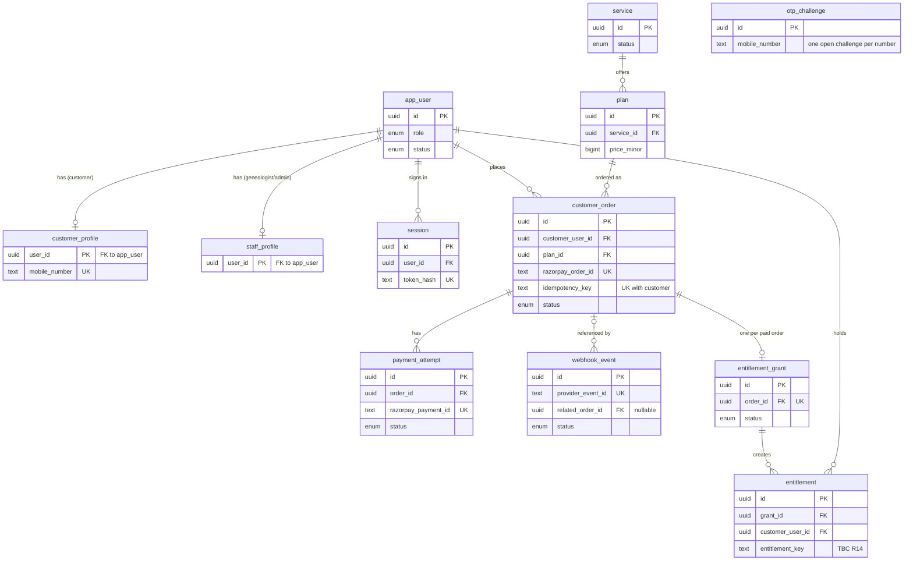
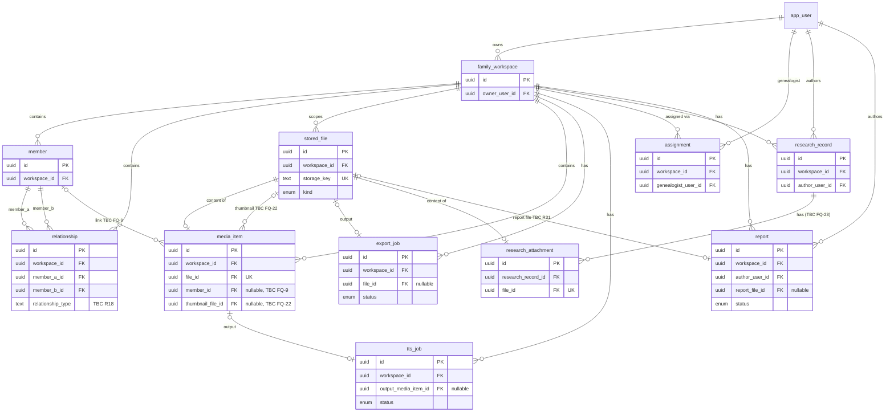
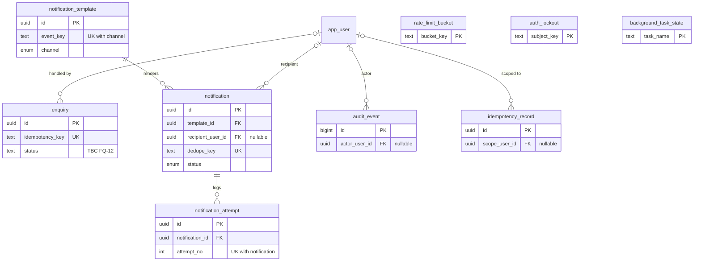

# Kulvriksh Digital Platform — Data Model

| Item | Value |
|---|---|
| Document | `docs/02-DATA-MODEL.md` |
| Status | Draft for review. Not approved for schema implementation. |
| Source documents | [`00-ROADMAP.md`](00-ROADMAP.md) (scope, decisions, TBC register R1–R48), [`01-PRODUCT-FLOWS.md`](01-PRODUCT-FLOWS.md) r2 (behaviour, flow IDs, FQ-1–FQ-27), [`PERFORMANCE-AND-NAVIGATION-STANDARDS.md`](PERFORMANCE-AND-NAVIGATION-STANDARDS.md) |
| Target | PostgreSQL via Prisma, on a 1 vCPU / 4 GB RAM / 50 GB shared NVMe VPS |
| Last updated | 2026-10-24 |
| Revision | r2 (2026-10-24): review fixes — run leases (replacing session advisory locks), lease fencing, state-transition invariants, OTP HMAC and atomic attempts, atomic rate limiting, database roles and audit transactions, order-creation idempotency. Report: [`reports/TASK-01-SPECIFICATION-REVIEW-FIXES.md`](reports/TASK-01-SPECIFICATION-REVIEW-FIXES.md) |

This document describes the **logical** data model. It contains no migration files, no Prisma schema and no SQL to run. Where a business decision is open, the model shows the alternatives and their effect on the schema. It does not choose one.

---

## Contents

1. [Purpose, scope, terminology and source-of-truth rules](#1-purpose-scope-terminology-and-source-of-truth-rules)
2. [Proposed entity-relationship diagrams](#2-proposed-entity-relationship-diagrams)
3. [Conventions and entity catalogue](#3-conventions-and-entity-catalogue)
4. [Keys, constraints and indexes](#4-keys-constraints-and-indexes)
5. [Identity, roles, profiles, sessions, OTP and account states](#5-identity-roles-profiles-sessions-otp-and-account-states)
6. [Catalogue, orders, payments, webhooks, grants and entitlements](#6-catalogue-orders-payments-webhooks-grants-and-entitlements)
7. [Family workspaces, members, relationships, files, media and jobs](#7-family-workspaces-members-relationships-files-media-and-jobs)
8. [Assignments, research, reports and attachments](#8-assignments-research-reports-and-attachments)
9. [Enquiries, notifications, audit and admin records](#9-enquiries-notifications-audit-and-admin-records)
10. [Background-task state, leases, retries and concurrency](#10-background-task-state-leases-retries-and-concurrency)
11. [Data access and tenant/ownership boundaries](#11-data-access-and-tenantownership-boundaries)
12. [Retention, deletion and privacy (unresolved)](#12-retention-deletion-and-privacy-unresolved)
13. [Migration and seed-data considerations](#13-migration-and-seed-data-considerations)
14. [Open decisions and traceability](#14-open-decisions-and-traceability)
15. [Acceptance checklist and blockers](#15-acceptance-checklist-and-blockers)

---

## 1. Purpose, scope, terminology and source-of-truth rules

### 1.1 Purpose

This document defines the entities, fields, relationships, constraints and indexes needed for the behaviour in `01-PRODUCT-FLOWS.md`. It is the input for the Phase 2 schema work. It is approved separately from the schema itself.

### 1.2 Scope

**In scope:** a data model for all ten approved scope items ([Roadmap §3](00-ROADMAP.md#3-approved-scope)).

**Out of scope:**
- Refund data. Refund processing is excluded (D3).
- An object-storage schema. The migration is excluded; only the storage abstraction is in scope.
- Analytics data, which is held by the external tool (R5).
- Content storage for surname pages, until R2 decides the content source.

### 1.3 Labels used in this document

| Label | Meaning |
|---|---|
| **Confirmed** | Follows directly from an approved roadmap item or confirmed decision (D1–D7). |
| **Proposed** | An engineering design, from flows r2 or this document. Not client-approved. It needs technical review at CP2. |
| **TBC (R*n*)** | Unresolved and registered in [Roadmap §9](00-ROADMAP.md#9-unconfirmed-requirements-tbc). |
| **TBC (FQ-*n*)** | Unresolved and tracked only in [Flows §15](01-PRODUCT-FLOWS.md#15-open-questions-and-tbc-decisions). **Not in the roadmap register yet.** |
| **TBC (DQ-*n*)** | A new data-model question raised by this document ([§14.3](#143-new-data-model-questions-dq)). **Not registered anywhere else yet.** |
| **Placeholder** | A field or table whose shape cannot be fixed until the referenced TBC is resolved. It must not be implemented as shown without a decision. |

### 1.4 Terminology

The terms are as defined in [Flows §1.4](01-PRODUCT-FLOWS.md#14-terminology). Additional terms:

| Term | Meaning |
|---|---|
| Tenant boundary | The family workspace. Every customer-private record is reachable through exactly one workspace. |
| Workspace-scoped table | A table carrying its own `workspace_id` column, so access checks and indexes need no join. |
| Lease | A time-limited claim on a work item (`lease_owner`, `lease_expires_at`). An expired lease means the item can be recovered. |
| Minor units | An integer amount in the currency's smallest unit, as used by Razorpay. |

### 1.5 Source-of-truth rules

1. **Precedence:** roadmap (scope and decisions), then product flows (behaviour), then this document (structure). If this document conflicts with the flows, the flows win, and the conflict is raised for review rather than resolved here.
2. **PostgreSQL** is the source of truth for application state, job and task state, and every state machine.
3. **Razorpay** is the source of truth for payment facts. The database stores what has been verified and reconciled ([Flows F-ORD-03 to F-ORD-05](01-PRODUCT-FLOWS.md#f-ord-03-payment-confirmation-and-entitlement-grant)).
4. **Storage abstraction:** it holds file bytes, and `stored_file` holds the pointer and metadata. A file is never addressed by a user-supplied path.
5. **Authorisation is enforced by the Express API** on every request. Schema features such as composite foreign keys and uniqueness reduce errors, but they are **not** an access-control mechanism ([§11](#11-data-access-and-tenantownership-boundaries)).
6. **TBC permission cells** in [Flows §13](01-PRODUCT-FLOWS.md#13-security-and-permissions-matrix) are denied. No column, view or index in this model grants access by existing.

---

## 2. Proposed entity-relationship diagrams

These are proposed. For readability, the diagrams show only keys and the columns that define relationships. Full fields are in §5–§10. Relationship lines labelled TBC depend on an open decision.

### 2.1 Identity, catalogue and commerce



### 2.2 Family workspace, files, research and reports



### 2.3 Operations, notifications and audit



`otp_challenge`, `rate_limit_bucket`, `auth_lockout` and `background_task_state` have no foreign keys. They are keyed by values such as a mobile number, a rate-limit key or a task name, not by user ID.

---

## 3. Conventions and entity catalogue

### 3.1 Conventions (proposed)

| Topic | Convention |
|---|---|
| Naming | Tables and columns use `snake_case`. Prisma models map to these names. `app_user` and `customer_order` avoid the reserved words `user` and `order`. |
| Primary keys | `uuid`, generated by the database (`gen_random_uuid()`). They are not guessable, but **unguessable IDs are not access control** (§1.5). Exceptions: `audit_event` uses `bigint` identity, because it is append-only and high-volume. `customer_order.id` is generated by the API before the Razorpay call ([§6.2](#62-customer_order)). |
| Timestamps | `timestamptz`, stored in UTC. Most tables have `created_at` (default now) and `updated_at`. |
| Money | `bigint` amount in minor units, plus `currency` (`text`, ISO 4217, checked to be 3 uppercase letters). The currency value itself is configuration and is not assumed here. |
| State machines | PostgreSQL enums for working state sets that the flows define. Sets that are still TBC are marked **Placeholder**, and changing them later needs a migration. |
| Optimistic concurrency | `version int not null default 1` on records the flows edit with conflict detection: members, research records and reports. Last write wins for profiles (Flows F-PRO-01, proposed). |
| Deletion | Hard vs soft deletion is **not decided** (R10, R21, FQ-16; [§12](#12-retention-deletion-and-privacy-unresolved)). Foreign keys default to `RESTRICT`. Nothing cascades silently ([Flows F-FAM-02](01-PRODUCT-FLOWS.md#f-fam-02-member-management)). |
| Personal data | Kept to the minimum the flows need. Secrets (OTP codes, session tokens) are stored only as hashes. |
| JSON | `jsonb` only for snapshots and minimal payload excerpts, never for fields that are queried or permissioned. |

### 3.2 Entity catalogue

| Entity | Module | Basis | Ownership / boundary | Main flows |
|---|---|---|---|---|
| `app_user` | Identity | Confirmed (roles §1.5 of flows); single-role design proposed | Self | §3, F-ADM-00–02 |
| `customer_profile` | Identity | Confirmed (scope 2); fields TBC R8 | Owning customer | F-AUTH-02, F-PRO-01 |
| `staff_profile` | Identity | Confirmed (scope 6, 9); fields TBC R9, R33 | Staff user | F-GEN-01, F-ADM-00 |
| `session` | Identity | Proposed (server-side sessions for immediate revocation) | User | F-AUTH-02–05 |
| `otp_challenge` | Identity | Confirmed behaviour (Roadmap Phase 4); values FQ-3 | None (pre-auth) | F-AUTH-01–03 |
| `rate_limit_bucket` | Identity / security | Proposed | None | F-AUTH-01, F-PUB-04 |
| `auth_lockout` | Identity / security | Proposed | None | F-AUTH-02 |
| `service` | Catalogue | Confirmed (scope 3); fields TBC R12 | Admin-managed | F-PUB-03, F-ADM-04 |
| `plan` | Catalogue | Confirmed (scope 3); pricing and type TBC R12–R14 | Admin-managed | F-PUB-03, F-ADM-04 |
| `customer_order` | Commerce | Confirmed (scope 3); states working set (FQ-24) | Customer | F-ORD-01–07 |
| `payment_attempt` | Commerce | Proposed (flows r2) | Via order | F-ORD-03–05 |
| `webhook_event` | Commerce | Proposed (flows r2) | System | F-ORD-04 |
| `entitlement_grant` | Commerce | Proposed (flows r2) | Via order | F-ORD-03, F-ADM-05 |
| `entitlement` | Commerce | Confirmed (scope 3); shape TBC R13, R14 | Customer | F-ORD-06 |
| `family_workspace` | Family | Confirmed (scope 4, D1) | **Tenant root**; owner customer | F-FAM-01 |
| `member` | Family | Confirmed; fields TBC R17 | Workspace | F-FAM-02 |
| `relationship` | Family | Confirmed; types TBC R18 | Workspace | F-FAM-03 |
| `stored_file` | Files | Proposed (file content pointer) | Workspace | §7.1–7.2 of flows |
| `media_item` | Media | Confirmed (scope 5); linkage TBC FQ-9 | Workspace | F-MED-01–04 |
| `export_job` | Family | Confirmed (PDF export); persistence TBC FQ-11 | Workspace | F-FAM-05 |
| `tts_job` | Media | Confirmed (TTS); inputs TBC R25, FQ-10 | Workspace | F-MED-04 |
| `assignment` | Research | Confirmed (D2); scope TBC R28, R29 | Workspace + genealogist | F-ADM-03, F-GEN-02 |
| `research_record` | Research | Confirmed (scope 7); fields TBC R31 | Workspace | F-GEN-03 |
| `research_attachment` | Research | **Conditional** on FQ-23 | Workspace | F-GEN-03 |
| `report` | Research | Confirmed (scope 7, D4); workflow TBC R32 | Workspace | F-GEN-04, F-REP-01–04 |
| `enquiry` | Public | Confirmed (scope 1); fields TBC R4 | Admin-visible | F-PUB-04, F-ADM-06 |
| `notification_template` | Notifications | Confirmed (scope 8); events TBC R36 | Admin-managed | F-ADM-08 |
| `notification` | Notifications | Proposed (flows r2 outbox) | System | F-NOT-01 |
| `notification_attempt` | Notifications | Confirmed (delivery log, Roadmap Phase 9) | System | F-NOT-01 |
| `audit_event` | Audit | Confirmed (Roadmap §11 auditability) | System; append-only | All sensitive flows |
| `idempotency_record` | Cross-cutting | Proposed | Requester | Flows §12.2 |
| `background_task_state` | Background | Proposed | System | Flows §12.4 |

Not modelled until decided:
- staff credentials (R9)
- admin permission sets (R33)
- admin second factor (R34)
- surname content (R2)
- refund records (D3)
- withdrawal history (R32)
- data import tables (R43)

---

## 4. Keys, constraints and indexes

The constraints below are proposed. They are the authoritative list, and the field tables in §5–§9 refer back here.

**Implementation note:** partial unique indexes, check constraints and some composite foreign keys cannot be fully expressed in the Prisma schema language. They need raw SQL in migrations ([§13](#13-migration-and-seed-data-considerations)).

### 4.1 Foreign keys

| Table.column | References | On delete | Notes |
|---|---|---|---|
| `customer_profile.user_id` | `app_user.id` | RESTRICT | Also the primary key (1:1). |
| `staff_profile.user_id` | `app_user.id` | RESTRICT | Also the primary key (1:1). |
| `session.user_id` | `app_user.id` | RESTRICT | |
| `plan.service_id` | `service.id` | RESTRICT | |
| `customer_order.customer_user_id` | `app_user.id` | RESTRICT | |
| `customer_order.plan_id` | `plan.id` | RESTRICT | Plans that have orders are deactivated, not deleted (F-ADM-04, proposed). |
| `payment_attempt.order_id` | `customer_order.id` | RESTRICT | |
| `webhook_event.related_order_id` | `customer_order.id` | RESTRICT | Nullable (unknown order means `needs_attention`). |
| `entitlement_grant.order_id` | `customer_order.id` | RESTRICT | Also unique. |
| `entitlement.grant_id` | `entitlement_grant.id` | RESTRICT | |
| `entitlement.customer_user_id` | `app_user.id` | RESTRICT | Denormalised for entitlement checks. Must equal the order's customer (enforced in *Grant*). |
| `family_workspace.owner_user_id` | `app_user.id` | RESTRICT | |
| `member.workspace_id` | `family_workspace.id` | RESTRICT | |
| `relationship.workspace_id` | `family_workspace.id` | RESTRICT | |
| `relationship.(member_a_id, workspace_id)` | `member.(id, workspace_id)` | RESTRICT | A **composite** FK, so both members must be in the relationship's workspace (F-FAM-03). Cascade vs block on member deletion is TBC (R21); RESTRICT until then. |
| `relationship.(member_b_id, workspace_id)` | `member.(id, workspace_id)` | RESTRICT | As above. |
| `stored_file.workspace_id` | `family_workspace.id` | RESTRICT | |
| `media_item.workspace_id` | `family_workspace.id` | RESTRICT | |
| `media_item.(file_id, workspace_id)` | `stored_file.(id, workspace_id)` | RESTRICT | Composite: the file must be in the same workspace. |
| `media_item.(member_id, workspace_id)` | `member.(id, workspace_id)` | RESTRICT | **Placeholder (FQ-9).** Present only if media links to members. |
| `media_item.(thumbnail_file_id, workspace_id)` | `stored_file.(id, workspace_id)` | RESTRICT | **Placeholder (FQ-22).** |
| `export_job.workspace_id` | `family_workspace.id` | RESTRICT | |
| `export_job.requested_by_user_id` | `app_user.id` | RESTRICT | |
| `export_job.(file_id, workspace_id)` | `stored_file.(id, workspace_id)` | RESTRICT | Nullable until `ready`. |
| `tts_job.workspace_id` | `family_workspace.id` | RESTRICT | |
| `tts_job.requested_by_user_id` | `app_user.id` | RESTRICT | |
| `tts_job.(output_media_item_id, workspace_id)` | `media_item.(id, workspace_id)` | RESTRICT | Nullable until `ready`. |
| `assignment.workspace_id` | `family_workspace.id` | RESTRICT | |
| `assignment.genealogist_user_id` | `app_user.id` | RESTRICT | |
| `assignment.assigned_by_user_id` | `app_user.id` | RESTRICT | |
| `assignment.removed_by_user_id` | `app_user.id` | RESTRICT | Nullable. |
| `research_record.workspace_id` | `family_workspace.id` | RESTRICT | |
| `research_record.author_user_id` | `app_user.id` | RESTRICT | |
| `research_attachment.(research_record_id, workspace_id)` | `research_record.(id, workspace_id)` | RESTRICT | **Conditional (FQ-23).** |
| `research_attachment.(file_id, workspace_id)` | `stored_file.(id, workspace_id)` | RESTRICT | **Conditional (FQ-23).** |
| `research_attachment.uploaded_by_user_id` | `app_user.id` | RESTRICT | |
| `report.workspace_id` | `family_workspace.id` | RESTRICT | |
| `report.author_user_id` | `app_user.id` | RESTRICT | |
| `report.released_by_user_id` | `app_user.id` | RESTRICT | Nullable. |
| `report.returned_by_user_id` | `app_user.id` | RESTRICT | Nullable. |
| `report.(report_file_id, workspace_id)` | `stored_file.(id, workspace_id)` | RESTRICT | **Placeholder (R31).** |
| `enquiry.handled_by_user_id` | `app_user.id` | RESTRICT | Nullable. |
| `notification_template.updated_by_user_id` | `app_user.id` | RESTRICT | Nullable. |
| `notification.template_id` | `notification_template.id` | RESTRICT | |
| `notification.recipient_user_id` | `app_user.id` | RESTRICT | Nullable (e.g. a shared admin mailbox, if R36 uses one). |
| `notification_attempt.notification_id` | `notification.id` | RESTRICT | |
| `audit_event.actor_user_id` | `app_user.id` | RESTRICT | Nullable (system actor). |
| `idempotency_record.scope_user_id` | `app_user.id` | RESTRICT | Nullable (anonymous enquiry). |

The **composite foreign keys** need a supporting unique constraint `(id, workspace_id)` on `member`, `stored_file`, `media_item` and `research_record`. This is redundant with the primary key, but PostgreSQL requires it as the FK target.

### 4.2 Uniqueness constraints

| Constraint | Purpose | Source |
|---|---|---|
| `customer_profile(mobile_number)` | One customer account per number | F-AUTH-02; format FQ-1 |
| `session(token_hash)` | Session lookup | F-AUTH-02 |
| `otp_challenge(mobile_number) WHERE consumed_at IS NULL AND invalidated_at IS NULL` (partial) | At most one open challenge per number | F-AUTH-01 "earlier challenge invalidated" |
| `customer_order(razorpay_order_id)` | One internal order per Razorpay order | F-ORD-01 |
| `customer_order(customer_user_id, idempotency_key)` | Duplicate create returns the same order | F-ORD-01 |
| `payment_attempt(razorpay_payment_id)` | Unique payment reference; idempotent *Confirm* | F-ORD-03 |
| `webhook_event(provider_event_id)` | Webhook dedupe, inserted in the same transaction as the effects | F-ORD-04 |
| `entitlement_grant(order_id)` | One grant record per order | F-ORD-03 |
| `entitlement(grant_id, entitlement_key)` | No duplicate entitlement from repeated *Grant*. Shape depends on R14 ([§6.6](#66-entitlement)). | F-ORD-03, AS-ORD-08 |
| `relationship(workspace_id, member_a_id, member_b_id, relationship_type)` | Reject identical duplicates (proposed). Symmetric types need canonical ordering (R18). | F-FAM-03 |
| `stored_file(storage_key)` | Server-generated key is unique | Flows §7.1 |
| `media_item(file_id)` | A file belongs to one media item | §7 |
| `research_attachment(file_id)` | A file belongs to one attachment | §8 |
| `export_job(workspace_id, requested_by_user_id) WHERE status IN ('queued','running')` (partial) | Repeated clicks return the existing job | F-FAM-05, AS-FAM-12 |
| `tts_job(workspace_id, input_hash) WHERE status IN ('queued','running')` (partial) | An identical in-progress request returns the existing job | F-MED-04 |
| `assignment(workspace_id, genealogist_user_id) WHERE removed_at IS NULL` (partial) | No duplicate active assignment | F-ADM-03 |
| `assignment(workspace_id) WHERE removed_at IS NULL` (partial) | **Only if R29 forbids multiple genealogists per family** | R29 |
| `enquiry(idempotency_key)` | Duplicate submit creates one enquiry | F-PUB-04 |
| `notification_template(event_key, channel)` | One template per event and channel | F-ADM-08 |
| `notification(dedupe_key)` | One record per event, recipient and channel | F-NOT-01, AS-NOT-02 |
| `notification_attempt(notification_id, attempt_no)` | Ordered attempt log | F-NOT-01 |
| `idempotency_record(scope_key, operation, idempotency_key)` | Generic create deduplication | Flows §12.2 |
| `family_workspace(owner_user_id)` | **Only if FQ-8 limits each customer to one workspace** | FQ-8 |

### 4.3 Check constraints

| Table | Check |
|---|---|
| `plan` | `price_minor > 0`; `currency ~ '^[A-Z]{3}$'` |
| `customer_order` | `amount_minor > 0`; `(status = 'paid') = (paid_at IS NOT NULL)`; currency format |
| `payment_attempt` | `amount_minor >= 0`; `(status = 'captured') = (captured_at IS NOT NULL)` |
| `webhook_event` | `(status = 'needs_attention') = (attention_reason IS NOT NULL)` |
| `entitlement_grant` | `(status = 'granted') = (granted_at IS NOT NULL)`; `attempt_count >= 0`; `(lease_token IS NULL) = (lease_expires_at IS NULL)` and `(lease_token IS NULL) = (lease_owner IS NULL)`; `status <> 'granted' OR lease_token IS NULL` |
| `relationship` | `member_a_id <> member_b_id` (no self-relationship, F-FAM-03) |
| `stored_file` | `byte_size >= 0` |
| `export_job`, `tts_job` | `(status = 'ready') = (output reference IS NOT NULL)`; `(status = 'running') = (lease_token IS NOT NULL)`; `(lease_token IS NULL) = (lease_expires_at IS NULL)`; `(lease_token IS NULL) = (lease_owner IS NULL)` |
| `assignment` | `(removed_at IS NULL) = (removed_by_user_id IS NULL)` |
| `report` | `(status = 'released') = (released_at IS NOT NULL)` |
| `notification` | `attempt_count >= 0`; `(status = 'sending') = (lease_token IS NOT NULL)`; `(lease_token IS NULL) = (lease_expires_at IS NULL)`; `(lease_token IS NULL) = (lease_owner IS NULL)` |
| `otp_challenge` | `attempt_count >= 0`; `expires_at > created_at` |
| `rate_limit_bucket` | `count >= 1`; `expires_at > window_start` |
| `background_task_state` | The run-lease columns are all null or all set: `(run_lease_token IS NULL) = (run_lease_expires_at IS NULL)` and `(run_lease_token IS NULL) = (run_lease_owner IS NULL)`; `consecutive_failures >= 0` |

**Not enforceable by a simple constraint** (enforced in the API, inside transactions, and covered by tests):
- the role of a referenced user, for example that `owner_user_id` is a customer
- forward-only state transitions, enforced by compare-and-set updates ([§10.4](#104-state-machine-invariants)). The database alone does **not** enforce them.
- acyclic ancestry
- that `entitlement.customer_user_id` matches the order

Database triggers for these are optional and not proposed by default (DQ-4).

### 4.4 Indexes (practical set for the target VPS)

Only indexes that a flow's query needs are listed. Primary keys and unique constraints already create indexes.

| Index | Serves |
|---|---|
| `session(user_id) WHERE revoked_at IS NULL` | Revoke all of a user's sessions (suspend or deactivate) |
| `session(expires_at)` | Purging expired sessions |
| `otp_challenge(expires_at)` | Purging challenges |
| `plan(service_id) WHERE status = 'active'` | Public catalogue |
| `customer_order(customer_user_id, created_at DESC)` | Order history, paginated (F-ORD-07) |
| `customer_order(status, reconcile_last_checked_at) WHERE status IN ('created','pending','failed')` | Reconciliation selection (F-ORD-05) |
| `customer_order(created_at) WHERE attention_reason IS NOT NULL` | Admin attention queue |
| `payment_attempt(order_id)` | Order detail |
| `webhook_event(related_order_id)` | Order detail |
| `webhook_event(received_at) WHERE status = 'needs_attention'` | Attention queue |
| `entitlement_grant(next_attempt_at) WHERE status = 'pending'` | Grant recovery |
| `entitlement_grant(updated_at) WHERE status = 'failed'` | Attention queue |
| `entitlement(customer_user_id, entitlement_key)` | Entitlement checks (F-ORD-06) |
| `family_workspace(owner_user_id)` | Customer's workspace list |
| `member(workspace_id)`, plus a name-search index per R17 and R19 (DQ-5) | Member list, tree load, search (F-FAM-04) |
| `relationship(workspace_id)`; `relationship(member_b_id)` | Tree load in bounded queries; reverse lookups during cycle checks |
| `stored_file(workspace_id, kind)` | Quota sums and cleanup |
| `stored_file(updated_at) WHERE status = 'pending_deletion'` | Deletion retry |
| `media_item(workspace_id, created_at DESC)` | Gallery pagination |
| `export_job(lease_expires_at) WHERE status = 'running'`; `tts_job(lease_expires_at) WHERE status = 'running'` | Stale-job recovery |
| `assignment(genealogist_user_id) WHERE removed_at IS NULL` | Genealogist's assigned list (F-GEN-02) |
| `assignment(workspace_id) WHERE removed_at IS NULL` | Per-request assignment check |
| `research_record(workspace_id, updated_at DESC)` | Research list |
| `report(workspace_id, status)` | Customer released list; genealogist list |
| `report(submitted_at) WHERE status = 'submitted'` | Approval queue (F-ADM-07) |
| `enquiry(status, created_at DESC)` | Admin enquiry list |
| `notification(next_attempt_at) WHERE status = 'queued'` | Dispatcher claim |
| `notification(lease_expires_at) WHERE status = 'sending'` | Lease recovery |
| `audit_event(occurred_at)`; `audit_event(target_type, target_id)`; `audit_event(actor_user_id, occurred_at)` | Audit view filters (scope FQ-13) |
| `idempotency_record(expires_at)` | Purge |

**Admin search** across customers by name or number depends on the profile fields (R8). A trigram or full-text index needs an extension decision (DQ-5). It is not assumed.

---

## 5. Identity, roles, profiles, sessions, OTP and account states

### 5.1 `app_user`

**Basis:** Confirmed — the roles are customer, genealogist and admin (Roadmap Phase 1). Proposed — one role per account.

| Field | Type | Null | Notes |
|---|---|---|---|
| `id` | uuid | no | PK |
| `role` | enum `user_role` (`customer`, `genealogist`, `admin`) | no | **Proposed: one role per account.** Whether one person may hold several roles is TBC (DQ-1). Finer admin roles: R33. |
| `status` | enum `user_status` | no | See [§5.6](#56-account-states). |
| `status_changed_at` | timestamptz | yes | |
| `created_at`, `updated_at` | timestamptz | no | |

**Alternative for DQ-1 and R33:** a `user_role` join table (user, role), plus an `admin_permission` table if R33 defines permissions. Effect: every authorisation helper checks a set of roles instead of one value. Choosing the single-role design now does not block this later, because the helpers already go through one function (Flows §10).

### 5.2 `customer_profile`

**Basis:** Confirmed (scope 2). The fields are a **placeholder** (R8).

| Field | Type | Null | Notes |
|---|---|---|---|
| `user_id` | uuid | no | PK; FK → `app_user` (role must be `customer`, enforced in the API) |
| `mobile_number` | text | no | Unique; normalised by the API. Format and supported countries TBC (FQ-1). Whether it can change TBC (FQ-6). Contact detail; genealogist access TBC (FQ-26). |
| *profile fields* | — | — | **Placeholder (R8).** Not defined until R8 is resolved. |
| `created_at`, `updated_at` | timestamptz | no | |

If FQ-2 chooses a separate registration step, a profile-completion status may be needed (FQ-5). It is not added until decided.

### 5.3 `staff_profile`

**Basis:** Confirmed: genealogists and admins exist. **Placeholder:** the sign-in identifier and credentials (R9), and admin protection (R34).

| Field | Type | Null | Notes |
|---|---|---|---|
| `user_id` | uuid | no | PK; FK → `app_user` (role `genealogist` or `admin`) |
| `display_name` | text | yes | Needed to name the actor in admin views and audit (F-ADM-02). Confirm with R9. |
| *sign-in identifier and credential fields* | — | — | **Placeholder (R9).** A separate `staff_credential` table is expected once R9 decides the method (for example a password hash, or OTP to a number). Second-factor fields depend on R34. |
| `created_at`, `updated_at` | timestamptz | no | |

### 5.4 `session`

**Basis:** Proposed. The flows require revocation to be checked on every API request (Flows F-AUTH-05), so sessions are **server-side rows**. Self-contained tokens are not used.

| Field | Type | Null | Notes |
|---|---|---|---|
| `id` | uuid | no | PK |
| `user_id` | uuid | no | FK → `app_user` |
| `token_hash` | text | no | Unique. A hash of the random token in the cookie; the raw token is never stored. |
| `created_at` | timestamptz | no | |
| `last_seen_at` | timestamptz | no | For idle timeout (FQ-4). Updated at most once per configured interval, to avoid a write on every request on the single vCPU. |
| `expires_at` | timestamptz | no | Lifetime TBC (FQ-4) |
| `revoked_at` | timestamptz | yes | Set on logout, suspension, deactivation or role removal |
| `revoke_reason` | enum (`logout`, `expired`, `suspended`, `deactivated`, `admin_action`) | yes | `suspended` applies only if R35 adopts suspension |

Concurrent sessions per user are TBC (FQ-4). A limit would need a count check when creating a session. No uniqueness is imposed.

### 5.5 `otp_challenge`, `rate_limit_bucket`, `auth_lockout`

**Basis:** Confirmed behaviour: single use, short expiry, rate limits, lockout (Roadmap Phase 4). All values are TBC (FQ-3).

**`otp_challenge`**

| Field | Type | Null | Notes |
|---|---|---|---|
| `id` | uuid | no | PK |
| `mobile_number` | text | no | Normalised. Has no FK, because the account may not exist yet (FQ-2). |
| `code_hash` | text | no | `HMAC-SHA-256(otp_hmac_key, challenge id ‖ code)`. The key comes from configuration and is never stored in the database. The code is never stored in plain text (AS-AUTH-03). Proposed; see below. |
| `created_at`, `expires_at` | timestamptz | no | |
| `attempt_count` | int | no | Default 0. Incremented atomically **before** the code is compared. |
| `consumed_at` | timestamptz | yes | Single use. Set by an atomic conditional update. |
| `invalidated_at` | timestamptz | yes | Set by a resend, a new request, a provider failure, attempt exhaustion or lockout |

Partial unique index: one open challenge per number (§4.2). A new request invalidates the old challenge and inserts the new one in a single transaction.

**OTP generation and verification (proposed)**

All numeric values (code length, lifetime, attempt limit, windows, lockout duration) remain **TBC (FQ-3)** and are configuration.

1. **Generation:** codes are produced by a cryptographically secure random generator, with uniformly distributed digits.
2. **Storage — why a keyed hash:**
   - A 4–6 digit code has at most 10⁶ values. An unkeyed hash (even salted) can therefore be reversed in under a second by anyone who obtains the database.
   - With an HMAC whose key is held only in application configuration, a database leak alone is not enough to recover codes.
   - Including the challenge ID in the HMAC input makes every challenge's hash unique, so nothing can be precomputed across challenges.
3. **Key rotation:** a new key is deployed through configuration. Challenges are short-lived, so any challenge issued under the old key simply fails verification, and the user requests a new code.
   - No key-version column is proposed.
   - **Alternative (CP2):** add a `key_version` column so old challenges can still be verified during a rotation overlap.
4. **Request (F-AUTH-01):**
   - In one short transaction:
     - check the request rate limits (the atomic statement below) and any active `auth_lockout` for the number
     - invalidate the open challenge for the number (conditional update)
     - insert the new challenge
   - The SMS is sent **after commit**, outside any transaction.
   - If the provider fails, the challenge is invalidated with a conditional update.
   - Two concurrent requests for the same number collide on the partial unique index. The loser is treated as rate-limited and asked to retry.
5. **Verify (F-AUTH-02):**
   1. If `auth_lockout.locked_until > now()` for the number, return the generic failure.
   2. Run the atomic attempt accounting **before** comparing:
      `UPDATE otp_challenge SET attempt_count = attempt_count + 1 WHERE id = $1 AND consumed_at IS NULL AND invalidated_at IS NULL AND expires_at > now() AND attempt_count < $max RETURNING code_hash, attempt_count`.
      Zero rows means expired, used, invalidated or exhausted, and returns the generic failure.
   3. Compute the HMAC of the submitted code and compare it **in constant time**, over equal-length byte buffers.
   4. **On a mismatch:**
      - increment the per-number failure counter (rate-limit purpose `otp_verify_fail`, using the atomic statement below)
      - if that counter reaches its limit, upsert `auth_lockout` (`locked_until = greatest(existing, now() + duration)`) and invalidate the number's open challenge
      - if `attempt_count` has reached the maximum, invalidate the challenge
      - write the failure audit in its own transaction ([§9.4](#94-audit_event))
      - return the generic failure
   5. **On a match**, in one transaction:
      - consume atomically: `UPDATE otp_challenge SET consumed_at = now() WHERE id = $1 AND consumed_at IS NULL AND invalidated_at IS NULL AND expires_at > now() RETURNING id`. Zero rows means another request won, and this one returns the generic failure.
      - find or create the account (FQ-2) and check its status
      - create the session and write the success audit
      - commit
      **Only the request that consumed the challenge creates a session.**
6. **Guessing budget across challenges:** the per-number failure counter is independent of individual challenges. **Requesting a new code does not reset the guessing budget.** Whether a successful sign-in resets the counter is a configuration choice (FQ-3).

**`rate_limit_bucket` (proposed)**

| Field | Type | Null | Notes |
|---|---|---|---|
| `bucket_key` | text | no | PK. `HMAC-SHA-256(rate_limit_key, purpose ‖ ':' ‖ identifier)`. No raw IP address or mobile number is stored. |
| `window_start` | timestamptz | no | |
| `count` | int | no | Must be at least 1 |
| `expires_at` | timestamptz | no | End of the current window |

**Algorithm: a fixed-window counter, updated by one atomic statement (proposed).** This is a specification sketch, not a migration.

```sql
INSERT INTO rate_limit_bucket (bucket_key, window_start, count, expires_at)
VALUES ($key, now(), 1, now() + $window)
ON CONFLICT (bucket_key) DO UPDATE SET
  window_start = CASE WHEN rate_limit_bucket.expires_at <= now() THEN now() ELSE rate_limit_bucket.window_start END,
  count        = CASE WHEN rate_limit_bucket.expires_at <= now() THEN 1 ELSE rate_limit_bucket.count + 1 END,
  expires_at   = CASE WHEN rate_limit_bucket.expires_at <= now() THEN now() + $window ELSE rate_limit_bucket.expires_at END
RETURNING count, expires_at;
```

**How it is used:**
- **Decision:** the caller rejects the request when the returned `count` exceeds the purpose's limit, and derives Retry-After from `expires_at`. Rejected requests are still counted. There is never a separate read before the write, so concurrent requests cannot exceed the limit.
- **Purposes** (each with its own window and limit, values TBC FQ-3):
  - `otp_request:number`
  - `otp_request:ip`
  - `otp_verify:ip`
  - `otp_verify_fail:number`
  - `enquiry:ip`
  - any others are defined in Phase 2
  A key always uses the same window length.
- **Database unavailable:** OTP send/verify and enquiry submission **fail closed**, with a retryable 503. These operations need the database anyway.
- **Volume:** about one row per active key. The cleanup task deletes rows whose `expires_at` is older than a grace period. Row-lock contention arises only on a single hot key, and is acceptable at the expected volume.
- **Alternatives (not proposed):**
  - **Sliding-window log** (one row per request): accurate, but a write per request and more storage on the shared disk.
  - **Two-window sliding approximation:** smoother, but more complex.
  - The fixed window allows a burst of up to twice the limit across a window boundary. That is acceptable for these purposes, and is revisited only if measurements show abuse.

**`auth_lockout` (proposed)**

| Field | Type | Null | Notes |
|---|---|---|---|
| `subject_key` | text | no | PK. An HMAC of the purpose and the normalised number (no raw number). |
| `locked_until` | timestamptz | no | Upserted with `greatest(existing, new)`, so concurrent lockouts never shorten each other |
| `reason` | text | no | For example `otp_verify_fail` |
| `updated_at` | timestamptz | no | |

**Why these are in the database, and the cost:**
- **Why the database:** state survives a restart and stays correct if more than one API process runs. It needs no Redis (Roadmap §12).
- **Alternative:** in-memory counters. They are lost on restart and wrong with several processes, so they are not proposed.
- **Keys:** the HMAC keys for rate limits and OTP are separate configuration secrets.

### 5.6 Account states

| `user_status` value | Applies to | Basis |
|---|---|---|
| `active` | All roles | Confirmed |
| `deactivated` | Genealogists and admins | Confirmed for genealogists (Roadmap Phase 9 "create, deactivate"); admins per R33 |
| `suspended` | Customers | **TBC (R35).** Not added to the enum until decided. |
| `deleted` | Any | **TBC (R10).** Not modelled until decided ([§12](#12-retention-deletion-and-privacy-unresolved)). |

A status change revokes all the user's open sessions in the same transaction (Flows F-ADM-02, F-PRO-02).

---

## 6. Catalogue, orders, payments, webhooks, grants and entitlements

### 6.1 `service` and `plan`

**Basis:** Confirmed (scope 3). Descriptive fields, pricing structure and plan type are TBC (R12, R13). The mapping from plans to entitlements is TBC (R14).

**`service`**

| Field | Type | Null | Notes |
|---|---|---|---|
| `id` | uuid | no | PK |
| `status` | enum (`active`, `inactive`) | no | Inactive services are hidden publicly (AS-PUB-07) |
| *descriptive fields* | — | — | **Placeholder (R12).** For example name and description. Confirm with the client. |
| `created_at`, `updated_at` | timestamptz | no | |

**`plan`**

| Field | Type | Null | Notes |
|---|---|---|---|
| `id` | uuid | no | PK |
| `service_id` | uuid | no | FK → `service` |
| `status` | enum (`active`, `inactive`) | no | Inactive plans cannot be ordered (AS-ORD-03) |
| `price_minor` | bigint | no | Must be greater than 0. The values are client data (R12). |
| `currency` | text | no | ISO 4217. The value is configuration, not assumed. |
| *plan type and duration* | — | — | **Placeholder (R13).** See the effect below. |
| *entitlement definition* | — | — | **Placeholder (R14).** See [§6.6](#66-entitlement). |
| `created_at`, `updated_at` | timestamptz | no | |

**Effect of R13 on the schema:**
- **One-time** plans fit this model as it stands.
- **Time-limited** plans add a duration on `plan` and `valid_until` on `entitlement`.
- **Recurring** plans would need Razorpay subscriptions. That means a different payment model, with new subscription and invoice tables and different webhook events. **It is outside the current design, and would need a change-control assessment** ([Roadmap §10](00-ROADMAP.md#10-change-control)).

### 6.2 `customer_order`

**Basis:** Confirmed: server-side pricing and snapshot (Roadmap Phase 5). The states are the working set (FQ-24). Idempotency and attention handling are proposed (flows r2).

| Field | Type | Null | Notes |
|---|---|---|---|
| `id` | uuid | no | PK. **Generated by the API before the Razorpay call** and sent to Razorpay as the receipt reference (creation protocol below). |
| `customer_user_id` | uuid | no | FK → `app_user` |
| `plan_id` | uuid | no | FK → `plan` (reference only; billing uses the snapshot). Also compared on idempotent replay. |
| `idempotency_key` | text | no | Unique with `customer_user_id`. Format validated (creation protocol, step 1). |
| `razorpay_order_id` | text | no | Unique. Inserted only after Razorpay returns it (F-ORD-01), so it is never null. |
| `status` | enum `order_status` (`created`, `pending`, `paid`, `failed`) | no | Working set, transitions forward only ([Flows §5.1](01-PRODUCT-FLOWS.md#51-order-payment-attempt-and-grant-states-working-set)). Final set FQ-24. |
| `amount_minor` | bigint | no | **Snapshot.** Computed by the API. |
| `currency` | text | no | Snapshot |
| `plan_snapshot` | jsonb | no | Snapshot of the plan's descriptive fields at order time. The contents follow R12. |
| `paid_at` | timestamptz | yes | Set by *Confirm* |
| `attention_reason` | enum (`amount_mismatch`, `unreconciled`) | yes | For the admin attention queue (F-ADM-05) |
| `reconcile_last_checked_at` | timestamptz | yes | Reconciliation progress (F-ORD-05) |
| `reconcile_check_count` | int | no | Default 0 |
| `created_at`, `updated_at` | timestamptz | no | |

**Creation protocol (proposed; [Flows F-ORD-01](01-PRODUCT-FLOWS.md#f-ord-01-plan-selection-and-order-creation))**

1. **Validate the key:** proposed format is a client-generated UUID. Any other format or length is rejected with 400, and nothing is created.
2. **Replay check:** look up `(customer_user_id, idempotency_key)`.
   - If it exists with the **same** `plan_id`, return the existing order. No new Razorpay order is created.
   - If it exists with a **different** `plan_id`, return **409**, and nothing is created.
3. **Plan and amount:** check that the plan is active and compute the amount from the catalogue.
4. **Order ID:** generate the order `id` (UUID) in the API.
5. **Razorpay order:** create it **outside any transaction**, passing the order `id` as the receipt reference. A UUID is 36 characters; Razorpay's receipt length limit is confirmed in Phase 5.
6. **Insert** the order with that `id`.
   - On a unique conflict on `(customer_user_id, idempotency_key)`, re-read the winning row. If its `plan_id` differs, return 409; otherwise return the winner.
   - The loser's Razorpay order is never shown to the customer, so it cannot be paid. It can be traced through its receipt reference. Reconciliation iterates internal orders only, so it ignores such orphans.

**CP2 alternative — reserve first (not chosen here):**
- **Design:** insert the order in a pre-Razorpay state (e.g. `initiating`, with `razorpay_order_id` null) under the unique key, then call Razorpay, then update it to `created`.
- **Advantages:** no orphaned Razorpay orders, and concurrent duplicates are stopped before any network call.
- **Disadvantages:**
  - a nullable `razorpay_order_id`
  - an extra state with its own transitions
  - a sweeper for rows stuck in `initiating` after a crash
  - an extra check constraint
- **Decision:** to be made at CP2.

**Open items:**
- Unpaid-order expiry is TBC (FQ-18). If it is adopted, it adds an `expired` state and an `expires_at` column.
- Whether a customer can hold several open orders for one plan is TBC (R13, R14). If it is restricted, it needs a partial unique index on (`customer_user_id`, `plan_id`) over open states.

### 6.3 `payment_attempt`

**Basis:** Proposed (flows r2).

| Field | Type | Null | Notes |
|---|---|---|---|
| `id` | uuid | no | PK |
| `order_id` | uuid | no | FK → `customer_order` |
| `razorpay_payment_id` | text | no | **Unique payment reference** |
| `status` | enum (`authorised`, `captured`, `failed`) | no | `captured` is final. Other updates only move forward. |
| `amount_minor` | bigint | no | As reported by Razorpay; compared with the order snapshot |
| `currency` | text | no | |
| `captured_at` | timestamptz | yes | |
| `failure_code` | text | yes | Provider code only. No card or payment-method details are stored. |
| `first_seen_via` | enum (`verify`, `webhook`, `reconciliation`) | no | Diagnostics |
| `created_at`, `updated_at` | timestamptz | no | |

### 6.4 `webhook_event`

**Basis:** Proposed (flows r2, F-ORD-04). This row is **inserted in the same transaction** as the *Confirm* changes. There is no "received" state.

| Field | Type | Null | Notes |
|---|---|---|---|
| `id` | uuid | no | PK |
| `provider_event_id` | text | no | **Unique.** The Razorpay event identifier. Its delivery mechanism (header) is confirmed in Phase 5. |
| `event_type` | text | no | |
| `status` | enum (`processed`, `ignored`, `needs_attention`) | no | |
| `attention_reason` | text | yes | Required when the status is `needs_attention` |
| `related_order_id` | uuid | yes | FK → `customer_order`. Null if the order is unknown. |
| `related_payment_ref` | text | yes | The Razorpay payment ID from the payload. It has no FK, because the attempt may not exist. |
| `payload_excerpt` | jsonb | no | **Proposed:** only the fields needed for processing and audit. Retention follows R10. |
| `received_at` | timestamptz | no | |

Invalid signatures are **not** stored here. They go to the security log (F-ORD-04 step 1).

### 6.5 `entitlement_grant`

**Basis:** Proposed (flows r2). This is the durable link between *Confirm* (Transaction A) and *Grant* (Transaction B).

| Field | Type | Null | Notes |
|---|---|---|---|
| `id` | uuid | no | PK |
| `order_id` | uuid | no | FK → `customer_order`. **Unique**: one grant record per order. |
| `status` | enum (`pending`, `granted`, `failed`) | no | Created as `pending` by *Confirm* |
| `attempt_count` | int | no | Default 0. Incremented in a separate small update after a failed *Grant*. |
| `next_attempt_at` | timestamptz | yes | Backoff for the recovery task |
| `last_error` | text | yes | Sanitised |
| `lease_owner` | text | yes | Recovery-task claim; diagnostic only ([§10.3](#103-item-leases-and-fencing)) |
| `lease_token` | uuid | yes | New for every claim. The recovery task's bookkeeping updates are fenced on it. |
| `lease_expires_at` | timestamptz | yes | The three lease columns are all null or all set |
| `granted_at` | timestamptz | yes | |
| `failed_at` | timestamptz | yes | When automatic attempts were used up |
| `created_at`, `updated_at` | timestamptz | no | |

**How the transaction boundary maps to this table**

| Step | What happens |
|---|---|
| *Confirm* (Transaction A) | Locks the `customer_order` row; upserts `payment_attempt` by `razorpay_payment_id`; sets the order to `paid`; inserts `entitlement_grant(pending)`, any `notification` rows and the `audit_event`; commits. |
| *Grant* (Transaction B) | Locks the `entitlement_grant` row (`SELECT … FOR UPDATE`). If it is `granted`, it returns. Otherwise it inserts the `entitlement` row(s), sets the grant to `granted` with a compare-and-set update (`WHERE status IN ('pending','failed')`, [§10.4](#104-state-machine-invariants)), clears any lease, writes the `audit_event` and commits. |
| Recovery bookkeeping | The recovery task's updates to `attempt_count`, `next_attempt_at`, `last_error` and `failed` are fenced on `lease_token` ([§10.3](#103-item-leases-and-fencing)). *Grant* itself needs no lease: it is one short transaction under a row lock with a state check. A recovery worker that loses its lease therefore cannot double-grant. |

**Safeguards against duplicate grants:** the unique `entitlement_grant(order_id)`, the row lock, the state check, and the unique constraint on `entitlement` ([§6.6](#66-entitlement)).

### 6.6 `entitlement`

**Basis:** Confirmed: granted only after a verified payment. The **shape is a placeholder (R13, R14).**

| Field | Type | Null | Notes |
|---|---|---|---|
| `id` | uuid | no | PK |
| `grant_id` | uuid | no | FK → `entitlement_grant` |
| `customer_user_id` | uuid | no | FK → `app_user` (denormalised for checks) |
| `entitlement_key` | text | no | **Placeholder (R14):** what is unlocked |
| `valid_from` | timestamptz | no | |
| `valid_until` | timestamptz | yes | Only if R13 defines time-limited plans |
| `created_at` | timestamptz | no | |

**R14 alternatives**

| Option | Schema | Effect |
|---|---|---|
| (a) One entitlement per order | Unique `(grant_id)` | Simplest. A plan unlocks one thing. |
| (b) Several entitlements per order | Unique `(grant_id, entitlement_key)`; the plan definition lists its keys (a `plan_entitlement` table) | Supports bundles. |
| (c) Entitlement scoped to a workspace | Adds `workspace_id` (FK, composite with the owner check) | Needed if purchases unlock features for one family only. |

The working model uses (b)'s unique constraint, because it is safe under (a) too. It does not choose between the options.

---

## 7. Family workspaces, members, relationships, files, media and jobs

### 7.1 `family_workspace`

**Basis:** Confirmed: customer-owned and private by default (D1).

| Field | Type | Null | Notes |
|---|---|---|---|
| `id` | uuid | no | PK. **The tenant root.** |
| `owner_user_id` | uuid | no | FK → `app_user` (customer). It never changes; transfer and sharing are out of scope (R22). |
| *workspace fields* | — | — | **Placeholder.** For example a display name, defined together with R17. |
| `created_at`, `updated_at` | timestamptz | no | |

**Open items:**
- **Workspaces per customer (FQ-8):** if limited to one, add a unique constraint on `owner_user_id`.
- **Workspace deletion (FQ-16):** see §12.
- **Entitlement gating on creation:** an API check (R14). It needs no column.

### 7.2 `member`

**Basis:** Confirmed: create, read, update and delete. The **fields are a placeholder (R17).**

| Field | Type | Null | Notes |
|---|---|---|---|
| `id` | uuid | no | PK; also unique `(id, workspace_id)` |
| `workspace_id` | uuid | no | FK → `family_workspace` |
| *member fields* | — | — | **Placeholder (R17).** Search (F-FAM-04) needs at least one searchable name field. Which one is R17's decision. |
| `version` | int | no | Optimistic concurrency (F-FAM-02, proposed) |
| `created_by_user_id`, `updated_by_user_id` | uuid | no / yes | Actor; the role is recorded in audit |
| `created_at`, `updated_at` | timestamptz | no | |

**Storage alternatives for the R17 fields**

| Option | Effect |
|---|---|
| Typed columns | Validation, indexes and search are straightforward. Adding a field needs a migration. Recommended once R17 is fixed. |
| `jsonb` attributes | Flexible, but weaker validation, and search indexing needs extra work. Not recommended for queried fields. |

### 7.3 `relationship`

**Basis:** Confirmed: same workspace, no self-relationship, no ancestry cycles. The **types are a placeholder (R18).**

| Field | Type | Null | Notes |
|---|---|---|---|
| `id` | uuid | no | PK |
| `workspace_id` | uuid | no | FK → `family_workspace` |
| `member_a_id` | uuid | no | Composite FK with `workspace_id` → `member` |
| `member_b_id` | uuid | no | As above. Check `member_a_id <> member_b_id`. |
| `relationship_type` | text or enum | no | **Placeholder (R18).** No values are defined here. |
| `created_by_user_id` | uuid | no | |
| `created_at` | timestamptz | no | |

**Schema questions that depend on R18:**
- **Directed vs symmetric types:** symmetric types need canonical ordering (`member_a_id < member_b_id`) so duplicates are detected.
- **Which types count as "ancestry"** for the cycle check.
- **Enum vs lookup table:** an enum is cheaper. A lookup table lets admins configure types, but configurable types are not in scope.

**Cycle prevention (F-FAM-03, AS-FAM-05):**
- It is **not** enforceable by a constraint.
- **Proposed:** the API locks the workspace row (`SELECT … FOR UPDATE` on `family_workspace`) so relationship writes in one workspace happen one at a time. It then checks for cycles with a recursive query bounded by workspace size (R19), and inserts only if no cycle is found.

**Member deletion (R21):**
- Under **block**, the FK stays `RESTRICT`, which is the current default.
- Under **cascade**, it becomes `CASCADE` on the relationship FKs only, with audit of the cascaded deletions.

### 7.4 `stored_file` (content pointer)

**Basis:** Proposed. Every private file goes through the storage abstraction (Roadmap Phase 2). This table is the only link between a domain record and its bytes. It **is the content side** of the metadata/content split ([Flows §7.2](01-PRODUCT-FLOWS.md#72-file-access-rule)).

| Field | Type | Null | Notes |
|---|---|---|---|
| `id` | uuid | no | PK; also unique `(id, workspace_id)` |
| `workspace_id` | uuid | no | FK → `family_workspace`. Every file in scope belongs to one workspace: media, exports, attachments and reports. |
| `kind` | enum (`media`, `thumbnail`, `export_pdf`, `research_attachment`, `report`) | no | `thumbnail` applies only under FQ-22, and `research_attachment` only under FQ-23. TTS audio is `media`, because it is a media item ([Flows §13](01-PRODUCT-FLOWS.md#13-security-and-permissions-matrix)). |
| `storage_backend` | text | no | `local` initially. It allows the object-storage migration later without a schema change. |
| `storage_key` | text | no | Unique and server-generated. It is never shown to users. |
| `content_type` | text | no | Detected from the content signature, not the extension (Flows §7.1) |
| `byte_size` | bigint | no | Used for quotas |
| `checksum_sha256` | text | no | Integrity |
| `status` | enum (`committed`, `pending_deletion`) | no | See the lifecycle below |
| `created_at`, `updated_at` | timestamptz | no | |

**Lifecycle (proposed):**
- A **row is inserted only after the file is committed** to storage. Uploads in progress live in a temporary area that the cleanup task sweeps. So an interrupted upload leaves no row (AS-MED-04).
- Deleting a file marks it `pending_deletion`, removes the bytes, then deletes the row. A failed byte removal is retried by cleanup (F-MED-02).

**Quotas (R23):** the sum of `byte_size` grouped by workspace, or by owner through the workspace. Whether the quota is per customer or per workspace is R23's decision. No counter column is proposed. An aggregate over the index is enough at this scale; a counter can be added if measurements show a need.

### 7.5 `media_item` (metadata)

**Basis:** Confirmed: photographs, PDFs and documents, voice records and TTS audio (scope 5). Linkage is TBC (FQ-9), and thumbnails TBC (FQ-22).

| Field | Type | Null | Notes |
|---|---|---|---|
| `id` | uuid | no | PK; also unique `(id, workspace_id)` |
| `workspace_id` | uuid | no | FK → `family_workspace` |
| `file_id` | uuid | no | Composite FK → `stored_file`; unique |
| `media_type` | enum (`photo`, `document`, `voice`, `tts_audio`) | no | The allowed file types within each are R23's decision |
| `original_filename` | text | yes | Display only; sanitised; never used as a path |
| `member_id` | uuid | yes | **Placeholder (FQ-9).** See the options below. |
| `thumbnail_file_id` | uuid | yes | **Placeholder (FQ-22)** |
| `duration_seconds` | int | yes | Voice and TTS audio. The maximum is R24's decision. |
| `uploaded_by_user_id` | uuid | no | FK → `app_user` (owner; genealogist upload TBC FQ-25) |
| `created_at`, `updated_at` | timestamptz | no | |

**FQ-9 linkage options**

| Option | Schema | Effect |
|---|---|---|
| (a) Workspace only | No `member_id` | Simplest. No per-member gallery. |
| (b) Optional single member | Nullable `member_id`, composite FK | One member per item. Member deletion interacts with R21. |
| (c) Several members | A join table `media_member(media_item_id, member_id, workspace_id)` with composite FKs | Supports group photos. One more table and join. |

**Metadata vs content:**
- **Metadata endpoints** read `media_item` and selected `stored_file` columns (size, type).
- **Content endpoints** resolve `stored_file.storage_key` only after a separate content-permission check.
- There is no database view that joins metadata to `storage_key` for the API to expose.

### 7.6 `export_job` and `tts_job`

**Basis:** Confirmed: the features exist. Proposed: the job state, leases and dedupe (Flows F-FAM-05, F-MED-04, §12.4).

**`export_job`**

| Field | Type | Null | Notes |
|---|---|---|---|
| `id` | uuid | no | PK |
| `workspace_id` | uuid | no | FK |
| `requested_by_user_id` | uuid | no | FK → `app_user` (owner; others TBC R28, FQ-14, FQ-25) |
| `status` | enum (`queued`, `running`, `ready`, `failed`) | no | Partial unique on open jobs per workspace and requester (§4.2) |
| `lease_owner`, `lease_token`, `lease_expires_at` | text, uuid, timestamptz | yes | All set while `running`, all null otherwise. Completion is fenced on `lease_token` ([§10.3](#103-item-leases-and-fencing)). |
| `file_id` | uuid | yes | Composite FK → `stored_file` (`kind = export_pdf`). Set when `ready`. |
| `expires_at` | timestamptz | yes | **Placeholder (FQ-11):** retention of generated PDFs |
| `error_code` | text | yes | |
| `created_at`, `updated_at` | timestamptz | no | |

**`tts_job`**

| Field | Type | Null | Notes |
|---|---|---|---|
| `id` | uuid | no | PK |
| `workspace_id` | uuid | no | FK |
| `requested_by_user_id` | uuid | no | FK → `app_user` |
| `input_hash` | text | no | A hash of the normalised text, language and voice. Used for in-progress dedupe. |
| `source_text` | text | yes | **Placeholder (FQ-10):** whether the text is stored at all, and where it comes from. Storing it holds personal data (§12). |
| `language`, `voice` | text | no | From the configured list (R25) |
| `status` | enum (`queued`, `running`, `ready`, `failed`) | no | |
| `lease_owner`, `lease_token`, `lease_expires_at` | text, uuid, timestamptz | yes | All set while `running`, all null otherwise. Completion is fenced on `lease_token` ([§10.3](#103-item-leases-and-fencing)). |
| `output_media_item_id` | uuid | yes | Composite FK → `media_item` (`media_type = tts_audio`) |
| `error_code` | text | yes | |
| `created_at`, `updated_at` | timestamptz | no | |

---

## 8. Assignments, research, reports and attachments

### 8.1 `assignment`

**Basis:** Confirmed: admin-created, scoped, and removable with immediate effect (D2). The **scope is a placeholder (R28)**, and multiplicity is TBC (R29).

| Field | Type | Null | Notes |
|---|---|---|---|
| `id` | uuid | no | PK |
| `workspace_id` | uuid | no | FK |
| `genealogist_user_id` | uuid | no | FK → `app_user` (role `genealogist`, checked in the API) |
| `scope` | — | — | **Placeholder (R28).** See the options below. |
| `assigned_by_user_id` | uuid | no | FK → `app_user` (admin) |
| `assigned_at` | timestamptz | no | |
| `removed_at` | timestamptz | yes | Set on unassignment; access ends on the next request |
| `removed_by_user_id` | uuid | yes | |

Removed rows are **kept** for history (F-ADM-02, F-GEN-03). An active assignment is one where `removed_at IS NULL`.

**R28 scope options**

| Option | Schema | Effect |
|---|---|---|
| (a) Whole workspace | No scope column | The access check is "an active assignment exists". |
| (b) A fixed set of scopes | A scope enum or flags column | The check also compares the requested resource type with the scope. |
| (c) Specific parts (e.g. subsets of members) | An `assignment_scope_item` table | A more complex check and an extra join on every request. Needs measuring against the performance targets. |

**R29:** if a family can have only one genealogist, add a partial unique index on `(workspace_id) WHERE removed_at IS NULL`. Otherwise, version checks on edited records cover concurrent edits.

### 8.2 `research_record`

**Basis:** Confirmed: genealogists create and update records on assigned families, and customers cannot see them (D4). The **fields are a placeholder (R31).** Whether notes are part of this record or a separate type is also R31's decision.

| Field | Type | Null | Notes |
|---|---|---|---|
| `id` | uuid | no | PK; also unique `(id, workspace_id)` |
| `workspace_id` | uuid | no | FK |
| `author_user_id` | uuid | no | FK → `app_user` (genealogist) |
| *research fields and notes* | — | — | **Placeholder (R31)** |
| `version` | int | no | Optimistic concurrency |
| `created_at`, `updated_at` | timestamptz | no | |

Records stay after unassignment and remain visible to admins. Behaviour on reassignment is TBC (FQ-15). Access is checked against the **current** active assignment, never against `author_user_id` alone.

### 8.3 `research_attachment` (conditional on FQ-23)

| Field | Type | Null | Notes |
|---|---|---|---|
| `id` | uuid | no | PK |
| `workspace_id` | uuid | no | Present so the composite FKs work |
| `research_record_id` | uuid | no | Composite FK → `research_record` |
| `file_id` | uuid | no | Composite FK → `stored_file` (`kind = research_attachment`); unique |
| `original_filename` | text | yes | Display only |
| `uploaded_by_user_id` | uuid | no | FK → `app_user` |
| `created_at` | timestamptz | no | |

**Metadata vs content:** admins can read attachment metadata, but access to attachment content is **TBC (FQ-27)** and denied until decided.

### 8.4 `report`

**Basis:** Confirmed: customers see a report only after release (D4), and it can be returned. The **workflow is a working set (R32)**, and the format is TBC (R31).

| Field | Type | Null | Notes |
|---|---|---|---|
| `id` | uuid | no | PK |
| `workspace_id` | uuid | no | FK |
| `author_user_id` | uuid | no | FK → `app_user` (genealogist) |
| `status` | enum `report_status` (`draft`, `submitted`, `returned`, `released`) | no | **Working set.** Whether to add `approved` (a separate step from release) and `withdrawn` is TBC (R32). |
| *report content fields* | — | — | **Placeholder (R31):** generated in the platform, uploaded, or both |
| `report_file_id` | uuid | yes | Composite FK → `stored_file` (`kind = report`). **Placeholder (R31).** |
| `version` | int | no | |
| `submitted_at` | timestamptz | yes | |
| `returned_at`, `returned_by_user_id`, `return_reason` | timestamptz, uuid, text | yes | Whether a reason or comments are required is R32's decision |
| `released_at`, `released_by_user_id` | timestamptz, uuid | yes | Check: `released_at` is set if and only if the status is `released` |
| `created_at`, `updated_at` | timestamptz | no | |

**Release transaction (F-REP-01):** lock the report row, check that it is `submitted`, set `released`, then insert the `notification` rows and the `audit_event`, all in one commit.

**Customer access predicate:** `status = 'released'` together with workspace ownership. It applies to both the report row and its file ([§11](#11-data-access-and-tenantownership-boundaries)).

**Effect of R32 on the schema:**
- If approval and release are separate steps, add `approved` with `approved_at` and `approved_by_user_id`.
- If withdrawal is allowed, add `withdrawn` with `withdrawn_at`, `withdrawn_by_user_id` and `withdrawal_reason`. The customer predicate stays `status = 'released'`, so withdrawal revokes access automatically.

Transition history is kept in `audit_event`. A dedicated `report_transition` table is an alternative if R32 needs a review thread (DQ-6).

---

## 9. Enquiries, notifications, audit and admin records

### 9.1 `enquiry`

**Basis:** Confirmed (scope 1). The **fields are a placeholder (R4)**, and the statuses are TBC (FQ-12).

| Field | Type | Null | Notes |
|---|---|---|---|
| `id` | uuid | no | PK |
| `idempotency_key` | text | no | Unique |
| *enquiry fields* | — | — | **Placeholder (R4)** |
| `status` | text or enum | no | Initial value `new`. **The status set is TBC (FQ-12).** |
| `handled_by_user_id` | uuid | yes | FK → `app_user` (admin) |
| `created_at`, `updated_at` | timestamptz | no | |

Rate limiting uses `rate_limit_bucket`, keyed by a **hashed** IP. Raw IPs are not stored on the enquiry. Whether to store any request metadata is a privacy decision (§12).

### 9.2 `notification_template`

**Basis:** Confirmed: configurable SMS and email templates and toggles (scope 8). The **events and content are TBC (R36).**

| Field | Type | Null | Notes |
|---|---|---|---|
| `id` | uuid | no | PK |
| `event_key` | text | no | One of the confirmed events (R36). The candidates are in [Flows §11.1](01-PRODUCT-FLOWS.md#111-events). |
| `channel` | enum (`sms`, `email`) | no | Unique with `event_key` |
| `enabled` | boolean | no | Default `false`. No event is enabled without R36. |
| `subject` | text | yes | Email only |
| `body` | text | no | Uses only the variables allowed for the event. The allowed-variable list is defined in code per event, not in the database (proposed). |
| `provider_template_ref` | text | yes | For providers that need pre-registered templates (R37) |
| `version` | int | no | Notifications record which version they used |
| `updated_by_user_id` | uuid | yes | FK → `app_user` |
| `created_at`, `updated_at` | timestamptz | no | |

### 9.3 `notification` and `notification_attempt`

**Basis:** Proposed: an outbox written in the same transaction as the triggering change, with at-least-once dispatch (Flows F-NOT-01).

**`notification`**

| Field | Type | Null | Notes |
|---|---|---|---|
| `id` | uuid | no | PK |
| `template_id` | uuid | no | FK → `notification_template` |
| `template_version` | int | no | |
| `event_key`, `channel` | text, enum | no | |
| `recipient_user_id` | uuid | yes | FK → `app_user` |
| `recipient_address` | text | no | The number or email needed to send. It is personal data (§12). |
| `rendered_body` | text | no | Rendered at write time, inside the same transaction. Contains no OTPs: OTP SMS is sent synchronously and outside this table (F-AUTH-01). |
| `source_type`, `source_id` | text, uuid | no | What triggered it (for example `report` and its ID) |
| `dedupe_key` | text | no | **Unique:** `event_key`, source, recipient and channel |
| `status` | enum (`queued`, `sending`, `sent`, `failed`) | no | |
| `attempt_count` | int | no | |
| `next_attempt_at` | timestamptz | no | |
| `lease_owner`, `lease_token`, `lease_expires_at` | text, uuid, timestamptz | yes | All set while `sending`, all null otherwise. Completion is fenced on `lease_token` ([§10.3](#103-item-leases-and-fencing)). |
| `provider_message_id` | text | yes | |
| `last_error_code` | text | yes | |
| `sent_at` | timestamptz | yes | |
| `created_at`, `updated_at` | timestamptz | no | |

**`notification_attempt`**

`id` uuid PK; `notification_id` FK; `attempt_no` int, unique with `notification_id`; `started_at`, `finished_at` timestamptz; `outcome` enum (`accepted`, `transient_failure`, `permanent_failure`, `lease_expired`); `provider_response_code` text.

### 9.4 `audit_event`

**Basis:** Confirmed: sensitive actions are logged with the actor and timestamp (Roadmap §11). The view scope is TBC (FQ-13, R33).

| Field | Type | Null | Notes |
|---|---|---|---|
| `id` | bigint identity | no | PK |
| `occurred_at` | timestamptz | no | |
| `actor_user_id` | uuid | yes | FK → `app_user`. Null for the system. |
| `actor_role` | text | no | The role at the time of the action |
| `action` | text | no | For example `order.paid`, `assignment.removed`, `report.released`, `file.content_accessed` (the last is proposed, AS-SEC-03) |
| `target_type`, `target_id` | text, text | no | |
| `workspace_id` | uuid | yes | No FK, so audit survives any future deletion policy (R10). It is indexed only if the audit view needs it (FQ-13). |
| `outcome` | enum (`success`, `failure`) | no | |
| `details` | jsonb | yes | Minimal. Never secrets, OTPs, tokens or file contents. |
| `request_id` | text | yes | Correlation with logs |

**Append-only (proposed)**
- **Privileges:** the **runtime application role** ([§9.7](#97-database-roles-proposed)) has only `INSERT` and `SELECT` on `audit_event`, plus whatever sequence privilege the identity mechanism needs (verify in Phase 2; a `serial` column needs `USAGE` on its sequence). It has no `UPDATE`, `DELETE` or `TRUNCATE`, and does not own the table.
- No API route modifies audit rows (AS-ADM-11).
- **Limit of this protection:** it protects against application bugs and a compromised application role. It does **not** protect against the table owner, a database superuser, or anyone with server access. Whether tamper-evidence is required (hash chaining or shipping logs off the server) is **DQ-7**.
- **Purging:** if R10 ever approves purging audit records, it is done only through a separate maintenance role ([§9.7](#97-database-roles-proposed)), never by the runtime role.

**Which transaction an audit event is written in (proposed)**
- **Success events** for a state change are written **in the same transaction** as the change, so the change and its audit commit or roll back together. Examples: `order.paid`, `report.released`, `assignment.removed`.
- **Failure and security events** are written **in their own short transaction**, so they survive the rollback of the request they describe. Examples:
  - a failed sign-in or OTP verification
  - a lockout
  - an invalid webhook signature
  - an authorisation denial, if denials are audited (scope FQ-13)
- If that separate write itself fails, the request still returns its normal error, and the audit failure goes to the application log.

**Volume:** this is the fastest-growing table. Retention is TBC (§12). Partitioning is not proposed unless measurements show a need.

### 9.5 Admin-related records

- **Admin accounts:** an `app_user` with `role = admin` plus a `staff_profile`. The first admin is created by a bootstrap command, not by seed data in production (F-ADM-00).
- **Admin permissions (R33):** not modelled. If finer roles are adopted, `admin_permission(user_id, permission)` or a role table is added. See [§5.1](#51-app_user).
- **Admin second factor (R34):** not modelled until decided.
- **Attention queues** (F-ADM-05) are **queries**, not tables:
  - `customer_order.attention_reason`
  - `entitlement_grant.status = failed`
  - `webhook_event.status = needs_attention`

### 9.6 `idempotency_record`

**Basis:** Proposed (Flows §12.2). It covers the creates that do not carry their own key column: workspace, member, upload, export and TTS jobs. Orders and enquiries keep their own unique key columns.

| Field | Type | Null | Notes |
|---|---|---|---|
| `id` | uuid | no | PK |
| `scope_key` | text | no | The user ID, or an anonymous key for public requests |
| `scope_user_id` | uuid | yes | FK → `app_user` |
| `operation` | text | no | For example `workspace.create` |
| `idempotency_key` | text | no | Unique with `scope_key` and `operation` |
| `resource_type`, `resource_id` | text, uuid | yes | Filled in when the create commits; returned on replay |
| `created_at`, `expires_at` | timestamptz | no | Short retention (configurable); purged by cleanup |

It is written **in the same transaction** as the resource it creates.

**Alternative:** a key column on each table. That is simpler per table, but repeats the same logic in many places.

### 9.7 Database roles (proposed)

| Role (names indicative) | Used by | Privileges |
|---|---|---|
| Owner / migration role | **Only** the migration step during deployment | Owns the schema objects; runs DDL. Never used by the running application. |
| Runtime application role | The Express API | `CONNECT`; `USAGE` on the schema; `SELECT`, `INSERT`, `UPDATE`, `DELETE` on application tables, **except** `audit_event` (`INSERT`, `SELECT` only); sequence privileges as needed. No DDL, no `TRUNCATE`, owns nothing. |
| Maintenance role (optional) | Only if R10 approves purging, through an operator-run job | `DELETE` on the approved purge targets, including `audit_event` |

**Rules**
- **Two connection strings:** one for the runtime role and one for the owner role. Migrations run with the owner connection string; the API runs with the runtime one. No credentials appear in any document or the repository (Roadmap Phase 2).
- **Next.js never connects to PostgreSQL.** All data goes through the Express API ([Roadmap §2](00-ROADMAP.md#frontend-architecture)).
- **Default privileges:** if they are used so new tables automatically grant DML to the runtime role, the migration that creates `audit_event` must explicitly re-assert its restricted grants. A migration review checks this ([§13](#13-migration-and-seed-data-considerations)).
- **Superuser:** the database superuser is used only by an administrator for provisioning, never by the application.
- **Local development:** use the same role split locally, so permission errors appear before production.

---

## 10. Background-task state, leases, retries and concurrency

**Basis:** Proposed (Flows §12.4). Background work runs inside the Express API process. State lives in PostgreSQL, and **no queue service or Redis is used** (Roadmap §12).

### 10.1 `background_task_state`

| Field | Type | Null | Notes |
|---|---|---|---|
| `task_name` | text | no | PK, e.g. `reconciliation`, `grant_recovery`, `notification_dispatch`, `job_recovery`, `cleanup`, `consistency_check`. Rows are created once per task by migration or seed. |
| `run_lease_owner` | text | yes | Process instance identifier; diagnostic only |
| `run_lease_token` | uuid | yes | New for every run. Heartbeat and release are fenced on it. |
| `run_lease_expires_at` | timestamptz | yes | Set from the database clock |
| `last_started_at`, `last_finished_at` | timestamptz | yes | |
| `last_status` | enum (`succeeded`, `failed`, `skipped_lease_held`, `lease_lost`) | yes | |
| `last_error` | text | yes | |
| `consecutive_failures` | int | no | Used to raise an alert (R40) |

**Run leases for whole-task runs (proposed — replaces session-level advisory locks)**

**Claim** a run with one conditional statement that uses the database clock:

```sql
UPDATE background_task_state
SET run_lease_owner = $owner, run_lease_token = gen_random_uuid(),
    run_lease_expires_at = now() + $lease, last_started_at = now()
WHERE task_name = $task
  AND (run_lease_expires_at IS NULL OR run_lease_expires_at < now())
RETURNING run_lease_token;
```

Zero rows means another runner holds the lease. The run is skipped and recorded as `skipped_lease_held`.

**Heartbeat:** a long run extends its lease with `UPDATE … SET run_lease_expires_at = now() + $lease WHERE task_name = $task AND run_lease_token = $token`. Zero rows means the lease was lost: the run stops taking new items and records `lease_lost`. Items already processed are safe, because every item is individually fenced or idempotent ([§10.3](#103-item-leases-and-fencing), [§10.4](#104-state-machine-invariants)).

**Release:** `UPDATE … SET run_lease_owner = NULL, run_lease_token = NULL, run_lease_expires_at = NULL, last_finished_at = now(), last_status = … WHERE task_name = $task AND run_lease_token = $token`. A crashed run is never released; its lease simply expires.

**Lease length:** longer than the run's time budget plus a margin. The run's time budget is enforced in-process (§10.2).

**Why not session-level advisory locks:**
- `pg_try_advisory_lock` belongs to one database session.
- Prisma uses a connection pool, so the lock and the unlock can run on different pooled connections, and the lock leaks.
- A pooled connection is not closed when a run ends, so "released when the connection closes" cannot be relied on.
- A run lease is an ordinary row update, so it works with any connection.

**Advisory locks** may be used only in their transaction-scoped form (`pg_try_advisory_xact_lock`), inside a short transaction with no network calls. No current design needs one.

### 10.2 Per-task state and recovery

| Task | Work-item state lives in | Claim method | Retry | Recovery after a restart |
|---|---|---|---|---|
| Reconciliation (F-ORD-05) | `customer_order.reconcile_*` | Run lease ([§10.1](#101-background_task_state)); the order row is locked inside *Confirm* | Next run; check count capped; then `attention_reason = unreconciled` | Progress is in the rows; the lease expires and the next run continues |
| Grant recovery (F-ORD-03) | `entitlement_grant` | `SELECT … FOR UPDATE SKIP LOCKED` on `pending` rows with `next_attempt_at <= now()` and no live lease, then a fenced item lease ([§10.3](#103-item-leases-and-fencing)) | Backoff, up to a configured maximum, then `failed` | An expired lease makes the row claimable again |
| Notification dispatch (F-NOT-01) | `notification` | `SKIP LOCKED` claim; `sending` with a lease | Backoff (FQ-17), then `failed` | An expired `sending` lease returns to `queued` (at-least-once) |
| PDF export (F-FAM-05) | `export_job` | `SKIP LOCKED` claim of `queued` rows; `running` with a lease | None automatically (user-initiated retry) | An expired `running` job becomes `failed`, and its partial file is removed |
| TTS (F-MED-04) | `tts_job` | Same as export | None automatically | Same as export; no partial audio |
| Cleanup | Temporary upload area; `stored_file.pending_deletion`; expired `otp_challenge`, `session`, `rate_limit_bucket`, `idempotency_record` | Run lease | Next run | Idempotent deletes |
| Consistency check ([§10.4](#104-state-machine-invariants)) | Read-only queries | Run lease | Next run | Nothing to recover |

### 10.3 Item leases and fencing

**Basis:** Proposed. Applies to `entitlement_grant` (recovery task), `notification`, `export_job` and `tts_job`.

| Column | Purpose |
|---|---|
| `lease_owner` | Process instance identifier. Diagnostic only, **never** used for fencing. |
| `lease_token` | A new UUID generated at **every** claim. Every later write by the claiming worker is conditional on it. |
| `lease_expires_at` | Set from the database clock (`now() + duration`) |

**Rules**
1. **Claim:** in a short transaction **with no network calls**:
   - select due rows `FOR UPDATE SKIP LOCKED LIMIT n`
   - set the claimed status (`sending` or `running`; grants stay `pending`) together with `lease_owner`, a new `lease_token` and `lease_expires_at`
   - commit
2. **Work** happens outside any transaction, for example the provider call or PDF and TTS generation.
3. **Fenced completion:** every completion or state update has the form
   `UPDATE … SET <new state>, lease_owner = NULL, lease_token = NULL, lease_expires_at = NULL WHERE id = $id AND status = <claimed status> AND lease_token = $token RETURNING id`.
   **Zero rows means the worker lost its lease.** The worker must then:
   - discard its result
   - delete its own temporary output (a partial PDF or audio file)
   - write nothing else, so it never overwrites the new owner's state
4. **Output attachment:** generated files are written to a temporary storage key that includes the lease token. Inserting the `stored_file` row and setting the job to `ready` happen **inside** the fenced completion transaction. A worker that has lost its lease therefore cannot attach output.
5. **Heartbeat:** long jobs (PDF) extend their lease with `UPDATE … SET lease_expires_at = now() + $d WHERE id = $id AND status = 'running' AND lease_token = $token`. Zero rows means stop immediately and clean up.
6. **Lease duration:**
   - at least the maximum operation timeout (provider timeout, or the PDF/TTS time limit) plus a safety margin
   - the heartbeat interval is at most one third of the lease
   - the values are configuration, measured during Phase 10 ([Roadmap Phase 10](00-ROADMAP.md#phase-10--qa-deployment-and-handover))
7. **Recovery** of expired leases (§10.2) also uses a conditional update: `WHERE id = $id AND lease_token = $expired_token AND lease_expires_at < now()`. Two recoverers therefore cannot both act.
8. **Clock:** all lease comparisons use the database `now()`, never the application clock.

**Remaining duplicate window (notifications):** if the provider accepts a message and the worker then loses its lease or crashes before the fenced `sent` update, the message is sent again after recovery. Delivery stays **at-least-once** ([Flows F-NOT-01](01-PRODUCT-FLOWS.md#f-not-01-delivery)). Provider-side idempotency is used where the chosen provider supports it (R37).

### 10.4 State-machine invariants

**Basis:** Proposed.

**Compare-and-set rule:** every state change is a conditional update:

`UPDATE <table> SET status = $to, … WHERE id = $id AND status IN (<allowed predecessors of $to>) [AND lease_token = $token] RETURNING …`

Zero rows means the caller reloads the row, then treats the result as an idempotent no-op (the state is already at or beyond the target) or as a 409, as the flow specifies. This applies **even when a row lock is also held**, so that no code path can move a state backwards.

**`customer_order`** (working set; final set FQ-24; expiry FQ-18)

| From | To | Performed by |
|---|---|---|
| — | `created` | Insert (F-ORD-01) |
| `created`, `failed` | `pending` | *Confirm*: attempt authorised or reported |
| `created`, `pending`, `failed` | `paid` | *Confirm*: captured, and the amount and currency match |
| `created`, `pending` | `failed` | *Confirm*: attempt failed and none captured |
| `paid` | — | Terminal (D3) |

**`payment_attempt`**

| From | To | Performed by |
|---|---|---|
| — | `authorised`, `captured`, `failed` | Insert by *Confirm* |
| `authorised` | `captured`, `failed` | *Confirm* |
| `captured`, `failed` | — | Terminal. Later events for these attempts are no-ops. |

**`entitlement_grant`**

| From | To | Performed by |
|---|---|---|
| — | `pending` | *Confirm* |
| `pending` | `granted` | *Grant* |
| `pending` | `failed` | Recovery task, fenced, once attempts are used up |
| `failed` | `granted` | Admin re-run of *Grant* (F-ADM-05) |
| `granted` | — | Terminal |

**`webhook_event`:** insert-only. Its state is set at insert, in the same transaction as the effects, and the row is never updated. Admin follow-up of `needs_attention` happens on the order or through reconciliation, not on the event row.

**`notification`**

| From | To | Performed by |
|---|---|---|
| — | `queued` | Insert in the triggering transaction |
| `queued` | `sending` | Dispatcher claim |
| `sending` | `sent` | Fenced completion |
| `sending` | `queued` | Fenced transient failure, or lease-expiry recovery |
| `sending` | `failed` | Fenced permanent failure, or attempts used up |
| `sent`, `failed` | — | Terminal |

**`export_job` and `tts_job`**

| From | To | Performed by |
|---|---|---|
| — | `queued` | Insert (deduplicated by the partial unique index) |
| `queued` | `running` | Runner claim |
| `running` | `ready` | Fenced completion (output attached in the same transaction) |
| `running` | `failed` | Fenced error, or lease-expiry recovery |
| `ready`, `failed` | — | Terminal. Expiry of ready exports depends on FQ-11. |

**`report`** (working set; R32 may add `approved` and `withdrawn`)

| From | To | Performed by |
|---|---|---|
| — | `draft` | Genealogist |
| `draft`, `returned` | `submitted` | Genealogist |
| `submitted` | `returned` | Approver |
| `submitted` | `released` | Approver (in the same transaction as the notification rows) |
| `released` | — | Terminal unless R32 allows withdrawal |

Content edits are allowed only in `draft` and `returned`, with a version check.

**`assignment`:** active (`removed_at IS NULL`) → removed (`removed_at` set) only. Reassignment inserts a new row.

**Other lifecycles:**
- `stored_file`: `committed` → `pending_deletion` → row deleted
- `session`: open → revoked (expiry is by time)
- `otp_challenge`: open → consumed or invalidated (expiry is by time)

**Consistency checks (monitoring only)**

The `consistency_check` task runs these read-only queries under a run lease. Results are logged and alerted (R40). **There is no automatic repair** beyond the recovery already defined in §10.2–§10.3.

1. A `paid` order with no `entitlement_grant` row.
2. A `granted` grant with no `entitlement` row.
3. A `captured` payment attempt whose order is not `paid` and has no `attention_reason`.
4. A `running` or `sending` row whose lease expired more than a configured time ago, meaning recovery is not running.
5. A `released` report with a null `released_at`. The §4.3 check constraint already prevents this; the query is kept as defence in depth in case that constraint is not adopted.
6. A `stored_file` row that no domain row references, older than a grace period.

### 10.5 Concurrency constraints (summary)

| Risk | Database safeguard |
|---|---|
| Two runners process the same item | `SKIP LOCKED` row claims with item leases ([§10.3](#103-item-leases-and-fencing)); run leases for whole-task runs ([§10.1](#101-background_task_state)) |
| A worker finishes after losing its lease | `lease_token` fencing on every completion and heartbeat ([§10.3](#103-item-leases-and-fencing)) |
| A state moves backwards under concurrency | Compare-and-set updates ([§10.4](#104-state-machine-invariants)) |
| Verify, webhook and reconciliation race each other | The `customer_order` row lock in *Confirm*; unique `payment_attempt.razorpay_payment_id`; unique `webhook_event.provider_event_id` |
| Duplicate entitlement | Unique `entitlement_grant.order_id`; the grant row lock; the unique constraint on `entitlement` |
| Duplicate notification | Unique `notification.dedupe_key` |
| Two relationship writes create a cycle | The workspace row lock during relationship writes |
| Concurrent edits | `version` columns (optimistic) |
| A crash mid-item | Lease expiry plus idempotent handlers |

**Load on the 1 vCPU / 4 GB server:**
- Claims use small batches and partial indexes, so polling scans only open items.
- Polling intervals are configuration. They are measured during Phase 10 load checks ([Roadmap Phase 10](00-ROADMAP.md#phase-10--qa-deployment-and-handover)).

---

## 11. Data access and tenant/ownership boundaries

**The API enforces all of this on every request.** The schema supports it with:
- a direct `workspace_id` on every workspace-scoped table
- composite FKs that keep child rows in their parent's workspace
- indexes that make the access predicates cheap

**Schema features are not a substitute for API authorisation.** PostgreSQL row-level security is a possible extra layer for defence in depth. It is **not proposed now**, because it adds complexity with Prisma's connection model (DQ-3).

### 11.1 Ownership chain

```
app_user (customer) ──owns──▶ family_workspace ──scopes──▶ member, relationship, stored_file,
                                                         media_item, export_job, tts_job,
                                                         research_record, research_attachment,
                                                         report, assignment
app_user (customer) ──owns──▶ customer_order ──▶ payment_attempt, entitlement_grant ──▶ entitlement
```

### 11.2 Access predicates by role (from Flows §13)

| Role | Workspace-scoped rows | File **content** (`stored_file`) |
|---|---|---|
| Customer | `family_workspace.owner_user_id = :user`. Reports additionally need `status = 'released'`. Research records: none (FQ-21). | Only for files reached through the customer's own `media_item`, their export, or a released `report`. |
| Genealogist | An active assignment exists (`removed_at IS NULL`) for the workspace, within its scope (R28). | Research attachments and reports they can access. Customer media and exports: **denied until FQ-25 is decided.** |
| Admin | Read access, per D1 and Roadmap Phase 9 | Reports under review: allowed. Media, exports, research-attachment content: **denied until FQ-14 and FQ-27 are decided.** |
| Visitor | None | None |

**Rules**
- **Metadata vs content:** metadata queries never select `storage_key`. Content resolution is a separate function that re-checks permission and (proposed) writes `audit_event` for non-owner access.
- **Contact details:** `customer_profile.mobile_number` is excluded from every genealogist-facing query until FQ-26 is decided.
- **Orders, payments and entitlements:** customers see their own; admins can read. Genealogists have no access.
- **Out-of-scope rows** return 404 (Flows §12.1, proposed). Queries filter by the access predicate, so out-of-scope rows are never loaded.
- **No shared caching** of any query result that contains workspace-scoped or customer data ([Roadmap §12](00-ROADMAP.md#12-performance-and-navigation-requirements)).

---

## 12. Retention, deletion and privacy (unresolved)

**No retention or deletion rule is decided in this document.** Each item below needs a client decision. The schema keeps both options open by using `RESTRICT` foreign keys and no automatic purges of business data.

| Data | Personal / sensitive? | Decision needed | Reference | Schema effect of the alternatives |
|---|---|---|---|---|
| Customer account and profile | Yes | Account deletion: hard delete, anonymise, or soft delete | R10 | Soft delete adds `deleted_at` and filters everywhere. Anonymise overwrites personal fields and keeps the rows. Hard delete needs a cascade plan across orders, workspaces and audit. |
| Family workspace and its contents | Yes (family data) | Can a customer delete it, and what happens to files, reports and research? | FQ-16, R10 | Depends on the above. Files need byte removal through cleanup. |
| Members with relationships | Yes | Cascade or block | R21 | The FK action on `relationship` |
| Orders, payment attempts, entitlements | Financial records | Retention period | R10 | Tax and legal requirements may override deletion. Client decision. |
| Webhook payload excerpts | Contains payment metadata | Retention and minimisation | R10 | A purge job, or keep forever |
| Audit events | Yes (actor IDs) | Retention; behaviour after account deletion | R10, FQ-13 | A purge or archive job. `workspace_id` has no FK so audit can outlive deleted data. |
| OTP challenges, sessions, rate-limit buckets, idempotency records | Yes / security | **Proposed** short technical retention (configurable) | FQ-3, FQ-4 | Cleanup task |
| Notification records and attempts | Yes (address, content) | Retention | R10, R36 | A purge job |
| Enquiries | Yes | Retention | R10 | A purge job |
| TTS source text | Possibly | Whether to store it at all | FQ-10 | A nullable column or none |
| PDF exports | Yes | Persist or regenerate; expiry | FQ-11 | `export_job.expires_at` plus cleanup |
| Image metadata (EXIF location) | Yes | Strip on upload? | R26 | No column. Processing only. |
| Backups | Contain all of the above | Retention and off-server destination | R39 | Outside the schema. Deletion requests vs backups is a client policy question. |
| Customer media | Yes | Malware scanning | R27 | A possible `scan_status` on `stored_file`, only if adopted |

---

## 13. Migration and seed-data considerations

For the later implementation phase. Nothing here is executed now.

1. **Tooling:** Prisma Migrate, with versions fixed in Phase 2 (Roadmap Phase 2). These need **hand-written SQL** inside Prisma migrations:
   - partial unique indexes
   - check constraints
   - composite FKs where Prisma cannot express them
   - role grants and revokes, including the restricted `audit_event` grants ([§9.7](#97-database-roles-proposed))
   Each one is documented in the migration. Migrations run with the owner role's connection string only.
2. **Extensions:** none are required. `gen_random_uuid()` is built into PostgreSQL 13 and later; the PostgreSQL version is confirmed in Phase 2. Trigram or full-text search extensions are only added if DQ-5 is decided.
3. **Enums with TBC values:** adding values later (e.g. `suspended`, `withdrawn`, `approved`, `expired`) is an additive migration. Removing or renaming values is not, so placeholder sets stay minimal.
4. **Placeholders must be resolved before their migrations are written:**
   - member fields (R17), relationship types (R18)
   - research and report fields (R31)
   - plan type and entitlements (R13, R14)
   - assignment scope (R28)
   - media linkage (FQ-9)
   - profile fields (R8), enquiry fields (R4)
5. **Seed data (development and test only):**
   - roles and one admin per environment, created through the bootstrap command
   - sample services and plans with obviously fake prices, never client prices
   - representative-volume families, members, media metadata, research, reports and admin list data, following R19 and R48, or the documented assumptions until they are confirmed (Roadmap Phase 2)
   - no real personal data
6. **Notification templates:** seeded **disabled**. Enabling them follows R36.
7. **Production seeding:** none, except the bootstrap admin and the confirmed catalogue entered by admins. Seeds never run against production by default.
8. **Existing data import:** TBC (R43). If required, import or staging tables are designed separately, under change control.
9. **Migration safety:** migrations are reviewed before production ([Roadmap Phase 10](00-ROADMAP.md#phase-10--qa-deployment-and-handover)). Large index builds on populated tables use concurrent creation where supported.
10. **Storage backend:** `stored_file.storage_backend` allows a later object-storage migration without a schema change. The migration itself is out of scope.

---

## 14. Open decisions and traceability

### 14.1 Schema-affecting decisions (blocking final schema approval)

| Decision | Reference | Affects | Alternatives |
|---|---|---|---|
| Member fields | R17 | `member`, search index | [§7.2](#72-member) |
| Relationship types, direction, ancestry types | R18 | `relationship`, cycle check | [§7.3](#73-relationship) |
| Maximum family size | R19 | Index choice, tree query strategy | Measurement input |
| Member deletion | R21 | FK actions | [§7.3](#73-relationship) |
| Plan type (one-time, time-limited, recurring) | R13 | `plan`, `entitlement`, payment model | [§6.1](#61-service-and-plan) |
| Plan-to-entitlement mapping | R14 | `entitlement`, possibly `plan_entitlement` | [§6.6](#66-entitlement) |
| Final order and payment states; unpaid-order expiry | FQ-24, FQ-18 | `order_status` enum, expiry columns | [§6.2](#62-customer_order) |
| Media linkage | FQ-9 | `media_item.member_id` or join table | [§7.5](#75-media_item-metadata) |
| Thumbnails | FQ-22 | `thumbnail_file_id`, `stored_file.kind` | [§7.5](#75-media_item-metadata) |
| Assignment scope; multiple genealogists | R28, R29 | `assignment`, access predicate | [§8.1](#81-assignment) |
| Research fields and notes; report format | R31 | `research_record`, `report` | [§8.2](#82-research_record), [§8.4](#84-report) |
| Research attachments | FQ-23 | `research_attachment` exists or not | [§8.3](#83-research_attachment-conditional-on-fq-23) |
| Approval/release split; withdrawal | R32 | `report_status`, columns | [§8.4](#84-report) |
| Customer profile fields | R8 | `customer_profile` | [§5.2](#52-customer_profile) |
| Staff sign-in method; admin protection | R9, R34 | `staff_credential` | [§5.3](#53-staff_profile) |
| Admin roles | R33 | Role model | [§5.1](#51-app_user) |
| Enquiry fields and statuses | R4, FQ-12 | `enquiry` | [§9.1](#91-enquiry) |
| Workspaces per customer; workspace deletion | FQ-8, FQ-16 | Unique constraint; deletion model | [§7.1](#71-family_workspace) |
| Retention and deletion | R10 and others in §12 | Many tables | [§12](#12-retention-deletion-and-privacy-unresolved) |

### 14.2 Traceability

**Roadmap R-items**

| Ref | Entities / constraints |
|---|---|
| R2 | Surname content (not modelled) |
| R4 | `enquiry` |
| R5 | Analytics (not modelled) |
| R8 | `customer_profile` |
| R9 | `staff_profile`, `staff_credential` (placeholder) |
| R10 | §12 (all retention) |
| R12 | `service`, `plan`, `customer_order.plan_snapshot` |
| R13 | `plan`, `entitlement.valid_until`, possible subscription model |
| R14 | `entitlement`, possible `plan_entitlement` |
| R16 | No refund tables |
| R17 | `member` |
| R18 | `relationship` |
| R19 | `member` / `relationship` indexes, seed volumes |
| R21 | FK actions on `relationship` |
| R22 | `family_workspace.owner_user_id` is immutable; no sharing table |
| R23 | `stored_file.byte_size`, quota queries, `media_item.media_type` |
| R24 | `media_item.duration_seconds` |
| R25 | `tts_job.language`, `tts_job.voice` |
| R26 | Processing only (no column) |
| R27 | Possible `stored_file.scan_status` |
| R28 | `assignment` scope, access predicate |
| R29 | Partial unique on `assignment` |
| R30 | API permission on `member` and `relationship` writes (no schema change) |
| R31 | `research_record`, `report` content, `report_file_id` |
| R32 | `report_status`, release/return/withdraw columns |
| R33 | `app_user.role`, possible `admin_permission`, audit view |
| R34 | `staff_credential` (placeholder) |
| R35 | `user_status` (`suspended`), `session.revoke_reason` |
| R36 | `notification_template.event_key`, `enabled` default false |
| R37 | `notification_template.provider_template_ref` |
| R38 | Possible opt-out table (not modelled) |
| R39 | Backups (outside the schema) |
| R40 | `background_task_state.consecutive_failures` and alerting |
| R43 | Import tables (not modelled) |
| R48 | Seed volumes, list indexes |

**Product-flow FQ-items**

| Ref | Entities / constraints |
|---|---|
| FQ-1 | `customer_profile.mobile_number` and `otp_challenge.mobile_number` format |
| FQ-2 | `app_user` creation on first verification; profile-completion status |
| FQ-3 | `otp_challenge`, `rate_limit_bucket`, `auth_lockout` values |
| FQ-4 | `session.expires_at`, `last_seen_at`, concurrent-session rule |
| FQ-5 | Possible profile-completion field |
| FQ-6 | Mutability of `customer_profile.mobile_number` |
| FQ-7 | No schema effect (presentation) |
| FQ-8 | Possible unique `family_workspace(owner_user_id)` |
| FQ-9 | `media_item.member_id` or `media_member` |
| FQ-10 | `tts_job.source_text` |
| FQ-11 | `export_job.expires_at` |
| FQ-12 | `enquiry.status` |
| FQ-13 | `audit_event` indexes and view scope |
| FQ-14 | Admin content access predicate (§11.2) |
| FQ-15 | `research_record` behaviour on reassignment |
| FQ-16 | Workspace deletion model (§12) |
| FQ-17 | `notification.next_attempt_at` and backoff configuration |
| FQ-18 | `customer_order.reconcile_*`, possible expiry |
| FQ-19 | No schema effect (analytics tool) |
| FQ-20 | Possible withdrawal notification event |
| FQ-21 | No customer predicate on `research_record` until decided |
| FQ-22 | `media_item.thumbnail_file_id`, `stored_file.kind = thumbnail` |
| FQ-23 | `research_attachment` (conditional) |
| FQ-24 | `order_status` enum |
| FQ-25 | Genealogist content and metadata predicates; `export_job.requested_by_user_id` |
| FQ-26 | Exclusion of `customer_profile.mobile_number` from genealogist queries |
| FQ-27 | Admin predicate for research-attachment content |

R-items with no schema effect: R1, R3, R6, R7 (content and presentation), R11 (environments), R15 (receipts — may add an invoice table if required), R20 (PDF layout), R41, R42, R44, R45, R46, R47 (operations, accessibility and performance tooling).

### 14.3 New data-model questions (DQ)

These are raised by this document and are **not registered** in the roadmap or the flows. They should be added at the next roadmap register update.

| ID | Question | Type |
|---|---|---|
| DQ-1 | Can one person hold more than one role, for example both customer and genealogist, on one account? | Client decision |
| DQ-2 | Currency or currencies to configure for plans | Client decision (configuration) |
| DQ-3 | Should PostgreSQL row-level security be added as defence in depth? | Technical review |
| DQ-4 | Should database triggers enforce role-of-FK and forward-only transitions, in addition to the API? | Technical review |
| DQ-5 | Search approach for member names and admin customer search (plain index, trigram or full text), once R17, R8 and R19 are known | Technical review |
| DQ-6 | Is a dedicated report review history needed, beyond audit events? | Client decision (with R32) |
| DQ-7 | Is tamper-evidence for audit records required, e.g. hash chaining or shipping logs off the server? Append-only privileges do not protect against the database owner or superuser ([§9.4](#94-audit_event)). | Technical review, with client input on assurance needs |

---

## 15. Acceptance checklist and blockers

### 15.1 Data-model acceptance checklist

| # | Check | Status in this draft |
|---|---|---|
| 1 | Every entity in the ER diagrams has a definition in §5–§10, and every defined entity appears in a diagram | Met (validated) |
| 2 | Every FK in §4.1 references a defined entity | Met (validated) |
| 3 | Unique payment reference, one grant record per order, webhook event uniqueness | Met (§4.2, §6) |
| 4 | *Confirm* and *Grant* transaction boundaries are reflected; grant recovery state is durable; recovery bookkeeping is fenced on `lease_token`; transitions use compare-and-set | Specified (§6.5, §10.3, §10.4); pending CP2 review |
| 5 | Webhook event row inserted in the same transaction as its effects; no "received" state | Met (§6.4) |
| 6 | Background-task state without a queue service: run leases replace session advisory locks; item leases are fenced by `lease_token`; restart recovery is defined | Specified (§10.1–§10.3); pending CP2 review |
| 7 | The workspace is the tenant root; composite FKs keep children in their workspace | Met (§4.1, §11) |
| 8 | Metadata (`media_item` etc.) is separate from content (`stored_file`) | Met (§7.4–7.5, §11.2) |
| 9 | TBC permission cells are not granted by the schema | Met (§1.5, §11.2) |
| 10 | Every in-scope module is represented | Met: public/enquiries, authentication/profile, commerce, family/tree/PDF, media/voice/TTS, genealogist/research, reports, notifications, admin/audit, background tasks |
| 11 | No invented member fields, relationship types, prices, entitlement mappings, linkage, scope, research fields, workflows, retention rules or permissions | Met: placeholders and alternatives only |
| 12 | Practical index set for the shared VPS; no extra infrastructure | Met (§4.4, §10.5) |
| 13 | Proposed designs labelled; client decisions listed | Met (§1.3, §14) |
| 14 | **Final schema approval** | **Blocked**: see §15.2 |

### 15.2 Blockers to final schema approval

**Client decisions required before the affected tables can be finalised:**

| Decision | Reference |
|---|---|
| Member fields | R17 |
| Relationship types | R18 |
| Plan type | R13 (recurring plans would change the payment model) |
| Entitlement mapping | R14 |
| Assignment scope | R28 |
| Multiple genealogists per family | R29 |
| Research and report format | R31 |
| Report workflow | R32 |
| Customer profile fields | R8 |
| Staff sign-in method | R9 |
| Enquiry fields | R4 |
| Media linkage | FQ-9 |
| Research attachments | FQ-23 |
| Final order states | FQ-24 |
| Account and workspace deletion | R10, FQ-16 |
| Role model | DQ-1 |

**Client decisions that change access predicates, not tables:** R28, R30, FQ-14, FQ-21, FQ-25, FQ-26 and FQ-27.

**Technical review required (CP2):**
- every **Proposed** design, including:
  - server-side sessions
  - OTP HMAC with atomic attempt accounting
  - database-backed atomic rate limits and lockouts
  - the outbox, grant records and the webhook event table
  - run leases, item leases with `lease_token` fencing, and compare-and-set transitions
  - `idempotency_record`
  - the order creation protocol, versus the reserve-first alternative
  - the `stored_file` lifecycle
  - database roles and audit transaction rules
- DQ-3 to DQ-5 and DQ-7

**Register housekeeping:** FQ-1 to FQ-27 and DQ-1 to DQ-7 are **not** in the roadmap register ([Roadmap §9](00-ROADMAP.md#9-unconfirmed-requirements-tbc) holds R1–R48 only). Adding them needs an authorised roadmap update. This document does not change the roadmap.

### 15.3 Blockers by implementation milestone

Milestones follow the project's Stage D order:
1. Foundation
2. Authentication, OTP, sessions and rate limits
3. Public site, SEO and enquiries
4. Commerce and Razorpay
5. Workspaces, tree and PDF
6. Files, media, voice and TTS
7. Genealogist, research and reports
8. Notifications, admin and audit
9. Hardening and backup

In addition to the items below, **CP2 technical review of the Proposed designs** is needed before any table built on them is migrated.

| Milestone | Blocking open items | Can start without a client decision (subject to CP2 review) |
|---|---|---|
| 1 | None from the client. Technical: CP2 review; DQ-3, DQ-4. | Repository and tooling, configuration validation, logging and error conventions, database connection with the role split (§9.7), `background_task_state` with run leases, `audit_event`, storage abstraction, provider interface stubs |
| 2 | FQ-1, FQ-2, FQ-3 (production values), FQ-4, FQ-6, R8, R9, R34, R35, DQ-1 | Session mechanism, rate-limit and lockout engine, OTP HMAC and atomic attempt mechanics with configurable values, SMS interface stub. Customer profile fields, staff sign-in and production limit values stay blocked. |
| 3 | R1, R2, R3, R4, R5, R6, R7, R45, FQ-7, FQ-12, FQ-19 | Next.js layouts and route skeleton, sitemap and 404 mechanics, enquiry submission mechanics without final fields |
| 4 | R12, R13 (recurring plans would change the payment model), R14, R15, R16, FQ-5, FQ-18, FQ-24, DQ-2; Razorpay account (external) | The webhook event, grant and reconciliation engines can be built and tested in Razorpay test mode only **after R13 confirms non-recurring plans** |
| 5 | R14 (creation gating), R17, R18, R19, R20, R21, FQ-8, FQ-11, FQ-16, DQ-5 | Workspace ownership and tenant scoping, export job framework (leases and fencing) |
| 6 | R23, R24, R25, R26, R27, FQ-9, FQ-10, FQ-14, FQ-22 | `stored_file` lifecycle, upload validation pipeline mechanics, private delivery with separate metadata and content checks |
| 7 | R28, R29, R30, R31, R32, FQ-15, FQ-21, FQ-23, FQ-25, FQ-26, FQ-27, DQ-6 | Assignment create and remove with per-request checks (whole-workspace access is not assumed until R28) |
| 8 | R33, R34, R35, R36, R37, R38, FQ-13, FQ-17, FQ-20, DQ-7 | Outbox and dispatcher mechanics with templates disabled; audit write path |
| 9 | R10, R11, R39, R40, R41, R42, R43, R44, R46, R47, R48 | Backup and restore scripting against non-production data; monitoring of the run-lease and consistency checks |
